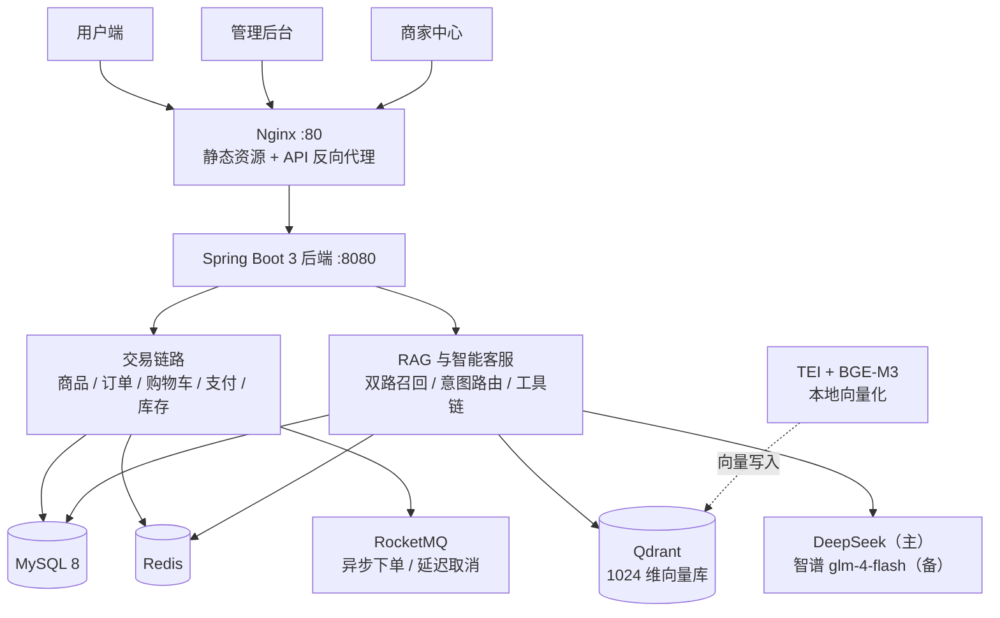

# 星创优品 B2C 电商系统

> 包含用户端 / 管理后台 / 商家中心三端的 B2C 电商系统。在完整交易链路（商品 / 订单 / 购物车 / 支付 / 库存）之外，重点建设两块 AI 能力：**RAG 语义搜索**与**可自助办理业务的 AI 客服 Agent**。

<!--
  📸 截图区（待补）：补图后删除本段注释即可
  建议三张，放 docs/images/ 下：
  1. docs/images/screenshot-home.png      用户端首页（商品瀑布流 + 分类导航）
  2. docs/images/screenshot-chat.png      客服对话（提问 → 商品卡片弹出，最能体现 RAG）
  3. docs/images/screenshot-dashboard.png 管理后台 Dashboard（ECharts 图表）
  可选：用 ScreenToGif 录一段 10 秒「提问 → 卡片 → 点进详情」的动图，效果强于静态图

  <div align="center">
    
    <br><br>
    
  </div>
-->

## 架构



> 推荐服务（`:8082`）为独立进程 + 独立库 `shop_rec`，行为事件经 Kafka 采集，不在上图主链路上。

## 技术栈

| 维度 | 技术选型 |
|------|---------|
| **后端** | Java 22 · Spring Boot 3.2.12 · MyBatis-Plus 3.5.5 · Sa-Token 1.45.0 · Druid 1.2.25 |
| **数据与中间件** | MySQL 8 · Redis · RocketMQ（客户端 4.9.7）· Kafka 3.7 + Flink 1.17.2（推荐事件流与实时计算）· Nginx 1.20.2 |
| **前端** | Vue 3 · Vite · Naive UI · Pinia · ECharts |
| **AI 能力** | LangChain4j 1.19.0 · Qdrant（1024 维）· 本地 TEI 部署 BGE-M3 · DeepSeek deepseek-chat（主）+ 智谱 glm-4-flash（备） |
| **离线数仓** | Hive 3.x · Sqoop · Azkaban 3.x |
| **接口文档** | springdoc-openapi 2.3.0（Swagger UI） |

## 功能概览

- **商品系统** — SPU/SKU 分层、二级分类联动、商家数据隔离、RAG 语义搜索
- **订单系统** — 7 态状态机、Redis 预扣 + MySQL 行锁防超卖、异步削峰下单、超时自动取消
- **购物车** — 未下单 / 已下单双态，下单后自动标记
- **支付系统** — 模拟支付回调，幂等处理
- **AI 客服 Agent** — SSE 流式对话、意图路由、RAG 检索增强、订单自助查询与取消
- **RBAC 权限** — 三级角色（管理员 / 商家 / 用户）+ 两级管理员
- **推荐服务** — 独立进程 + 独立库，行为采集、热度榜、用户画像
- **数据看板** — ECharts 图表：销售额趋势、商品排行、用户增长
- **离线数仓** — Hive 分层（ODS → DWD → DWS → ADS），Azkaban 每日调度

## 项目亮点

- **高并发下单**：下单接口仅投 RocketMQ 异步落库（前端轮询 `processingId`），消费端事务内「Redis Lua 预扣 → MySQL 行锁落单 → 订单快照」，削峰 + 防超卖双保险；库存不足在接口层即拒绝，不投无效消息进队列

- **三级缓存防穿透**：ID 布隆过滤（启动全量加载）→ 商品详情逻辑过期缓存（物理永不过期 + 互斥锁异步重建）→ DB

- **AI 客服 Agent「小星」**：SSE 流式对话（心跳保活防代理断流）；意图路由以规则强信号词零延迟判定，模型仅作模糊场景的单次分类兜底，据此划分闲聊 / 商品 / 查单 / 取消四类并收窄后续能力面；**写操作不进模型**——取消订单由确定性状态机执行（跨轮确认 + 归属与状态校验 + 库存回滚），模型只持有 `getMyOrders` / `getOrderStatus` 两个只读工具，`userId` 由服务端显式传参、归属校验在 Service 层强制，杜绝提示词注入越权；生成层熔断 + 四档降级链（主模型 → 备用模型 → 模板兜底 → 提示不可用）

- **RAG 语义搜索**：向量 + 关键词双路召回 + 加权 RRF 融合（默认关键词权重 2.0），30 条人工标注集离线评估 **Recall@3=0.711 / Recall@5=0.753 / MRR=0.474**，口语化同义词集 Recall@5 由 0.767 提升至 **0.867**；向量化由云端 API 迁至本地 TEI 部署的 **BGE-M3**（1024 维）；嵌入模型故障自动降级为纯关键词检索（故障注入验证：降级后召回指标与人工手算完全一致）；召回阶段只传 ID、选出 Top-K 后统一回查展示数据；回答带引用溯源编号与商品卡片推送

- **三端独立会话**：Sa-Token 独立 loginType（user / shop / admin），权限与数据彻底隔离

## 快速启动

> ⚠️ 本项目为 **Maven 多模块聚合工程**，根目录没有可启动模块，启动必须用 `-pl` 指定子模块。

```bash
# 1. 环境准备（JDK 22 + Maven 3.9+）
export JAVA_HOME="<你的 JDK 22 路径>"
cp .env.example .env          # 填写数据库密码、LLM API Key

# 2. 启动中间件（Redis / RocketMQ / Nginx）
docker compose up -d
# 可选分组：--profile rec（Kafka）｜--profile rag --profile gpu（Qdrant + TEI）

# 3. 构建（首次需先 install 依赖模块到本地仓库）
mvn clean install -DskipTests

# 4. 启动后端 :8080（在仓库根目录执行）
#    ⚠️ 必须显式指定 workingDirectory：spring-boot:run 默认工作目录是模块目录（shop-server/），
#       而 .env 在仓库根目录，不指定会读不到 DB_PASSWORD，报 MySQL "Access denied"
#    Git Bash 用 $(pwd -W) 取 Windows 风格路径（注意不是 $(pwd)，那是 /d/... 形式，Java 不认）
mvn -pl shop-server spring-boot:run -Dspring-boot.run.workingDirectory="$(pwd -W)"
#    也可以直接写死绝对路径（Windows 路径用正斜杠）：
#    mvn -pl shop-server spring-boot:run -Dspring-boot.run.workingDirectory="D:/path/to/shop"

# 5. 构建前端三端
cd frontend          && npm install && npm run build
cd ../frontend-admin && npm install && npm run build
cd ../frontend-merchant && npm install && npm run build
```

推荐服务（可选，独立进程 `:8082`，需先起 Kafka）：

```bash
docker compose --profile rec up -d
mvn -pl shop-rec spring-boot:run -Dspring-boot.run.workingDirectory="$(pwd -W)"
```

## 访问地址

| 端 | 地址 | 账号 |
|----|------|------|
| 用户端 | `http://localhost` | `user` |
| 管理后台 | `http://localhost/admin/` | `admin`（超级管理员）/ `admin2`（普通管理员） |
| 商家中心 | `http://localhost/merchant/` | `merchant1` |
| 接口文档 | `http://localhost:8080/swagger-ui.html` | — |

> 所有测试账号密码统一为 `123456`

## 项目结构

```
shop/                            # Maven 聚合工程
├── shop-common/                 # 通用能力（Result / 异常 / 分页 / 缓存 / Sa-Token 工具）
├── shop-server/                 # 商城后端 :8080（启动类 ShopApplication）
│   └── src/main/java/com/shop/
│       ├── controller/          # REST 接口层
│       ├── service/ mapper/     # 业务逻辑与持久层
│       ├── model/               # entity / dto / vo / query
│       ├── mq/                  # RocketMQ：异步落单、延迟取消
│       ├── rag/                 # RAG 与智能客服（search / index / chat / memory / resilience / config）
│       ├── config/ web/ task/   # 全局配置、异常处理、定时任务
│       └── constant/            # 枚举与常量
├── shop-rec/                    # 推荐服务 :8082（启动类 RecApplication，独立库 shop_rec）
├── shop-rec-flink/              # 推荐链路 Flink 作业（独立 Maven 工程，不参与主构建）
├── frontend/                    # 用户端（Vue 3）
├── frontend-admin/              # 管理后台（Vue 3）
├── frontend-merchant/           # 商家中心（Vue 3）
├── shared/                      # 三端共享前端源码（CSS 变量 / TS 工具）
├── docker/                      # Nginx / RocketMQ / Elasticsearch 容器配置
├── azkaban/                     # 离线数仓调度作业
└── docs/                        # 设计文档与检索评估报告
```

## 核心设计

- **防超卖** — `UPDATE sku SET stock = stock - n WHERE id = ? AND stock >= n`（MySQL 行锁，最终凭证）+ 接口层 Redis Lua 原子预扣（快速失败）
- **幂等** — Redis Token 防重下单 + RocketMQ 消费幂等键（SETNX）+ 支付回调条件更新
- **订单快照** — 下单时 name / price / image 写入 `order_item`，历史订单不受商品变更影响
- **商家数据隔离** — MyBatis-Plus 拦截器自动为 `product` / `orders` 追加 `AND shop_id = ?`，叠加 Service 层校验
- **缓存一致性** — 商品详情走逻辑过期缓存，修改 / 删除时主动删 key 保证变更立即可见
- **长整型 ID** — Jackson `Long → String` 全局序列化，解决 JS 精度丢失（雪花 ID 超出 `Number.MAX_SAFE_INTEGER`）

## 已知限制

- **单机演示定位**：图片上传为本地磁盘存储（按日期分片 + UUID 重命名），生产环境应替换为对象存储；`FileStorageService` 接口契约不变，改实现即可
- **中间件依赖**：RAG 检索需 Qdrant 与 TEI 在线（TEI 需 NVIDIA GPU）；两者不可用时自动降级为纯关键词检索，但召回质量下降
- **评估集规模**：检索离线评估集为基础集 30 条 + 同义词集 5 条，样本量不足以支撑小幅指标的显著性判断，详见 [评估报告 §9.5](./docs/rag-evaluation-report.md)
- **推荐服务**：当前为单机部署，与商城后端同宿主；生产应独立扩容

## 文档

- [完整项目文档](./docs/README.md)
- [RAG 检索离线评估报告](./docs/rag-evaluation-report.md) — 评估集构成、指标定义、复现命令、已知缺陷
- [RAG 代码地图](./docs/rag-code-map.md) — 6 个子包 32 个类的导航
- [检索链路降级加固设计](./docs/rag-fallback-design.md)

## 协议

[Mulan PSL v2](LICENSE)（木兰宽松许可证，第 2 版）
