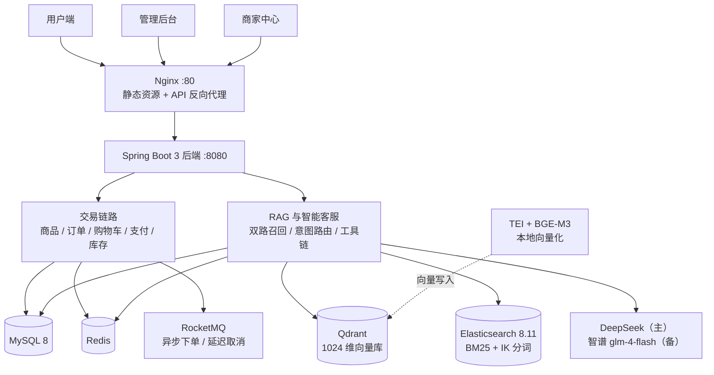

# 星创优品 B2C 电商系统

> 包含用户端 / 管理后台 / 商家中心三端的 B2C 电商系统。在完整交易链路（商品 / 订单 / 购物车 / 支付 / 库存）之外，重点建设两块 AI 能力：**RAG 语义搜索**与**可自助办理业务的 AI 客服 Agent**。

<!--
  📸 截图区（待补）：补图后删除本段注释即可
  建议三张，放 docs/images/ 下：
  1. docs/images/screenshot-home.png      用户端首页（分类侧栏 + 商品网格 + 无限滚动）
  2. docs/images/screenshot-chat.png      客服对话（提问 → 商品卡片弹出，最能体现 RAG）
  3. docs/images/screenshot-dashboard.png 管理后台 Dashboard（ECharts 图表）
  可选：用 ScreenToGif 录一段 10 秒「提问 → 卡片 → 点进详情」的动图，效果强于静态图

  <div align="center">
    
    <br><br>
    
  </div>
-->

## 架构



> **推荐链路在主链路上**：用户端首页经 `GET /api/home/rank` 调用，由商城后端代理到推荐服务 `:8082`（独立进程 + 独立库 `shop_rec`），上游不可达时自动降级为原生热销榜。行为上报接口 `/api/rec/behavior/report` 以 `@Profile("!rec")` 内嵌在商城后端 `:8080` 运行，**不在**推荐进程内。

## 技术栈

| 维度 | 技术选型 |
|------|---------|
| **后端** | Java 22 · Spring Boot 3.2.12 · MyBatis-Plus 3.5.5 · Sa-Token 1.45.0 · Druid 1.2.25 |
| **数据与中间件** | MySQL 8 · Redis · RocketMQ（客户端 4.9.7）· Kafka 3.7 + Flink 1.17.2（推荐事件流与实时计算）· Nginx 1.20.2 |
| **前端** | Vue 3 · Vite · Naive UI · Pinia · ECharts |
| **AI 能力** | LangChain4j 1.19.0 · Qdrant（1024 维）· 本地 TEI 部署 BGE-M3 · Elasticsearch 8.11.4 + IK（BM25 关键词路）· DeepSeek deepseek-chat（主）+ 智谱 glm-4-flash（备） |
| **离线数仓** | Hive 3.x · Sqoop · Azkaban 3.x |
| **接口文档** | springdoc-openapi 2.3.0（Swagger UI） |

## 功能概览

- **商品系统** — SPU/SKU 分层、二级分类 + 品牌主数据、商家数据隔离、图片上传、审核流（待审核 → 上架 → 下架）
- **订单系统** — 7 态状态机、Redis 预扣 + MySQL 行锁防超卖、异步削峰下单、延迟消息超时取消、确认收货
- **购物车** — 未下单 / 已下单双态，下单后自动标记，选中状态与数量管理
- **支付系统** — 模拟支付回调（公开）+ 用户端模拟支付，幂等处理
- **AI 客服 Agent** — SSE 流式对话、意图路由、RAG 检索增强、订单自助查询与取消、会话历史 / 点赞反馈 / 清除记忆
- **RAG 语义搜索** — 向量 + 关键词双路召回（关键词路 ES BM25 与 MySQL FULLTEXT 可切换、故障自动回退），独立公开接口，附索引重建与状态查询的管理能力
- **管理后台** — 用户治理（状态变更 / 批量 / 强制下线）、商品审核、全平台订单查询、统计看板、RAG 索引管理、推荐系统控制台
- **商家中心** — 本店数据看板、商品管理（新增 / 编辑 / 送审 / 下架）、订单查询与发货、SKU 库存调整
- **推荐子系统** — 行为采集 → Kafka → Flink 实时特征 → 多路召回融合排序；支持策略配置、固定坑位、过滤规则、画像版本回滚
- **数据看板** — 实时统计（管理端 5 项）+ 离线数仓看板（11 个维度）+ 商家端 4 张图
- **RBAC 权限** — 三级角色（管理员 / 商家 / 用户）+ 两级管理员；后端能力完整，**前端暂无角色 / 权限配置界面**
- **离线数仓** — Hive 分层（ODS → DWD → DWS → ADS），Azkaban 每日调度

## 三端能力总览

> 状态说明：✅ 已接真实接口　🟡 部分功能为本地占位　⬜ UI 占位（未接后端）

### 用户端 `frontend/`（base `/`，17 个页面）

| 页面 | 路由 | 核心能力 | 状态 |
|------|------|---------|------|
| 首页 | `/home` | Hero + 智能搜索入口 + 个性化推荐信息流 + 分类侧栏 + 商品网格无限滚动 | ✅ |
| 智能搜索 | `/search` | RAG 语义检索、搜索历史、排序、加载更多、点击埋点 | 🟡 热搜为静态占位 |
| 登录 / 注册 | `/login` `/register` | 账号登录、注册 | ✅ |
| 商品详情 | `/product/:id` | 图片画廊、SKU 联动、库存、加购、立即购买、价格走势图、停留时长埋点 | 🟡 收藏 / 评价为本地占位 |
| 购物车 | `/cart` | 勾选全选、数量步进、库存预警、失效商品、合计结算 | ✅ |
| 确认订单 | `/order/create` | 地址选择、备注、异步下单 + 轮询落单状态 | 🟡 地址 / 优惠券为占位 |
| 我的订单 | `/orders` | 状态 Tab、分页、支付 / 取消 / 收货 / 再次购买 | ✅ |
| 订单详情 | `/order/:id` | 支付倒计时、订单步骤、金额明细、模拟支付 / 取消 / 确认收货 | ✅ |
| 地址管理 | `/address` | 增删改查、默认地址 | 🟡 后端已就绪 / 前端待接 |
| 领券 / 我的券 | `/coupons` `/my-coupons` | 券列表、状态 Tab | ⬜ 本地占位 |
| 我的评价 / 发表评价 | `/my-reviews` `/my-reviews/new` | 评分、评价列表 | ⬜ 本地占位 |
| 收藏 | `/favorites` | 收藏网格、取消收藏 | ⬜ 本地占位 |
| 售后 / 申请售后 | `/after-sales` `/after-sales/new` | 售后列表与申请表单 | ⬜ 本地占位 |

**全局能力**：悬浮 AI 客服「小星」（SSE 流式、意图状态条、快捷问题、会话历史、引用商品卡片）、顶部搜索与购物车角标、用户下拉菜单。**无独立个人中心页**。

### 管理后台 `frontend-admin/`（base `/admin/`，16 个页面）

| 页面 | 核心能力 | 状态 |
|------|---------|------|
| 数据看板 | 8 个 KPI + 6 张 ECharts（销售额趋势 / 订单状态日趋势 / 商品 TOP10 / 分类排行 / 周趋势环比 / GMV 与付费用户） | ✅ |
| 商品管理 | 新增、SKU 维护、主图与轮播上传、待审核商品审核通过 / 驳回、上下架 | 🟡 编辑受后端接口限制 |
| 订单管理 | 多条件筛选、分页、详情抽屉 | 🟡 只读，无发货 / 退款 |
| 用户管理 | 搜索、状态筛选、单条与批量状态、强制下线 | ✅ |
| RAG 索引 | Qdrant / FULLTEXT / ES 三套索引状态、健康检查、全量重建 | ✅ |
| 推荐控制台 ×6 | 策略配置、固定坑位、过滤规则、画像版本回滚、运行指标、商品索引 | ✅ |
| 优惠券 / 评价 / 售后 | 统计 + 列表 + 操作弹窗 | ⬜ UI 占位 |
| 分类管理 | 分类树 CRUD、两级结构校验、删除前校验子分类与商品引用 | 🟡 后端已就绪 / 前端待接 |
| 系统设置 | — | ⬜ UI 占位 |

### 商家中心 `frontend-merchant/`（base `/merchant/`，7 个页面）

| 页面 | 核心能力 | 状态 |
|------|---------|------|
| 本店看板 | 今日营收 / 订单 / 商品数 / 待发货 + 4 张 ECharts | ✅ |
| 商品管理 | 新增 / 编辑、SKU、图片上传、提交审核 / 下架 | ✅ |
| 订单管理 | 状态筛选、详情、填写物流单号发货 | ✅ |
| 优惠券 / 评价 / 售后 / 库存预警 | — | ⬜ UI 占位 |

## API 概览

后端共 **16 个 Controller、63 个业务接口**（不含推荐服务独立进程内的 19 个）。完整定义见 Swagger UI：`http://localhost:8080/swagger-ui.html`。

| 端 | 基础路径 | 主要能力 |
|----|---------|---------|
| 公开 | `/api/product` `/api/category` `/api/brand` `/api/dashboard` `/api/pay` | 商品分页与详情、分类、品牌、首页聚合、支付回调、RAG 语义搜索 |
| 用户 | `/api/order` `/api/cart` `/api/user` `/api/chat` `/api/rag` `/api/upload` `/api/address` | 下单（token → create → status 轮询）、购物车、订单、客服 SSE、埋点、图片上传、收货地址 CRUD |
| 管理 | `/api/admin` `/api/admin/stats` `/api/admin/rag` `/api/admin/category` `/api/admin/brand` `/api/admin/role` | 用户治理、全平台订单、5 项统计、RAG 索引重建、分类与品牌 CRUD、角色权限分配 |
| 商家 | `/api/merchant` | 本店统计、订单与发货、商品管理、SKU 库存 |
| 推荐代理 | `/api/home/rank` | 首页榜单（转发 `:8082`，不可达降级热销榜） |
| 推荐服务 | `/api/rec/*` | 榜单、策略配置、坑位、过滤规则、画像、指标、商品索引 |

## 项目亮点

- **高并发下单**：下单接口仅投 RocketMQ 异步落库（前端轮询 `processingId`），消费端事务内「Redis Lua 预扣 → MySQL 行锁落单 → 订单快照」，削峰 + 防超卖双保险；库存不足在接口层即拒绝，不投无效消息进队列

- **三级缓存防穿透**：ID 布隆过滤（启动全量加载）→ 商品详情逻辑过期缓存（物理永不过期 + 互斥锁异步重建）→ DB

- **AI 客服 Agent「小星」**：SSE 流式对话（心跳保活防代理断流）；意图路由以规则强信号词零延迟判定，模型仅作模糊场景的单次分类兜底，据此划分闲聊 / 商品 / 查单 / 取消四类并收窄后续能力面；**写操作不进模型**——取消订单由确定性状态机执行（跨轮确认 + 归属与状态校验 + 库存回滚），模型只持有 `getMyOrders` / `getOrderStatus` 两个只读工具，`userId` 由服务端显式传参、归属校验在 Service 层强制，杜绝提示词注入越权；生成层熔断 + 四档降级链（主模型 → 备用模型 → 模板兜底 → 提示不可用）

- **RAG 语义搜索**：向量（BGE-M3）+ 关键词双路召回 + 加权 RRF 融合（关键词权重 1.5）；关键词路已升级为 **Elasticsearch BM25 + IK 分词**（索引期 `ik_max_word` / 查询期 `ik_smart`），分类与价格过滤下推到 ES `filter` context，ES 连续失败 3 次熔断 30s、半开自动恢复，期间无感回退 MySQL FULLTEXT。按 670 件真实商品重建 **40 条分层评估集**（精确型号 / 品类 / 品牌 / 口语 / 错别字 / 属性组合），指标为 **Hit@3=1.000 / MRR=0.986**；同链路对照下 ES 关键词路较 MySQL FULLTEXT 的 MRR 提升 0.034，同义词扩展使口语词 MRR 从 0.840 提升到 1.000。向量化由云端 API 迁至本地 TEI 部署的 **BGE-M3**（1024 维）；召回阶段只传 ID、选出 Top-K 后统一回查展示数据；回答带引用溯源编号与商品卡片推送

- **三端独立会话**：Sa-Token 独立 loginType（user / shop / admin），权限与数据彻底隔离；三套 token key 各自独立，`admin.id` 与 `shop.id` 同为 1 也不会串

- **管理后台用户治理**：4 态账号状态机（正常 / 停用 / 注销中 / 封禁中）+ 状态变更日志 + 批量操作 + **强制下线**（只踢登录会话、不改账号状态，与封禁互补）

- **推荐链路工程化**：首页榜单经商城后端代理转发推荐服务（内部令牌鉴权），上游不可达时自动降级热销榜；榜单快照翻页保证翻页一致性；策略配置热更新（30 秒生效）、画像版本可回滚

## 快速启动

> ⚠️ 本项目为 **Maven 多模块聚合工程**，根目录没有可启动模块，启动必须用 `-pl` 指定子模块。

```bash
# 1. 环境准备（JDK 22 + Maven 3.9+）
export JAVA_HOME="<你的 JDK 22 路径>"
cp .env.example .env          # 填写数据库密码、LLM API Key

# 2. 启动中间件（Redis / RocketMQ / Nginx）
docker compose up -d
# 可选分组：--profile rec（Kafka）｜--profile rag --profile gpu（Qdrant + TEI）｜--profile es（Elasticsearch + IK）

# 3. 构建（首次需先 install 依赖模块到本地仓库）
mvn clean install -DskipTests

# 4. 启动后端 :8080（在仓库根目录执行）
#    ⚠️ 必须显式指定 workingDirectory：spring-boot:run 默认工作目录是模块目录（shop-server/），
#       而 .env 在仓库根目录，不指定会读不到 DB_PASSWORD，报 MySQL "Access denied"
#    Git Bash 用 $(pwd -W) 取 Windows 风格路径（注意不是 $(pwd)，那是 /d/... 形式，Java 不认）
mvn -pl shop-server spring-boot:run -Dspring-boot.run.workingDirectory="$(pwd -W)"
#    也可以直接写死绝对路径（Windows 路径用正斜杠）：
#    mvn -pl shop-server spring-boot:run -Dspring-boot.run.workingDirectory="D:/path/to/shop"

# 5. 构建前端三端
cd frontend          && npm install && npm run build
cd ../frontend-admin && npm install && npm run build
cd ../frontend-merchant && npm install && npm run build
```

推荐服务（可选，独立进程 `:8082`，需先起 Kafka）：

```bash
docker compose --profile rec up -d
mvn -pl shop-rec spring-boot:run -Dspring-boot.run.workingDirectory="$(pwd -W)"
```

## 访问地址

| 端 | 地址 | 账号 |
|----|------|------|
| 用户端 | `http://localhost` | `user` |
| 管理后台 | `http://localhost/admin/` | `admin`（超级管理员）/ `admin2`（普通管理员） |
| 商家中心 | `http://localhost/merchant/` | `merchant1` |
| 接口文档 | `http://localhost:8080/swagger-ui.html` | — |

> 所有测试账号密码统一为 `123456`

## 项目结构

```
shop/                            # Maven 聚合工程
├── shop-common/                 # 通用能力（Result / 异常 / 分页 / 缓存 / Sa-Token 工具）
├── shop-server/                 # 商城后端 :8080（启动类 ShopApplication）
│   └── src/main/java/com/shop/
│       ├── controller/          # REST 接口层
│       ├── service/ mapper/     # 业务逻辑与持久层
│       ├── model/               # entity / dto / vo / query
│       ├── mq/                  # RocketMQ：异步落单、延迟取消
│       ├── rag/                 # RAG 与智能客服（search / index / chat / memory / resilience / config）
│       ├── config/ web/ task/   # 全局配置、异常处理、定时任务
│       └── constant/            # 枚举与常量
├── shop-rec/                    # 推荐服务 :8082（启动类 RecApplication，独立库 shop_rec）
├── shop-rec-flink/              # 推荐链路 Flink 作业（独立 Maven 工程，不参与主构建）
├── frontend/                    # 用户端（Vue 3）
├── frontend-admin/              # 管理后台（Vue 3）
├── frontend-merchant/           # 商家中心（Vue 3）
├── shared/                      # 三端共享前端源码（CSS 变量 / TS 工具）
├── docker/                      # Nginx / RocketMQ / Elasticsearch 容器配置
├── azkaban/                     # 离线数仓调度作业
└── docs/                        # 设计文档与检索评估报告
```

## 核心设计

- **防超卖** — `UPDATE sku SET stock = stock - n WHERE id = ? AND stock >= n`（MySQL 行锁，最终凭证）+ 接口层 Redis Lua 原子预扣（快速失败）
- **幂等** — Redis Token 防重下单 + RocketMQ 消费幂等键（SETNX）+ 支付回调条件更新
- **订单快照** — 下单时 name / price / image 写入 `order_item`，历史订单不受商品变更影响
- **商家数据隔离** — MyBatis-Plus 拦截器自动为 `product` / `orders` 追加 `AND shop_id = ?`，叠加 Service 层校验
- **缓存一致性** — 商品详情走逻辑过期缓存，修改 / 删除时主动删 key 保证变更立即可见
- **长整型 ID** — Jackson `Long → String` 全局序列化，解决 JS 精度丢失（雪花 ID 超出 `Number.MAX_SAFE_INTEGER`）
- **订单超时（三段式）** — RocketMQ 延迟消息（30 分钟）为主取消机制；`ScheduledTasks` 每 60 分钟扫描作为 MQ 不可用时的兜底；另有每 10 分钟一次的悬空 Redis 预扣恢复
- **商品审核流** — 商家新增进待审核（`status=0`），管理员审核通过才上架；待审核商品对外完全不可见（列表过滤 + 详情拦截，缓存命中也覆盖）；商家不能自行上架，可主动下架或重新送审
- **SKU 库存调整** — 商家改库存走 Cache Aside：先写 DB，再删 Redis 缓存
- **RAG 索引运维** — 管理端可全量重建 Qdrant 向量索引、MySQL FULLTEXT 与 ES 索引，并提供三套索引状态与健康检查

## 已知限制

- **单机演示定位**：图片上传为本地磁盘存储（按日期分片 + UUID 重命名），生产环境应替换为对象存储；`FileStorageService` 接口契约不变，改实现即可
- **中间件依赖**：RAG 检索需 Qdrant、TEI 与 Elasticsearch 在线（TEI 需 NVIDIA GPU）；ES 不可用时自动回退 MySQL FULLTEXT，向量服务不可用时降级为纯关键词检索，召回质量会下降
- **评估集规模**：检索离线评估集为 40 条分层用例（37 正样本 + 3 负样本），指标为 Hit@K / MRR；样本量仍不足以支撑小幅指标（如 ±0.03）的显著性判断，且期望 ID 依赖商品数据，**重构数据后需重新生成**，详见 [评估报告](./docs/specs/001-es-keyword-search/evaluation-2026-10-21.md)
- **推荐服务**：当前为单机部署，与商城后端同宿主；生产应独立扩容
- **前端部分模块为 UI 占位**：用户端地址 / 领券 / 我的券 / 评价 / 收藏 / 售后共 8 页，管理后台优惠券 / 评价 / 售后 / 分类 / 系统设置共 5 页，商家中心优惠券 / 评价 / 售后 / 库存预警共 4 页——界面已搭，后端未接（详见上方「三端能力总览」的状态列）
- **部分前端占位页待接**：收货地址、分类管理、品牌管理、角色权限的**后端 CRUD 已实现**（见上方 API 概览），但对应前端页面仍为本地占位，需按接口对接
- **优惠券 / 评价 / 收藏 / 售后未实现**：主库暂无对应表，需先设计表结构再补接口
- **管理后台订单仍为只读**：可查询与查看详情，暂无退款操作（发货在商家中心）
- **管理后台订单只读**：可查询与查看详情，暂无发货 / 退款操作（发货在商家中心）

## 文档

- [完整项目文档](./docs/README.md)
- [ES 关键词路设计与验收](./docs/specs/001-es-keyword-search/) — 可切换双路、熔断回退、评估集重建与调优
- [RAG 检索评估报告（2026-10-21）](./docs/specs/001-es-keyword-search/evaluation-2026-10-21.md) — 评估集构成、Hit@K / MRR 口径、复现命令、遗留问题
- [RAG 代码地图](./docs/rag-code-map.md) — 6 个子包 37 个类的导航
- [检索链路降级加固设计](./docs/rag-fallback-design.md)

## 协议

[Mulan PSL v2](LICENSE)（木兰宽松许可证，第 2 版）
