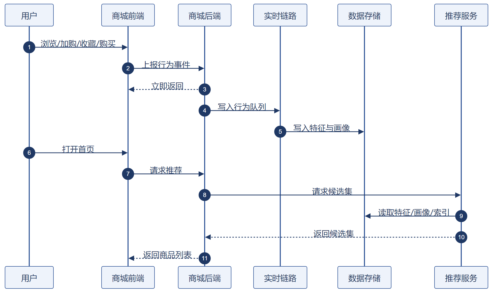

# 基于实时特征的个性化商品推荐系统

## 需求分析说明书

---

## 1 引言

### 1.1 编写目的

本文档面向星创优品商城个性化推荐子系统的业务需求方与项目相关方，说明项目为何建设、业务上需要达成什么目标、依赖哪些数据、系统需具备哪些业务能力与质量要求。

本文档定位为**需求分析阶段文档**，也是本项目的**现行需求基线**，聚焦业务视角的「为什么做」与「要什么」。系统架构、模块划分、库表与接口设计见《概要设计说明书》，字段级实现、参数、异常分支与验收口径见《详细设计说明书》，本文档不重复展开。

> 说明：《需求规格说明书》（2026-09-20）已于 2026-10-08 作废，仅存档，不再作为设计依据。

### 1.2 读者对象

| 读者 | 关注章节 |
|---|---|
| 业务与运营人员 | 第 2 章、第 3 章 |
| 项目评审与验收方 | 全书，重点为第 3、5、6 章 |
| 开发与测试人员 | 第 4、5、6 章 |

### 1.3 术语与定义

| 术语 | 说明 |
|---|---|
| 事件时间 | 行为实际发生的时刻，由上报数据携带，系统计算以它为准，不使用数据到达系统的时刻 |
| 滑动窗口 | 以当前时刻为终点、向前追溯固定时长的时间区间，用于统计用户近期行为 |
| 实时特征 | 由用户近期行为在秒级聚合出的数值，用于影响当次推荐结果 |
| 用户画像 | 对用户偏好的结构化描述，由行为序列归纳得到 |
| 类目偏好召回 | 依据用户近期行为反映出的类目、品牌偏好筛选候选商品 |
| 热门召回 | 依据商品近期整体热度筛选候选商品 |
| 双路召回 | 类目偏好召回与热门召回并行执行，各自产出候选商品后统一融合 |
| 召回候选池 | 多路召回结果经去重与过滤后形成的待重排商品集合 |
| 热门兜底 | 以近期热度榜作为保底结果，保证任何情况下都有商品可返回 |
| 冷启动 | 用户没有任何历史行为、无法计算个性化特征的状态 |
| 固定坑位 | 榜单中位置固定、不参与个性化排序的运营干预商品位 |

### 1.4 参考资料

1. 《基于实时特征的个性化商品推荐系统-概要设计说明书》（V0.1 / 2026-09-24）
2. 《基于实时特征的个性化商品推荐系统-详细设计说明书》（2026-09-24）
3. 星创优品商城现有首页榜单实现
4. 项目需求沟通记录

> 《需求规格说明书》（2026-09-20）已作废，不再列为参考资料。

### 1.5 版本记录

| 版本 | 日期 | 修订内容 |
|---|---|---|
| V0.1 | 2026-09-20 | 初稿，完成项目背景与功能需求主体 |
| V0.2 | 2026-09-22 | 补充引言、业务需求、数据需求章节，功能需求以 Word 版为准 |
| V0.3 | 2026-09-22 | 补充源数据格式与计算聚合说明；移除用户评价数据源；调整排版字号 |

---

## 2 项目背景

### 2.1 业务概述

商城首页热销榜单是平台核心流量入口，承担商品曝光、用户消费引导的核心作用。目前商城首页采用**全局静态热销榜单**展示模式，面向所有用户展示统一的商品排序，榜单仅依据商品整体热度生成，未结合用户个人浏览、点击等行为偏好做差异化适配。平台已具备较完善的用户行为采集能力，可记录用户首页浏览、商品点击等行为数据，具备实现个性化推荐的数据基础。

### 2.2 业务现状与痛点

当前静态榜单展示模式存在明显业务短板，无法适配精细化运营需求：

1. **用户侧体验问题**：全体用户共享同一套榜单，无个性化差异，用户需要逐条筛选商品，查找成本高、精准度低，容易降低浏览意愿与下单转化率。
2. **数据价值浪费问题**：平台采集的海量用户行为数据仅用于离线统计、报表展示，未实现线上数据回流，无法反哺首页推荐业务，数据利用率极低。
3. **平台与商家流量问题**：固定固化的榜单排序导致流量高度集中，无法实现兴趣匹配分发，商家商品难以精准触达目标客群，优质长尾商品曝光不足，整体流量转化效率偏低。

### 2.3 项目建设意义

为解决静态榜单的体验短板与数据闲置问题，本次项目将打通用户行为数据回流链路，实现首页热销榜单的**个性化动态重排能力**。

项目建设完成后，可基于用户个体行为偏好差异化展示榜单内容：在用户侧大幅降低商品筛选成本、提升浏览体验；在商家侧实现商品精准兴趣曝光，提升销量与经营收益；在平台侧盘活存量行为数据，提升首页流量利用率与整体业务转化效率。

### 2.4 业务目标

| 目标维度 | 现状基线 | 目标值 |
|---|---|---|
| 个性化能力 | 全局静态榜单，个性化覆盖率为零 | 有行为用户的榜单实现按个体偏好动态重排 |
| 响应时效 | 不涉及实时计算 | 用户行为发生后 5 秒内影响推荐结果；推荐请求 P95 不超过 800ms |
| 流量结构 | 流量集中于少数热销商品 | 长尾商品获得基于兴趣匹配的曝光机会，不再完全依赖整体热度排序 |
| 数据价值 | 行为数据仅用于离线统计 | 形成「采集—计算—推荐」的线上数据闭环 |

---

## 3 业务需求

### 3.1 业务角色与诉求

| 角色 | 关注点 | 核心诉求 |
|---|---|---|
| 消费者 | 快速找到感兴趣的商品 | 首页榜单贴合自身兴趣，减少逐条筛选商品的成本 |
| 运营人员 | 推荐策略可控、营销活动可干预 | 可调整推荐策略参数与固定坑位商品，且改动生效无需发版 |
| 平台 | 转化效率与流量分配 | 提升首页转化效率，避免流量过度集中于头部商品 |

### 3.2 业务场景

**场景一：游客访问。** 未登录用户打开首页时，系统无法识别其身份与历史偏好，直接返回热门榜单内容；页面不出现空白或报错，浏览体验与改造前保持一致。

**场景二：冷启动新用户。** 用户已注册登录但没有任何历史行为，类目偏好召回无有效输入，系统依靠热门召回兜底返回非空候选集；待其产生首次行为后，再逐步纳入个性化计算。

**场景三：有行为的老用户。** 用户近期浏览过某类目商品，行为经采集写入行为队列后，实时特征在 5 秒内完成更新；再次打开首页时，候选池按实时特征与画像重新排序，列表顺序与上次访问不同。

**场景四：运营干预。** 运营人员需要在大促期间把活动商品固定在榜单首位，同时对全站推荐策略做整体调整；该诉求需在不发版、不中断线上服务的前提下完成。

**场景五：服务降级。** 特征读取失败或类目偏好召回异常时，系统按预设策略降级：画像沿用上一版、召回降级为热门召回；接口仍返回非空商品列表并标记降级状态，不出现空白页或请求挂起。

### 3.3 业务流程

系统整体业务流程为：用户在商城前端产生浏览、加购、收藏、购买行为 → 行为事件上报至商城后端并立即返回 → 行为数据进入实时链路，产出实时特征与用户画像 → 用户打开首页请求推荐 → 推荐服务读取特征与画像完成双路召回与重排 → 返回个性化商品列表供首页渲染。



### 3.4 业务规则

| 规则项 | 规则说明 |
|---|---|
| 可推荐商品范围 | 仅上架且有库存的商品可进入推荐结果 |
| 不可推荐商品 | 已下架、已售罄、黑名单、地域不可售、会员限定（非会员不可见）、低质商品 |
| 个性化边界 | 固定坑位商品不参与个性化打分与重排，所有用户看到的位置一致 |
| 结果稳定性 | 同一用户翻页时榜单顺序保持一致，不出现商品重复曝光或顺序跳变 |
| 可用性底线 | 任意环节异常都必须返回非空商品列表，禁止页面空白或请求挂起 |

---

## 4 数据需求

### 4.1 数据来源与形态

| 数据源 | 来源 | 形态 | 关键内容 | 更新频率 | 数据特点 |
|---|---|---|---|---|---|
| 用户行为数据 | 商城前端上报，经后端写入行为队列 | 结构化事件流 | 用户标识、商品标识、行为类型（浏览/加购/收藏/购买）、行为发生时间 | 实时 | 只追加、不可变；存在重复上报与时间乱序 |
| 商品基础数据 | 商城商品服务 | 结构化商品记录 | 商品名称、商品描述、类目、品牌、上下架状态、库存状态 | 商品信息变更时 | 可变（会改价、下架），需与行为数据保持状态一致 |
| 用户账号数据 | 商城账号服务 | 账号属性 | 登录态、会员状态 | 实时查询 | 用于召回过滤与接口鉴权 |

行为数据具有天然的长尾稀疏特征：少数热门商品占据大部分行为量，多数商品行为稀少。这是冷启动问题与特征稀疏的直接来源，也是系统的关键假设之一。

### 4.2 源数据格式与计算说明

**用户行为事件**（上报接口 JSON）：

```json
{
  "userId": "u_100234",
  "itemId": "i_88012",
  "eventType": "add_cart",
  "eventTime": "2026-09-22T14:32:07+08:00",
  "duration": 1240
}
```

| 字段 | 类型 | 必填 | 说明 | 参与计算 |
|---|---|---|---|---|
| userId | string | 是 | 用户唯一标识 | 作为聚合分组键，按用户维度归集偏好特征 |
| itemId | string | 是 | 商品唯一标识 | 作为聚合分组键统计商品热度；经商品数据关联出类目与品牌 |
| eventType | string | 是 | 行为类型：view / add_cart / favorite / purchase | 折算行为权重，权重越高对偏好分贡献越大 |
| eventTime | string | 是 | 行为发生时间，带时区 ISO 8601 格式 | 决定事件归入 1h / 24h / 7d 中的哪个滑动窗口 |
| duration | int | 否 | 商品页停留时长（毫秒） | 用于识别无效行为，不参与特征计算 |

系统所有实时特征与画像均由该事件流计算得出，各字段的计算作用见上表「参与计算」列。

**商品基础数据**：

```json
{
  "itemId": "i_88012",
  "itemName": "商品名称",
  "categoryId": "c_2031",
  "brandId": "b_77",
  "status": "on_sale",
  "stock": 120
}
```

| 字段 | 类型 | 说明 | 参与计算 |
|---|---|---|---|
| itemId | string | 商品唯一标识 | 与行为事件关联的键 |
| itemName | string | 商品名称 | 用于结果展示，不参与计算 |
| categoryId | string | 二级类目标识 | 作为类目偏好特征的聚合维度 |
| brandId | string | 品牌标识 | 作为品牌偏好特征的聚合维度 |
| status | string | 商品上下架状态 | 用于召回过滤，不参与偏好打分 |
| stock | int | 库存数量 | 用于召回过滤，不参与偏好打分 |

商品基础数据通过 itemId 与行为事件关联，为行为事件补充类目标识与品牌标识，是类目偏好、品牌偏好特征能够按维聚合的前提。

**特征计算与聚合**

以行为事件为输入，按以下步骤聚合出用户偏好特征：

1. **窗口归属**：以事件时间（eventTime）为准，将行为事件归入 1h、24h、7d 三个滑动窗口，不使用数据到达系统的时刻，规避网络乱序导致的统计错误。
2. **行为加权**：按行为类型（eventType）折算分值，浏览、加购、收藏、购买对应不同权重，权重支持后台配置。
3. **维度聚合**：按「用户 + 二级类目」「用户 + 品牌」分组，对窗口内的行为分值累加。
4. **封顶处理**：单维度累计分值超过阈值时按阈值计，防止单一类目或品牌偏好权重无限膨胀。
5. **结果写入**：聚合结果写入特征存储并配置有效期，供召回环节读取。

| 特征 | 聚合维度 | 聚合方式 | 业务含义 |
|---|---|---|---|
| 类目偏好特征 | 用户 + 二级类目 | 窗口内行为加权累加 | 用户对各二级类目的兴趣强度 |
| 品牌偏好特征 | 用户 + 品牌 | 窗口内行为加权累加 | 用户对各品牌的兴趣强度 |
| 商品热度分 | 商品 | 统计周期内行为加权累加 | 商品在全平台的受欢迎程度 |

**计算示例**

某用户在 1h 窗口内对「手机」类目产生 2 次浏览、1 次加购，则该用户对「手机」类目的窗口偏好分 = 2 × 浏览权重 + 1 × 加购权重；再叠加 24h、7d 两个窗口的加权结果，得到该类目的最终偏好分，写入特征存储供召回环节读取。

**数据处理流程**

上述计算在链路中的位置如下：用户行为事件由商城后端接收后立即返回、异步写入行为队列；实时链路消费事件流，以事件时间为基准做滑动窗口统计，产出实时特征并写入特征存储，供召回环节读取；同一份行为流用于归纳用户画像并持久化存储，按天保留历史版本；商品基础数据用于商品特征匹配与召回过滤。推荐服务在收到首页请求时，并行读取实时特征与用户画像，执行类目偏好召回与热门召回两路召回并融合去重，输出召回候选池交由重排环节生成最终榜单。

### 4.3 数据量级与时效要求

| 项目 | 要求 |
|---|---|
| 数据规模 | 可支撑至少 100 万条行为数据；覆盖全部商品与用户数据 |
| 特征时效 | 用户行为产生后 5 秒内完成特征计算并生效，可影响后续推荐结果 |
| 画像时效 | 画像按天更新；生成失败时允许沿用上一有效版本 |
| 数据保留 | 用户画像至少保留最近 3 个历史版本，支持回滚 |
| 数据质量 | 重复上报需合并或去重；时间乱序由事件时间机制适配，不因乱序产生统计错误 |

---

## 5 功能需求

### 5.0 功能总览

| 编号 | 功能名称 | 优先级 | 能力描述 |
|---|---|---|---|
| FR-01 | 用户行为采集 | P0 | 采集用户四类行为事件并上报，作为本模块唯一数据源 |
| FR-02 | 实时行为特征计算 | P0 | 基于滑动窗口秒级计算用户近期类目、品牌偏好特征 |
| FR-03 | 用户画像更新 | P1 | 汇聚行为序列归纳用户长期偏好画像并持久化存储 |
| FR-04 | 双路召回与融合 | P0 | 类目偏好与热门两路召回并行执行，去重过滤生成候选池 |
| FR-05 | 个性化榜单重排 | P0 | 按规则加权打分重排，输出首页个性化榜单 |

**优先级判定依据**：P0 功能构成「采集—计算—召回—展示」的最小可用闭环，缺任一项链路中断；P1 功能内置降级路径，缺失时可由热门召回兜底保证系统可用。

### 5.1 用户行为采集（FR-01）

采集用户浏览、加购、收藏、购买四类行为，通过内部接口上报行为事件，作为本模块的数据源。

**业务规则**：行为事件包含用户标识、商品标识、行为类型与带时区 ISO 8601 格式的行为发生时间；后端接收请求后校验字段合法性，校验通过写入行为队列并立即返回响应，不阻塞页面主流程；支持配置事件采样策略，高并发场景下可开启抽样上报以降低链路压力。

**异常处理**：前端实现上报失败自动重试，并限制最大重试次数与重试频率；后端识别并丢弃短时间高频重复上报、行为时长异常、爬虫访问产生的无效事件。

### 5.2 实时行为特征计算（FR-02）

消费行为队列中的用户行为事件流，基于事件时间，使用 1h、24h、7d 滑动窗口统计各类用户行为频次；结合可配置的行为权重规则，计算用户类目、品牌偏好特征。

**业务规则**：窗口统一以行为发生的事件时间计算，规避网络乱序带来的统计错误；实时计算生成的特征写入特征存储并配置有效期，供召回环节读取；行为权重规则支持后台配置。

**异常处理**：单条特征写入失败不中断主消费链路，仅记录异常日志；定义最大允许迟到时长，迟到事件在窗口有效期内参与统计，超出阈值直接丢弃；设置特征值封顶策略，防止单一类目或品牌偏好权重无限膨胀。

### 5.3 用户画像更新（FR-03）

汇聚用户全量行为序列，基于预设规则提取二级类目、品牌等商品属性，构建结构化用户画像。

**业务规则**：按天定时生成用户画像快照并持久存储，至少保留最近 3 个历史版本；存储分层——线上实时画像供榜单推荐查询使用，全量画像快照用于备份与离线分析，线上推荐不读取全量快照。

**异常处理**：画像生成任务执行失败时，自动沿用最近一个可用版本对外提供服务，不影响推荐链路。

### 5.4 双路召回与融合（FR-04）

后端接收榜单推荐请求后，并行执行类目偏好召回和热门商品召回，两路召回候选集比例由后台权重配置管控。

**业务规则**：两路召回结果返回后按顺序处理——结果去重 → 过滤已下架商品、售罄商品 → 过滤商品黑名单、地域不可售、会员限定商品、低质商品 → 生成召回候选池，供后续重排逻辑使用。

**异常处理**：无用户画像的用户直接使用热门召回兜底；类目偏好召回出现超时、报错、返回空集等异常时，自动降级至热门召回。

### 5.5 个性化榜单重排（FR-05）

对召回候选池内商品执行规则加权打分，综合类目偏好分、商品热度分计算商品总分，输出首页个性化榜单。

**业务规则**：打分公式与各因子权重支持后台配置；支持榜单固定坑位配置，可插入平台置顶商品、活动商品，固定坑位商品不参与个性化打分与重排；榜单基于完整候选集一次性完成重排，翻页复用同一重排结果，保证翻页时榜单商品顺序稳定，避免商品重复曝光与顺序跳动问题。

**异常处理**：打分所需特征读取失败时，按无特征处理，仅使用商品热度分完成排序，保证榜单非空。

---

## 6 非功能需求

| 类别 | 要求 |
|---|---|
| 性能 | 推荐请求 P95 不超过 800ms；召回环节耗时不超过 150ms；行为上报接口响应不超过 100ms |
| 容量与时效 | 可支撑至少 100 万条行为数据，行为产生后 5 秒内特征生效（详见 4.3） |
| 可靠性 | 任意环节异常时仍返回有效结果，禁止页面空白或请求卡死。画像归纳失败保留上一版画像；类目偏好召回失败降级至热门召回；特征读取失败按无特征处理 |
| 安全合规 | 推荐接口校验登录态，用户仅可查看自身的推荐结果；用户画像不推断敏感属性；项目所用数据均为合成数据，不包含真实用户隐私信息 |
| 可观测性 | 可查询特征覆盖率、召回命中率、降级触发次数与链路各环节耗时，用于定位问题与评估运行状态 |
| 可维护性 | 推荐策略参数与业务规则支持配置化调整，无需修改代码与重新发布 |

---

本文档聚焦业务与需求视角，系统架构模式、约束条件、模块划分与库表设计见《概要设计说明书》第 3、4、5 章；接口定义、时序细节、降级分支与验收口径见《详细设计说明书》第 5、7、9.4 节。

需求侧效果目标（Recall@10 相对基线的提升幅度）的评测方式与验收口径，见《详细设计说明书》"离线评测与效果验证"章节。
