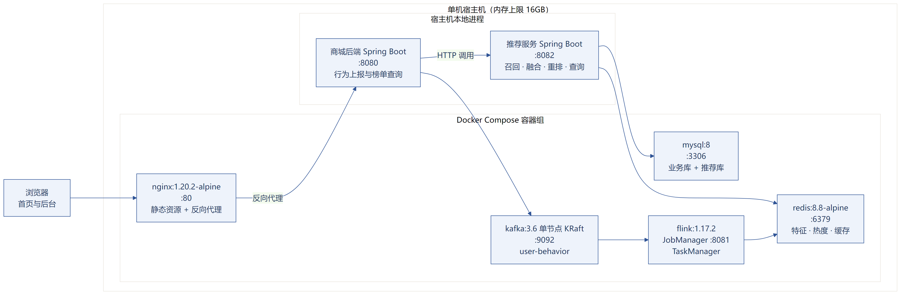
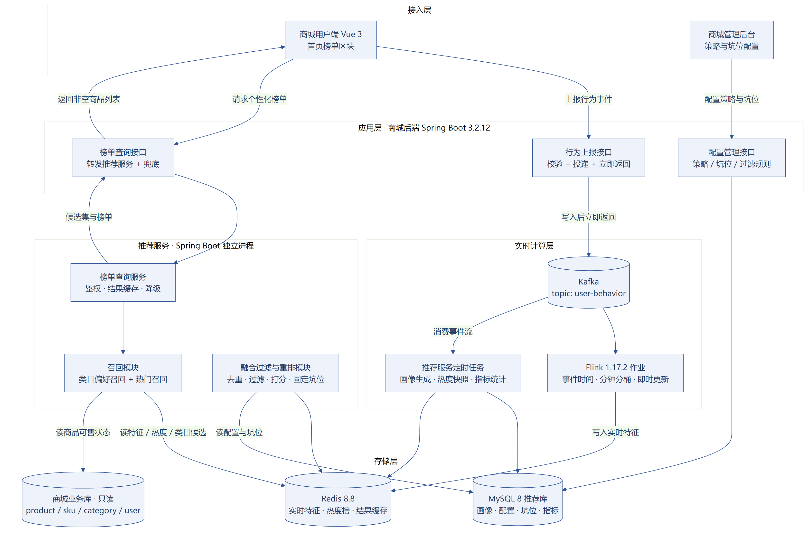
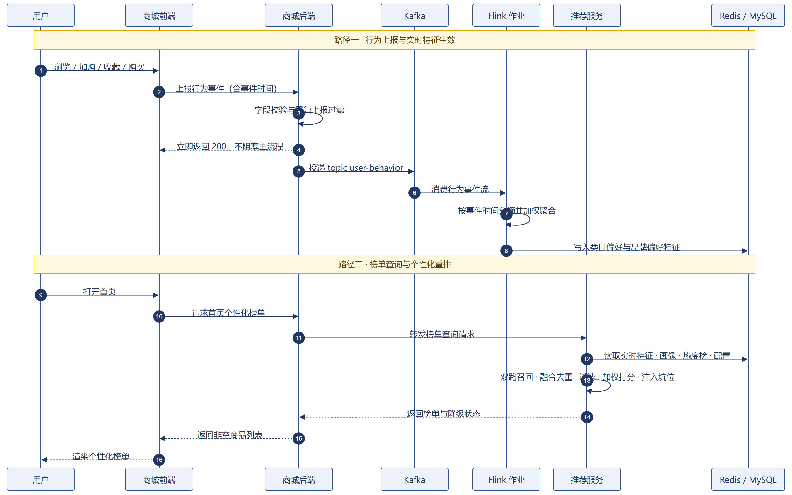
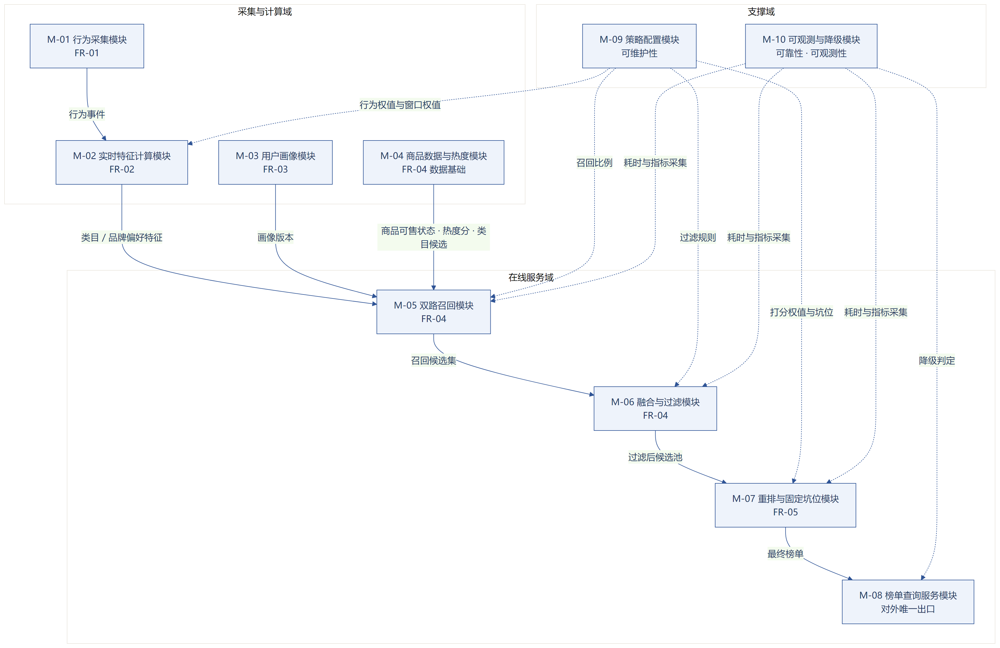
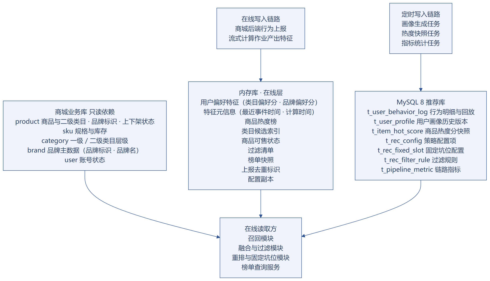
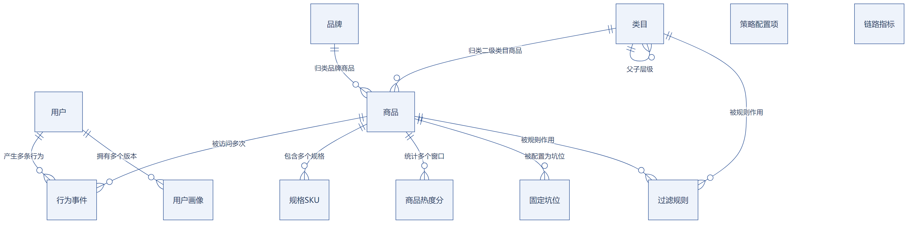

# 基于实时特征的个性化商品推荐系统

## 概要设计说明书

---

## 1 引言

**本章要点**：说明本文档的定位、读者对象与适用范围，明确只做架构、模块、库表与接口的宏观设计，字段级与算法级细节交由详细设计。

### 1.1 编写目的

本文档为基于实时特征的个性化商品推荐系统的概要设计说明书，用于明确系统整体架构、功能模块划分、数据库总体设计及接口规范，为后续详细设计、编码开发、系统测试提供依据。

本文档承接《需求分析说明书》，向下指导《详细设计说明书》：只做架构级、模块级、表级与接口级的宏观设计，具体类与方法实现、字段级定义与测试用例在详细设计阶段展开。

### 1.2 项目背景

商城首页热销榜单是平台核心流量入口，当前为全局静态榜单：所有用户看到同一套排序，榜单仅由商品整体热度生成，与用户个人浏览、加购等行为偏好无关。由此带来三类问题：用户需逐条筛选商品、平台积累的行为数据仅用于离线统计而未回流线上、流量高度集中于少数头部商品。

本项目在商城原有业务之外新增个性化推荐子系统，打通「行为采集—实时计算—推荐展示」的线上数据闭环：用户行为在 5 秒内折算为实时偏好特征，首页榜单依据个体偏好动态重排。系统只做首页榜单的个性化重排，不涉及商品上架、订单交易、支付结算、购物车等商城原有业务。

### 1.3 参考资料

| 编号 | 名称 | 说明 |
|---|---|---|
| 1 | 《基于实时特征的个性化商品推荐系统-需求分析说明书》（2026-09-22，V0.3） | 本设计的需求来源与验收依据，**现行需求基线** |
| 2 | 星创优品商城现有工程实现 | Spring Boot 3.2.12 后端、Vue 3 三端前端、Redis / MySQL / Docker Compose 部署配置 |
| 3 | 项目需求沟通记录 | 人工确认的补充约定 |

> 《需求规格说明书》（2026-09-20）已于 2026-10-08 作废（原采用多路召回路线，与最终技术方案不一致），仅存档，其约束条件、前提假设与风险分析已由本文档第 3.1 节架构约束（C-01~C-07）承接。

### 1.4 术语与定义

| 术语 | 说明 |
|---|---|
| 事件时间 | 行为实际发生时刻，由上报数据携带；窗口归属与顺序判定均以它为准 |
| 时间分桶 | 以 1 分钟为粒度的计数单元，六档滑动窗口由连续桶区间汇总得出 |
| 实时特征 | 存于内存库、带有效期、可被召回环节直接读取的用户偏好分与商品热度分 |
| 用户画像 | 按天生成、带版本号、可回滚的长期偏好记录 |
| 类目偏好召回 | 依据用户类目偏好分取偏好类目，再取该类目候选商品的一路召回 |
| 热门召回 | 依据商品热度分取候选商品的一路召回 |
| 双路召回 | 类目偏好召回与热门召回并行执行，各自产出候选结果 |
| 召回候选池 | 两路召回结果按配置比例截取、合并去重并过滤后形成的待排序集合 |
| 结果快照 | 一次重排产生的完整榜单及顺序，用于保证同一用户翻页顺序一致 |
| 固定坑位 | 位置固定的运营干预商品位，不参与打分与重排 |
| 降级与兜底 | 环节异常时按预设策略返回可用结果，并以状态标识记录的做法 |
| 冷启动 | 用户无任何历史行为、无法计算个性化特征的状态 |

### 1.5 适用范围

| 项目 | 说明 |
|---|---|
| 覆盖内容 | 需求概述、系统总体架构与分层、功能模块划分与依赖、数据库总体结构、接口设计规范 |
| 不覆盖内容 | 具体类与方法设计、算法公式实现、字段级建表语句、单元与集成测试用例、压测脚本 |
| 适用对象 | 开发人员（编码依据）、测试人员（用例设计依据）、评审与验收方（架构合理性评估依据） |
| 系统边界 | 仅覆盖首页榜单个性化重排，不涉及商城原有商品、订单、交易、支付业务 |

---

## 2 需求概述

**本章要点**：给出 5 项功能需求、非功能指标与运行环境要求；其中 7 条架构约束（单机 16GB、事件时间口径、六档窗口、无向量能力等）是后续所有设计取舍的依据。

### 2.1 功能需求

系统核心功能共 5 项，构成「采集—计算—召回—展示」的最小可用闭环。

| 编号 | 功能名称 | 优先级 | 功能简述 |
|---|---|---|---|
| FR-01 | 用户行为采集 | P0 | 采集浏览、加购、收藏、购买四类行为并上报，作为系统唯一数据源；上报前校验字段，过滤重复点击与爬虫等无效数据 |
| FR-02 | 实时行为特征计算 | P0 | 按 1min / 5min / 10min / 1h / 24h / 7d 六档滑动窗口统计用户行为，结合可配置行为权重计算类目偏好与品牌偏好特征 |
| FR-03 | 用户画像更新 | P1 | 汇聚用户历史行为，按规则提取类目、品牌等偏好，按天生成画像并保留历史版本；生成失败沿用上一有效版本 |
| FR-04 | 双路召回与融合 | P0 | 类目偏好召回与热门召回并行执行，结果按配置比例截取、去重，并过滤下架、售罄等不可展示商品，形成召回候选池 |
| FR-05 | 个性化榜单重排 | P0 | 依据类目偏好分与商品热度分加权打分重排，支持固定坑位注入，保证翻页顺序稳定，特征缺失时降级为热度排序 |

系统需覆盖两类冷启动场景：

1. **未登录或身份无法识别的游客**：系统不采集其行为数据，榜单直接返回热门内容，浏览体验与改造前保持一致。
2. **已登录但没有任何历史行为的注册新用户**：类目偏好召回缺少有效输入，系统仅执行热门召回并保证返回非空候选，待其产生首次行为后逐步纳入个性化计算。

两类场景均要求页面不出现空白或报错，仅在内部以状态标识记录。

**游客行为不采集的已知取舍**：按上述边界，游客行为不入库，因此商品热度分与热门召回只反映登录用户的行为分布。若平台游客流量占比较高，热门榜会与全站真实热度存在系统偏差。本期接受该偏差，原因是游客无稳定身份、无法保证去重与限频口径一致，采集反而可能污染热度统计。若后续需要修正，建议在商城前端为游客分配匿名设备标识并单独统计，不与登录用户行为混入同一热度口径。

### 2.2 非功能需求

| 类别 | 需求要求 | 设计落点 |
|---|---|---|
| 性能 | 推荐请求 P95 ≤ 800ms；召回环节 ≤ 150ms；行为上报接口 ≤ 100ms | 耗时预算分解、两路召回并行、结果快照复用 |
| 容量与时效 | 支撑至少 100 万条行为数据；行为产生后 5 秒内特征生效 | 1 分钟分桶聚合、事件驱动即时更新、内存水位控制 |
| 可靠性 | 任意环节异常仍返回有效结果，禁止页面空白与请求卡死；画像失败保留上一版、召回失败降级热门、特征失败按无特征处理 | 分层降级约定、热度兜底名单 |
| 安全性 | 接口校验登录态，用户仅可查看自身推荐结果；画像不推断敏感属性；数据均为合成数据 | 身份由服务端解析、偏好维度白名单、数据库只读账号 |
| 兼容性 | 复用商城现有技术栈与接口返回结构，新增能力不影响原有业务分支 | 与原系统解耦、返回结构沿用、字段向后兼容 |
| 可扩展性 | 召回与打分策略可扩展，后续可按需增加召回通道或打分因子 | 模块化划分、策略配置化、接口预留扩展字段 |
| 易用性 | 运营可自助调整策略与坑位，改动无需发版；用户端无额外操作负担 | 管理后台配置化、热更新、用户端保持原有交互习惯 |
| 可观测性 | 可查询特征覆盖率、召回命中率、降级触发次数与各环节耗时 | 指标采集点设计、运行看板 |
| 可维护性 | 推荐策略参数与业务规则配置化，问题可定位可回滚 | 配置热更新、画像版本回滚、链路标识贯穿 |

**安全性要求说明**（安全相关要求在此统一收口，其它章节只描述落实方式，不再重复要求本身）

| 安全项 | 要求 |
|---|---|
| 身份与鉴权 | 推荐相关接口必须校验登录态；用户身份一律由服务端解析，禁止由请求参数指定 |
| 数据可见范围 | 用户仅可查看自身的推荐结果，按用户维度查询的接口必须做越权校验 |
| 数据采集边界 | 仅采集行为类型、商品标识与行为时间等推荐必需的字段，不采集与推荐无关的个人信息 |
| 数据内容边界 | 画像与特征仅记录类目、品牌等商品偏好维度，不推断、不存储性别、年龄、地域等敏感属性；不存储商城用户密码、支付与地址信息 |
| 数据来源合规 | 项目所用数据均为合成数据，不含真实用户隐私信息 |
| 凭证与权限 | 数据库、缓存与消息队列凭证通过环境变量注入，不明文落盘、不提交代码仓库；推荐侧访问商城业务库使用只读账号，遵循最小权限 |
| 防滥用 | 行为上报按用户与来源限频，重复、爬虫与异常时长事件静默丢弃并计入指标，防止刷取偏好特征污染推荐结果 |

### 2.3 运行环境需求

**软件环境**

| 层次 | 组件 | 版本 | 说明 |
|---|---|---|---|
| 操作系统 | Windows 10/11 或主流 Linux 发行版 | 64 位 | 宿主机运行环境，容器以 Docker Desktop 或 Docker Engine 承载 |
| 前端 | Vue 3 + Vite + Naive UI + Pinia | 沿用商城现有版本 | 首页榜单区块渲染与行为上报 |
| 应用 | Spring Boot | 3.2.12 | 商城后端与推荐服务共用技术栈 |
| 应用 | MyBatis-Plus | 3.5.5 | 推荐库读写与商城业务库只读访问 |
| 应用 | Sa-Token | 1.45.0 | 登录态校验与用户身份解析 |
| 消息 | Kafka | 3.6（KRaft 单节点） | 承载行为事件流 |
| 计算 | Flink | 1.17.2 | 事件时间分桶聚合，产出实时特征 |
| 存储 | Redis | 8.8 | 实时特征、热度榜、类目候选索引、结果快照 |
| 存储 | MySQL | 8 | 推荐库新增数据 + 商城业务库只读 |
| 部署 | Docker Compose + Nginx | Nginx 1.20.2 | 单机编排、静态资源分发与反向代理 |

**硬件环境与服务器资源**

| 项目 | 要求 | 说明 |
|---|---|---|
| 服务器形态 | 单机部署，全部组件同机运行 | 面向课程演示与小规模评测，不做集群与高可用 |
| 内存 | 上限 16GB，建议预留 8GB 以上可用内存 | 全部组件同机运行，实际内存水位需压测确认；各组件资源分配方案见详细设计 |
| CPU | 建议 4 核及以上 | 前端构建、流式计算作业与查询服务并存 |
| 磁盘 | 建议 50GB 以上可用空间 | 行为明细保留 90 天、消息保留 7 天、容器镜像与日志 |
| 网络 | 本机回环通信 | 中间件端口仅对本机开放，不暴露局域网 |
| 环境可用性 | 中间件版本以本地实测为准 | 商城现网中间件为 RocketMQ，Kafka 与 Flink 需在课程环境完成部署验证 |

**浏览器适配**：用户端支持 Chrome 90+ / Edge 90+ / Firefox 88+ / Safari 14+，桌面与移动端自适应；管理后台要求相同，用于策略配置、坑位维护与运行看板查看。

---

## 3 系统总体架构设计

**本章要点**：确定架构模式（前后端分离 + 单体分层 + 在线与计算分离）、四层分层职责与各层降级约定，并给出整体架构、数据流向与外部依赖。

### 3.1 架构模式选择

**架构约束**：以下约束决定架构模式的取舍边界。

| 编号 | 约束内容 | 对架构的影响 |
|---|---|---|
| C-01 | 单机运行、内存上限 16GB、面向课程演示与小规模评测 | 不拆分微服务，不引入注册中心与网关；中间件单节点部署，不做高可用 |
| C-02 | 不改动商城原有商品、订单、交易逻辑 | 推荐能力集中在新模块，对商城业务库只读访问 |
| C-03 | 统计口径以事件时间（行为发生时刻）为准 | 计算侧必须采用事件时间语义，不使用数据到达时刻 |
| C-04 | 滑动窗口固定为 1min / 5min / 10min / 1h / 24h / 7d 六档 | 以 1 分钟分桶 + 多窗口滚加实现，不建六套独立窗口；窗口按整桶累加（近似误差不超过一个桶粒度，详见详细设计 6.1），分桶归属、窗口汇总与迟到判定**始终以事件时间（eventTime）为准**，不使用数据到达时刻 |
| C-05 | 本期不含用户评价数据与商品语义向量能力 | 不引入向量库与文本向量化服务，召回仅两路 |
| C-06 | 需支撑至少 100 万条行为数据，覆盖全部商品与用户 | 在线数据全部带有效期自动清理，明细数据按月归档 |
| C-07 | 仅上架且有库存的商品可进入推荐结果 | 召回后统一执行可售过滤，状态缓存随商品变更失效 |

**架构模式选择**

| 架构维度 | 选择 | 备选方案 | 选择理由 |
|---|---|---|---|
| 整体形态 | 前后端分离 + 单体分层 + 在线与计算分离 | C/S 架构、微服务架构 | 前端为浏览器访问，天然是 B/S 形态下的前后端分离；受 C-01 约束，微服务的注册中心、网关与分布式事务成本远高于收益；推荐子系统以独立进程部署即可实现故障隔离 |
| 前端架构 | Vue 3 单页应用（SPA） | 服务端渲染模板、MVVM 框架替换 | 沿用商城三端现有 MVVM 结构（Vue + Pinia），首页榜单仅替换数据来源，改动面最小 |
| 后端架构 | 单体分层（控制层—业务层—数据访问层） | 按功能拆微服务 | 模块数量与并发规模有限，单体分层已满足解耦需求，且便于单机部署与调试 |
| 计算架构 | 流式实时计算（消息队列 + 流计算作业），与在线请求解耦 | 在线请求内同步计算 | 5 秒特征时效与 800ms 请求时限无法在同一同步链路内同时满足 |
| 存储架构 | 关系库存持久化数据 + 内存库存特征与缓存 | 全部使用关系库 | 特征读写要求毫秒级并需自动过期，关系库难以满足 |
| 交互方式 | 榜单查询同步 REST，行为上报异步消息 | 全部同步调用 | 行为上报必须立即返回不阻塞页面，只能异步；榜单查询需同步返回结果 |
| 部署架构 | 单机容器化编排 | 多机集群 | 受 C-01 约束，单机部署满足演示与评测需求，部署与运维成本最低 |

**关于「独立 Flink 工程」与微服务的关系**：M-02 及 M-04 的商品热度算子以独立 Maven 工程 `shop-rec-flink` 构建、独立提交至 Flink 集群。这是**部署单元与编译目标的分离**（Flink 1.17.2 仅支持 Java 8/11，与 Java 22 的在线服务不兼容），**不是微服务拆分**——不引入注册中心、服务发现、网关与分布式事务，作业与推荐服务之间无远程调用，仅通过消息队列与内存库间接交互。同理，商城后端内部能力（含 RAG 等）保持单模块组织，不按业务功能拆 Maven 模块。

### 3.2 系统分层设计

系统按表现层、业务逻辑层、数据访问层、数据层四层组织，各层职责与失败时的处理约定如下。

| 层次 | 职责 | 本系统组成 | 失败时的降级处理 |
|---|---|---|---|
| 表现层 | 用户交互、数据展示与请求发起，不含业务规则 | 商城用户端首页榜单区块、管理后台策略与坑位配置页面 | 榜单降级不改变返回结构，页面照常渲染；请求失败时展示商城原有空态 |
| 业务逻辑层 | 请求编排、业务规则、实时特征计算与结果组装 | 商城后端（行为校验与投递、榜单查询转发与最终兜底）；推荐服务（双路召回、融合过滤、加权打分、坑位注入、降级判定、策略配置）；**独立 Flink 作业**（M-02 用户偏好计算与 M-04 商品热度算子）；推荐服务定时任务（画像、商品维度与索引、归档清理） | 特征读取失败按无特征处理；类目偏好召回异常丢弃该路；打分异常回退热度序；候选为空启用兜底名单；推荐服务整体不可用时由商城后端返回原生热销榜 |
| 数据访问层 | 数据读写封装、缓存访问与消息收发 | 推荐库与商城业务库的 Mapper、内存库访问组件、消息生产与消费组件、配置读取组件 | 缓存读写异常时跳过缓存直接计算；商品状态不可确认时丢弃该批候选；配置读取失败使用内置默认值 |
| 数据层 | 数据持久化与消息承载 | MySQL 8（商城业务库只读 + 推荐库）、Redis 8.8、Kafka | 关系库不可用时画像任务沿用上一版本；内存库不可用时整体走兜底名单；消息队列不可用时行为直接落库并告警 |

**分层约定**（用于保证结构在后续开发中不被破坏）

1. **单向依赖**：表现层只调用业务逻辑层，业务逻辑层只通过数据访问层访问数据层，禁止跨层直接调用。
2. **计算侧独立部署**：特征计算不占用在线请求线程，通过消息队列与在线服务解耦，计算侧故障不影响榜单查询可用性。计算侧以**独立工程与独立编译目标**构建（`shop-rec-flink`，Java 11），与在线服务（Java 22）不共享构建产物；两侧仅共享「分桶键格式」与「行为权值默认值」两项约定，以常量各自定义，不做代码共享。
3. **原系统隔离**：推荐相关逻辑集中在新模块内，对商城原有商品、订单、交易代码只做只读调用，不修改既有业务分支。
4. **降级不改变接口形态**：降级结果与正常结果的返回结构一致，仅状态标识不同，前端无需分支处理。

**总体降级兜底汇总**

| 触发情形 | 兜底结果 | 对外状态标识 |
|---|---|---|
| 未登录或身份无法识别 | 直接返回热门榜单 | 游客 |
| 已登录但无实时特征且无画像 | 仅执行热门召回 | 冷启动 |
| 特征读取失败 | 仅按商品热度分排序 | 特征缺失 |
| 类目偏好召回异常 | 丢弃该路，保留热门召回结果 | 召回降级 |
| 候选池或榜单为空 | 启用预生成的热度兜底名单 | 兜底名单 |
| 推荐服务整体不可用 | 商城后端返回原生热销榜 | 上游兜底 |

所有兜底结果与正常结果保持一致的返回结构且不为空，前端无需区分处理。本表为总体汇总，各环节的判定阈值与处理细节在详细设计与开发阶段落地。

### 3.3 整体架构图与外部依赖

系统整体架构见图 2，自下而上为数据层、数据访问层、业务逻辑层与表现层，其中消息队列与流式计算作业承担计算侧职责。

**数据流向**

| 数据流 | 起点 | 经过 | 终点 | 说明 |
|---|---|---|---|---|
| 行为数据流 | 用户操作 → 前端上报 | 商城后端校验投递 → 消息队列 → 流式计算作业分桶聚合 | 内存库实时特征 | 全异步，不阻塞用户操作，是实时性的来源 |
| 请求数据流 | 用户打开首页 | 商城后端转发 → 推荐服务鉴权与编排 → 召回 → 过滤 → 打分 → 坑位注入 → 结果快照 | 首页榜单 | 全同步，任一环节异常按分层降级约定兜底 |
| 配置数据流 | 运营在管理后台提交 | 配置校验并落库 → 同步内存配置副本 | 各模块热更新 | 无需发版与重启，默认 30 秒内生效 |
| 批处理数据流 | 定时任务触发 | 行为明细与商品数据 → 画像生成、热度与类目索引刷新 | 关系库与内存库 | 支撑个性化召回与打分，失败沿用上一版本 |

两条链路的数据流时序展开见图 3。

**外部依赖**

| 依赖对象 | 依赖内容 | 交互方式 | 不可用时的处理 |
|---|---|---|---|
| 商城业务库 | 商品、规格、类目、品牌只读数据 | 只读查询 + 启动全量加载 | 沿用上次加载结果并告警，不使用不完整数据覆盖缓存 |
| 商品变更通知 | 商品上下架、库存、属性变更 | 消息主题订阅 | 改为定时对账刷新，允许分钟级延迟 |
| 商城账号与登录态 | 用户身份与登录状态 | 由商城后端校验后透传用户标识 | 按游客策略返回热门榜单 |
| 商城后端 | 行为上报入口与榜单查询转发 | HTTP 调用 | 推荐服务不可达时由其返回原生热销榜 |
| 商城前端 | 行为上报与榜单渲染 | HTTP 调用 | 上报失败按上限重试，榜单失败展示原有空态 |
| 基础设施 | MySQL、Redis、Kafka、Flink、Nginx | 本机容器与进程 | 按 3.2 分层降级约定处理 |

---

## 4 系统功能模块划分

**本章要点**：给出 M-01~M-10 的职责、运行形态与调用依赖；在线查询链路严格单向 M-02 → M-05 → M-06 → M-07 → M-08，计算侧与在线侧解耦。

### 4.1 模块划分原则

| 原则 | 说明 |
|---|---|
| 高内聚低耦合 | 每个模块只承担一类职责，模块内部数据自洽，模块之间通过显式接口交互 |
| 按运行形态划分 | 在线服务、流式计算、定时批处理三类运行形态相互独立，互不阻塞 |
| 单一写入者 | 同一数据结构只允许一个模块写入，避免多写者导致口径不一致 |
| 可单独降级 | 每个在线模块都有明确失败语义与降级动作，不允许出现无兜底路径的模块 |
| 与原系统解耦 | 推荐相关模块集中管理，对商城原有模块只读调用，不修改其业务分支 |

### 4.2 系统模块结构图

系统划分为 10 个模块，分属采集与计算域、在线服务域、支撑域，结构见图 4。

### 4.3 模块职责定义

| 模块编号 | 模块名称 | 承载需求 | 运行形态 | 模块职责 | 输入 | 输出 |
|---|---|---|---|---|---|---|
| M-01 | 行为采集模块 | FR-01（需求分析 4.2） | 商城后端内嵌组件 | 接收行为事件、校验字段合法性、过滤重复与无效事件、异步投递行为队列后立即返回 | 前端上报的行为事件 | 写入行为队列的事件流、无效事件统计 |
| M-02 | 实时特征计算模块 | FR-02（需求分析 4.3） | 流式计算作业（**独立 Flink 工程，编译目标 Java 11**） | 按事件时间分桶聚合，行为加权、维度聚合、分值封顶，产出用户类目与品牌偏好特征；分桶累加值存放于 Flink 托管状态 | 行为事件流 | 用户实时偏好特征 |
| M-03 | 用户画像模块 | FR-03（需求分析 4.4、3.3） | 定时批处理 | 汇聚用户历史行为，按规则提取长期偏好，生成画像版本并持久化，失败时沿用上一有效版本；**支持按需回滚到保留的历史版本** | 行为明细、商品类目与品牌 | 带版本的持久化画像 |
| M-04 | 商品数据与热度模块 | FR-04 数据基础（需求分析 4.5、3.2） | **Flink 商品热度算子**（与 M-02 同作业）+ 定时批处理 + 变更消费 | 商品热度累计由同作业的商品热度算子承担；商品维度维护、可售状态缓存、类目候选索引与兜底名单由定时任务承担，商品变更时失效相关缓存 | 商品变更通知、行为事件流 | 热度分、类目候选索引、可售状态缓存 |
| M-05 | 双路召回模块 | FR-04（需求分析 4.5） | 在线服务 | 并行执行类目偏好召回与热门召回，按配置产出各路候选并校验结果有效性 | 用户偏好特征与画像、热度分、类目候选索引 | 两路召回候选集合 |
| M-06 | 融合与过滤模块 | FR-04（需求分析 4.5） | 在线服务 | 两路候选按比例截取、按商品标识合并去重，按可推荐范围过滤，形成召回候选池 | 两路召回候选、过滤规则、商品状态 | 召回候选池 |
| M-07 | 重排与固定坑位模块 | FR-05（需求分析 4.6） | 在线服务 | 按权重加权打分并排序，注入固定坑位，输出顺序稳定的完整榜单 | 召回候选池、偏好分、热度分、坑位配置 | 个性化榜单 |
| M-08 | 榜单查询服务模块 | 对外唯一出口（需求分析 4.5、5） | 在线服务 | 鉴权、流程编排、结果快照缓存、降级判定与统一返回 | 榜单查询请求 | 榜单、快照标识与降级状态 |
| M-09 | 策略配置模块 | 可维护性（需求分析 5） | 在线服务 + 管理后台 | 配置读写、合法性校验、热更新与生效通知 | 运营提交的配置 | 生效中的配置项与过滤规则 |
| M-10 | 可观测与降级模块 | 可靠性、可观测性（需求分析 5） | 横切组件 | 采集各环节耗时与业务指标，按阈值触发降级并记录降级事件 | 各模块上报的指标 | 指标数据、降级判定结果 |

**批任务模块的高层调度约束**（只约定调度时机、频率与失败处理，不涉及实现细节）：M-03 用户画像模块：触发时机 每日在业务低峰期固定触发一次，频率与时限 单次执行不超过 10 分钟，失败处理与错峰要求 失败沿用上一有效版本且不阻塞其它任务；与热度刷新任务错峰执行；M-04 商品数据与热度模块：触发时机 增量刷新按固定间隔触发，全量重建在业务低峰期触发，频率与时限 增量刷新单次不超过 1 分钟，全量重建每日一次，失败处理与错峰要求 失败沿用上一版索引；商品状态缓存随商品变更主动失效，不等待定时刷新。

### 4.4 模块间调用与依赖关系

**模块间调用关系**

| 调用方 | 被调方 | 调用方式 | 传递内容 | 失败处理 |
|---|---|---|---|---|
| M-01 | 消息队列 | 异步投递 | 行为事件 | 投递失败降级为落库并告警，不阻塞上报响应 |
| M-02、M-04 | 消息队列 | 消息订阅 | 行为事件流、商品变更 | 消费失败重试，超限进入重试队列 |
| M-05 | M-02 | 同步调用 | 用户标识（读取偏好特征） | 超时按无特征处理，仅按热度排序 |
| M-05 | M-03、M-04 | 同步调用 | 用户标识、偏好类目、候选条数 | 类目偏好召回异常丢弃该路，保留热门召回 |
| M-06 | M-04、M-09 | 同步调用 | 候选商品标识、过滤规则 | 状态查询失败丢弃该批候选 |
| M-07 | M-02、M-09 | 同步调用 | 品牌偏好分、打分权值、坑位配置 | 读取失败按默认权值处理，坑位读取失败跳过注入 |
| M-08 | M-05、M-06、M-07 | 同步调用 | 请求上下文与中间结果 | 任一环节异常由 M-08 统一执行降级并返回非空结果 |
| 全部模块 | M-10 | 异步上报 | 指标名、维度、数值 | 上报失败仅记日志，不影响主流程 |

**模块依赖关系**

| 依赖类型 | 涉及模块 | 说明 |
|---|---|---|
| 相互独立 | M-01 与在线服务域各模块 | 行为采集不依赖查询链路，二者可分别启动与停止 |
| 单向依赖 | M-02 → M-05 → M-06 → M-07 → M-08 | 在线查询链路严格单向，不允许反向调用 |
| 数据依赖 | M-03、M-04 与其他模块 | 画像与热度为计算侧产物，供召回与打分读取，不参与请求编排 |
| 配置依赖 | M-09 → M-02、M-05、M-06、M-07 | 策略配置以只读方式被各模块使用，配置异常时使用内置默认值 |
| 横切依赖 | M-10 → 在线服务域与计算侧 | 指标采集与降级判定贯穿全链路，不参与业务数据流转 |

---

## 5 数据库总体设计

**本章要点**：商城业务库只读 + 推荐库 7 张新增表；内存库按用途划分（键名细节见详细设计），并给出全局 E-R 与完整性、安全性约束。

本章做库级与表级的宏观设计，说明选型理由、库表划分、实体关系、完整性与安全约束；字段级定义、建表语句与索引细节在详细设计阶段给出。

### 5.1 数据库选型

| 存储类型 | 选型 | 备选方案 | 选型理由 |
|---|---|---|---|
| 关系型数据库 | MySQL 8 | Oracle、PostgreSQL | 商城现网同款，团队熟悉、运维成本低；满足画像版本管理、配置管理与指标统计的事务与查询需求 |
| 内存数据库 | Redis 8.8 | 进程内本地缓存、Memcached | 有序集合结构天然适配「偏好分排序」与「热度榜单」语义；支持按键设置有效期，特征可自动过期清理；多进程共享，商城后端与推荐服务可共用 |
| 消息队列 | Kafka 3.6 | RocketMQ、进程内队列 | 支持按用户标识分区保证局部有序、支持事件积压重放，与流式计算作业集成成熟，可直接对接事件时间语义；**Kafka 属课程演示选型，生产环境可替换为商城现网使用的 RocketMQ**，仅需替换生产与消费组件实现，报文与主题约定不变 |
| 计算引擎 | Flink 1.17.2 | 自研消费端内存聚合 | 原生支持事件时间、水位线与状态管理，避免自研乱序处理带来的实现与调试风险 |

### 5.2 数据库整体结构

系统不新建独立数据库实例，数据按「商城业务库只读 + 推荐库新增」两部分组织。

**库划分**：商城业务库（商城原有，推荐侧只读）包含商品、规格、类目、品牌、用户账号等原有表，不新增、不修改，其中商品表以品牌标识关联品牌主数据表；推荐库（本系统新增，读写）包含行为明细、画像、热度快照、策略配置、固定坑位、过滤规则、链路指标。

**核心数据表**

| 序号 | 表名 | 表的核心用途 | 主要关联 | 写入模块 |
|---|---|---|---|---|
| 1 | `t_user_behavior_log` | 行为明细，唯一记录用户行为事件，用于画像生成、特征重建与离线统计；以事件标识唯一约束实现上报去重 | 关联用户与商品 | M-01 |
| 2 | `t_user_profile` | 用户画像，保存长期偏好与历史版本，支持版本回滚 | 关联用户，一用户多版本 | M-03 |
| 3 | `t_item_hot_score` | 商品热度分快照，保存不同统计窗口下各商品热度，用于离线核对与索引重建 | 关联商品 | M-04 |
| 4 | `t_rec_config` | 推荐策略配置项，保存行为权值、窗口权值、召回比例、打分权值、缓存时长与降级开关等 | 独立实体，被全部模块读取 | M-09 |
| 5 | `t_rec_fixed_slot` | 固定坑位配置，保存坑位位置、商品与生效时间段 | 关联商品 | M-09 |
| 6 | `t_rec_filter_rule` | 过滤规则，保存黑名单、会员限定、地域限制、低质商品等规则 | 关联商品或类目 | M-09 |
| 7 | `t_pipeline_metric` | 链路指标，保存特征覆盖率、召回命中率、降级次数与各环节耗时等观测数据 | 独立实体 | 全部模块 |

**内存库数据用途**

| 数据类别 | 数据用途 | 写入模块 / 读取模块 |
|---|---|---|
| 用户偏好特征 | 保存用户对各二级类目、各品牌的偏好分，供按分值取偏好 TopN | M-02 / M-05、M-07 |
| 特征元信息 | 记录最近事件时间与计算时间，用于特征覆盖率与新鲜度统计 | M-02 / M-08、M-10 |
| 商品热度榜 | 保存全局商品热度分，供热门召回与打分使用 | M-04 / M-05、M-07 |
| 类目候选索引 | 保存各二级类目下的候选商品及类目内热度分 | M-04 / M-05 |
| 商品可售状态 | 保存上下架、库存、类目、品牌等状态，供过滤使用 | M-04 / M-06 |
| 过滤清单 | 保存黑名单、会员限定、低质商品等商品清单 | M-09 / M-06 |
| 排除清单 | 保存用户近 N 天已购与已加购的商品标识，供融合过滤使用 | M-01 / M-06 |
| 榜单快照 | 保存完整榜单与快照标识，供同一用户翻页复用 | M-08 / M-08 |
| 上报去重标识 | 标识已处理事件，拦截重复上报 | M-01 / M-01 |
| 配置副本 | 保存配置热更新副本，关系库为权威来源 | M-09 / 全部模块 |

各类数据的键名规则、数据结构与有效期取值在详细设计阶段定义。

**分桶累加值不在内存库中**：按事件时间划分的分钟桶、小时桶、天桶属计算侧中间状态，存放于 M-02 所在 Flink 作业的托管状态，由状态 TTL 与检查点保障，不占用内存库容量。内存库只接收计算完成后的偏好特征与元信息。该归位是内存容量核算的结果，详见详细设计 3.2、4.2 与 8.4。

**消息主题**：`user-behavior` 承载行为事件流，3 个分区、以用户标识为消息键、保留 7 天，M-01 生产 / M-02 与 M-04 消费；`item-change` 承载商品上下架、库存与属性变更通知，1 个分区、以商品标识为消息键、保留 3 天，商城商品服务生产 / M-04 消费。

生产者统一约定：需确认写入成功、开启幂等、失败重试三次；投递失败时降级为直接落库并告警，保证行为数据不丢失。三类存储的读写关系见图 5。

说明：本图只表达三类存储的数据类别与读写关系，不含键名与有效期细节，具体定义见详细设计说明书。

### 5.3 全局 E-R 图

各实体的关系见图 6：用户与商品通过行为事件形成**多对多**关系（一个用户可产生多条行为、一个商品可被多个用户访问）；用户与画像、商品与规格、商品与热度分、商品与固定坑位为**一对多**关系；类目与商品为一对多，类目自身存在父子层级的**一对多**关系；品牌与商品为一对多，商品以品牌标识关联品牌主数据表，品牌偏好特征即以该标识为聚合维度；过滤规则可作用于商品或类目，与二者构成**一对多**关系；策略配置项与链路指标为独立实体，不与其他实体建立外键关系。

说明：本图只表达实体与实体间的对应关系，不含字段级属性定义，字段明细见详细设计说明书。

### 5.4 数据完整性、约束与安全性设计

| 设计项 | 约定 |
|---|---|
| 主键设计 | 新增表统一使用数值型自增或雪花标识作为主键，业务标识另建唯一索引，避免业务字段变动影响主键 |
| 唯一性与约束 | 行为明细以事件标识唯一索引实现去重；配置表以配置键唯一；画像表以「用户 + 版本」唯一；坑位表限制同一时间段内同一位置不重复；数值型配置项限制取值区间 |
| 外键策略 | 不建立物理外键，改由应用层校验 + 唯一索引兜底。原因是跨库引用（商城业务库与推荐库）无法建立外键，且物理外键会拖慢批量写入 |
| 幂等设计 | 上报接口以事件标识幂等；配置写入按配置键覆盖；画像生成按「用户 + 日期版本」覆盖写入 |
| 数据清理与归档 | 特征与缓存一律设置有效期由存储自动清理；行为明细保留 90 天按月归档；画像仅保留最近 3 个版本；指标保留 30 天 |
| 账号与权限 | 落实 2.2 安全性要求：推荐侧以只读账号访问商城业务库，推荐库使用独立账号，配置修改按角色控制权限 |
| 敏感数据保护 | 落实 2.2 安全性要求：画像与特征仅保存偏好白名单内的商品维度和分值，不写入任何敏感属性 |
| 凭证管理 | 落实 2.2 安全性要求：凭证由环境变量注入，配置文件仅保留占位符 |

**受现有数据源限制的待确认事项**

下列三项为**已设计但暂未启用**的能力，需在需求侧明确降级口径，避免验收时按业务规则逐条核对出现缺项。

| 编号 | 事项 | 当前设计的处理方式 | 本期验收口径 |
|---|---|---|---|
| 1 | 会员限定与地域不可售缺少字段 | 商城现有商品表与用户表无会员等级、可售地域字段；已按可配置规则预留过滤能力，字段缺失时该规则不生效，避免误杀商品 | **不纳入验收**。字段就绪后由运营配置规则即启用，无需改代码 |
| 2 | 低质商品判定口径 | 过滤规则表已预留低质商品规则类型，判定标准待业务方给出后启用 | **不纳入验收**。口径确定后在管理后台配置启用 |
| 3 | 内存水位与数据规模 | 全部组件同机运行且内存上限 16GB，在线数据量需压测确认；分桶保留时长已按内存上限收敛（见详细设计 4.2、6.1） | 以压测实测为准，阈值与动作见详细设计 8.4 |

**与需求分析 3.4 业务规则的对照**：需求分析 3.4 列出的不可推荐商品共 7 类——「已下架」「已售罄」「黑名单」3 类已实现并纳入验收；「地域不可售」「会员限定」「低质商品」3 类因数据字段或判定口径缺失，本期按预留能力处理、不纳入验收；「已购」「已加购」过滤见详细设计 3.6 的补充过滤规则。

**品牌标识过渡说明**

商城的品牌口径已完成迁移：`product` 表以 `brand_id`（品牌标识）关联新建的 `brand` 品牌主数据表，商品表不再冗余存储品牌名。推荐侧仅依赖品牌标识做偏好聚合与打分，品牌名仅用于展示与核对，因此**不存在过渡期兼容逻辑**；迁移与回滚脚本见商城仓库 `src/main/resources/db/migrate-brand-20260927.sql` 与 `rollback-brand-20260927.sql`。

---

## 6 系统接口设计

**本章要点**：给出内外部接口清单与通用规范：三段式返回、身份与鉴权、幂等与限频、超时与重试、错误码四段划分。

本章定义系统内外的通用接口规范：内部接口约定模块之间的调用规则，外部接口约定与商城前端、后端及外部服务的交互方式，通用规范统一返回结构、鉴权、幂等与错误处理。单个接口的完整字段与示例报文在详细设计阶段给出。

### 6.1 内部接口

内部接口指系统模块之间的调用约定，用于明确各模块的协作边界与失败语义。

| 编号 | 接口名称 | 调用关系 | 接口用途 | 失败与降级语义 |
|---|---|---|---|---|
| I-01 | 类目偏好读取 | M-05 → M-02 | 获取用户类目偏好分 | 超时按无特征处理 |
| I-02 | 品牌偏好读取 | M-07 → M-02 | 获取用户品牌偏好分 | 超时按无特征处理 |
| I-03 | 类目偏好召回 | M-05 → M-04 | 按偏好类目取候选商品 | 超时或异常丢弃该路 |
| I-04 | 热门召回 | M-05 → M-04 | 按热度取候选商品 | 超时则整体走兜底名单 |
| I-05 | 候选过滤 | M-06 → M-04、M-09 | 剔除不可推荐商品 | 失败则丢弃该批候选 |
| I-06 | 加权打分 | M-07 内部 | 计算候选总分并排序 | 异常回退为按热度降序 |
| I-07 | 坑位查询 | M-07 → M-09 | 获取生效中的固定坑位 | 失败跳过坑位注入 |
| I-08 | 榜单快照读写 | M-08 → 内存库 | 保存与复用榜单结果 | 异常跳过缓存并实时计算 |
| I-09 | 配置读取 | 各模块 → M-09 | 获取生效配置 | 失败使用内置默认值 |
| I-10 | 指标上报 | 各模块 → M-10 | 上报耗时与业务指标 | 异步上报，失败仅记日志 |

各接口的入参、返回值与超时阈值在详细设计阶段定义。

**内部接口的两条硬约定**

1. **空集合与异常必须区分对待**：返回空集合表示链路正常但确实没有候选，触发兜底名单；返回异常表示链路故障，触发对应环节的降级动作。二者对外表现相近，若混用会导致故障被误判为「数据不足」而长期潜伏。
2. **无数据统一以空集合表达**：禁止用空对象或特殊值代替，避免调用方判断分支遗漏。

### 6.2 外部接口

外部接口指本系统与商城前端、商城后端、管理后台及外部服务之间的约定。

| 编号 | 接口名称 | 方向 | 接口用途 | 时限与失败处理 |
|---|---|---|---|---|
| E-01 | 行为上报接口 | 商城前端 → 商城后端 → 推荐链路 | 接收浏览、加购、收藏、购买四类行为事件，用户身份由服务端解析 | ≤100ms；不做服务端重试，由前端按上限重试 |
| E-02 | 榜单查询接口 | 商城后端 → 推荐服务 | 获取首页个性化榜单及降级状态 | P95 ≤800ms；异常时返回兜底结果并标记状态 |
| E-03 | 策略配置接口 | 管理后台 → 配置模块 | 查询与修改推荐策略配置 | ≤300ms；校验不通过拒绝写入并保留旧值 |
| E-04 | 坑位与规则管理接口 | 管理后台 → 配置模块 | 维护固定坑位与过滤规则 | ≤300ms；校验不通过拒绝写入 |
| E-05 | 商品数据依赖接口 | 推荐服务 → 商城业务库 | 读取商品、规格、类目、品牌只读数据 | 启动加载与定时对账，不设严苛时限；失败沿用上次结果 |
| E-06 | 商品变更通知 | 商城商品服务 → 消息队列 | 通知商品上下架、库存与属性变更 | 允许分钟级延迟；不可用时改为定时对账刷新 |
| E-07 | 账号状态依赖接口 | 商城后端 → 推荐服务 | 传递登录态解析后的用户身份 | 随榜单查询请求一并传递；无效时按游客策略处理 |
| E-08 | 画像版本回滚接口 | 管理后台 → 推荐服务 | 将指定用户的有效画像切换到保留范围内的历史版本 | ≤300ms；目标版本超出保留范围时拒绝回滚（4004），保持当前版本不变 |

各接口的完整字段、校验规则与示例报文在详细设计阶段定义。

外部接口的三点设计要求：

1. **上报接口不得阻塞页面**：只做校验与投递，返回前不等待下游写入完成。
2. **查询接口不得返回空列表**：任何异常都必须返回兜底结果并标记降级状态。
3. **写接口必须做校验**：配置类接口校验不通过时拒绝写入并保留旧值，防止非法配置导致线上策略异常。

### 6.3 接口通用规范

| 规范项 | 约定内容 |
|---|---|
| 协议与风格 | HTTP + REST/JSON，字符集 UTF-8；查询使用 GET，写入使用 POST/PUT/DELETE |
| 路径约定 | 推荐相关接口统一使用 `/api/rec/` 前缀，按资源命名，动作通过 HTTP 方法表达 |
| 统一返回结构 | 沿用商城现有三段式结构（状态码、提示信息、业务数据）；分页数据统一包含页码、页大小、总数与是否还有下一页 |
| 身份与鉴权 | 统一由登录态校验身份；用户标识一律以登录态解析结果为准，不允许以请求参数覆盖；未登录用户按游客策略返回热门榜单，不采集其行为数据 |
| 幂等与去重 | 行为上报以事件标识幂等；配置类接口按配置键覆盖写入；查询类接口天然幂等 |
| 安全约定 | 越权校验、上报限频与无效事件静默丢弃等要求的落实方式，见 2.2 安全性要求说明 |
| 超时与重试 | 行为上报接口不做服务端重试（由前端按上限重试）；榜单查询不自动重试；配置接口允许重试 |
| 降级标识 | 所有榜单相关返回必须携带降级状态字段，前端不因降级进入错误分支 |
| 兼容性 | 接口按主版本规划路径；新增字段对调用方向后兼容，删除或改义字段需升级版本 |
| 文档化 | 接口定义通过接口文档工具随代码生成，保证文档与实现同步 |

**错误码大类**

错误码按用途分为四段：1xxx 参数与鉴权类、2xxx 已降级类、3xxx 服务异常类、4xxx 配置非法类。调用方按段位区分处理：参数与鉴权类提示用户，已降级类照常渲染榜单，服务异常类使用兜底结果，配置非法类保留旧配置并提示操作人。

完整错误码清单、码值与对应处理方式见详细设计说明书。

**降级状态枚举**：正常、游客、冷启动、特征缺失、召回降级、兜底名单、上游兜底，共七种状态。降级返回的 HTTP 状态均为成功，避免前端进入错误分支；降级详情通过状态字段与埋点用于内部观测。
