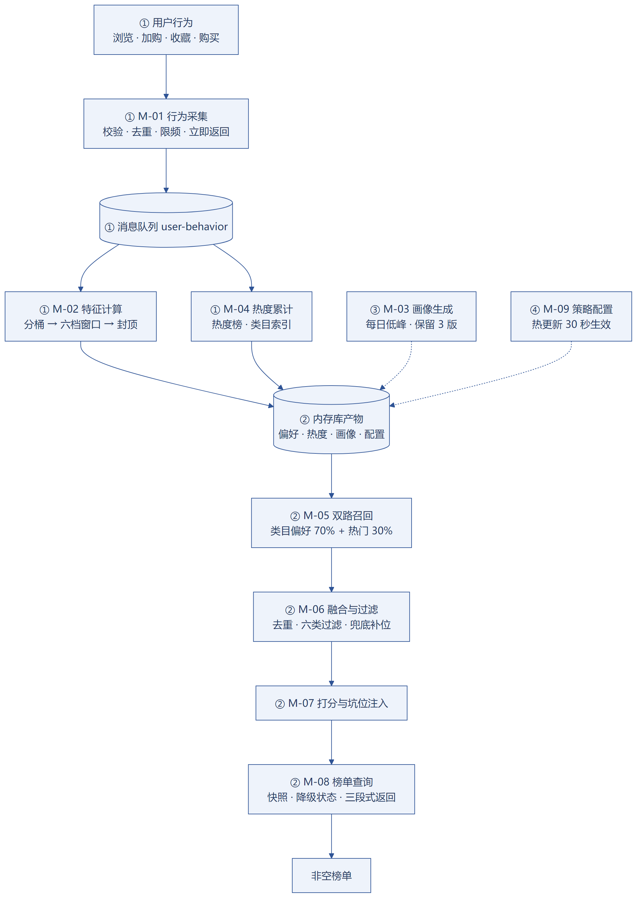
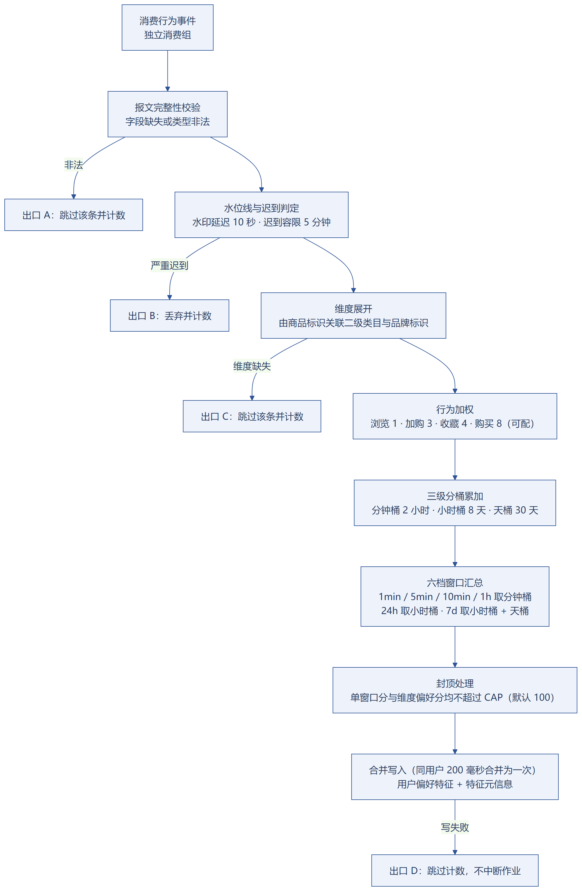
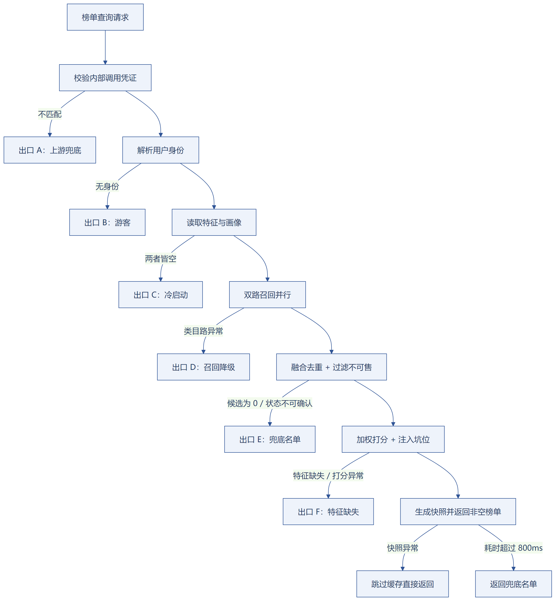

# 基于实时特征的个性化商品推荐系统

## 详细设计说明书

---

## 1 引言

**本章要点**：说明本文档与概要设计的分工（补齐概要标注「见详细设计说明书」的 7 处细节）、参考文档与文档范围。

### 1.1 编写目的

本文档为基于实时特征的个性化商品推荐系统的详细设计说明书，承接《概要设计说明书》，用于补齐概要在下列位置标注「见详细设计说明书」的全部实现细节：

| 概要位置 | 概要中的表述 | 本文档补齐内容 |
|---|---|---|
| 5.2 数据库整体结构 | 字段级定义、建表语句与索引细节见详细设计 | 第 4 章全部表结构、键定义、报文与归档规则 |
| 5.2 内存库数据用途 | 键名规则、数据结构与有效期取值在详细设计阶段定义 | 4.2 Redis 完整键定义 |
| 6.1 内部接口 | 各接口的入参、返回值与超时阈值在详细设计阶段定义 | 5.2 内部接口 I-01~I-10 |
| 6.2 外部接口 | 各接口的完整字段、校验规则与示例报文在详细设计阶段定义 | 5.1 外部接口 E-01~E-07 |
| 6.3 接口通用规范 | 完整错误码清单、码值与对应处理方式见详细设计 | 5.3 完整错误码表 |
| 3.2 系统分层设计 | 各环节的判定阈值与处理细节在详细设计与开发阶段落地 | 第 6、7 章公式与降级细则 |
| 2.3 运行环境需求 | 各组件资源分配方案见详细设计 | 8.1、8.4 部署与资源参数 |

本文档面向开发人员与测试人员：开发按本文档编码，测试按本文档设计用例。

### 1.2 参考文档

| 编号 | 文档名称 | 版本/日期 | 用途 |
|---|---|---|---|
| 1 | 《基于实时特征的个性化商品推荐系统-需求分析说明书》 | V0.3 / 2026-09-22 | 需求来源与验收依据，**现行需求基线** |
| 2 | 《基于实时特征的个性化商品推荐系统-概要设计说明书》 | V0.1 / 2026-09-24 | 本详细设计的直接上游 |
| 3 | 星创优品商城现有工程实现 | Spring Boot 3.2.12 / Java 22 / Vue 3 | 技术栈与既有约定（三段式返回、登录态、只读数据源） |
| 4 | 本文件 | V0.5 / 2026-10-08 | 设计评审修复记录见 1.5 版本记录 |

> 《需求规格说明书》（2026-09-20）已于 2026-10-08 作废（原采用多路召回路线，与最终技术方案不一致），仅存档，不列为参考文档。

### 1.3 术语说明

| 术语 | 说明 |
|---|---|
| 事件时间 | 行为实际发生时刻，由上报报文携带，窗口归属以它为准 |
| 分钟桶 / 小时桶 | 分桶聚合的计数单元：分钟桶粒度 1 分钟，小时桶粒度 1 小时 |
| 分桶键 | 桶内字段的组成形式：`{维度类型}:{维度值}:{桶时间戳}` |
| 维度类型 | 聚合维度标识：`cat` 表示二级类目，`brand` 表示品牌（取值即品牌主数据的品牌标识），`item` 表示商品 |
| 窗口汇总 | 将连续桶区间内的分值累加，得到某一档滑动窗口的窗口分 |
| 偏好分 | 六档窗口分按窗口权值合成后的用户偏好强度，写入内存库供召回读取 |
| 封顶阈值 | 单维度偏好分上限，防止单一偏好无限膨胀 |
| 召回候选池 | 两路召回按比例截取、合并去重并过滤后形成的待排序集合 |
| 归一化 | 将不同量纲的分值映射到 0~1 区间，本系统采用候选池内 min-max 归一化 |
| 快照 ID | 一次榜单重排产生的唯一标识，翻页时按其复用同一排序 |
| 兜底名单 | 商品热度榜 TopN 在模块内存中的短周期缓存，任何异常下的保底结果 |
| 降级状态 | 返回结果携带的处理状态标识，共 7 种 |
| traceId | 贯穿商城后端与推荐服务的链路标识，用于问题定位 |

### 1.4 文档范围

**文档范围**：包含：M-01~M-10 模块的业务步骤与异常分支；7 张表完整表结构；Redis 键定义；Kafka 报文；外部接口 E-01~E-07 与内部接口 I-01~I-10 的字段与参数；关键公式；降级触发与处理；部署与配置参数；图目录；不包含：可直接编译的源码；前端页面视觉稿与交互设计；运维手册与监控大盘配置；压测报告与效果指标报告；需求分析与概要设计已覆盖的内容。

### 1.5 版本记录

| 版本 | 日期 | 修订内容 |
|---|---|---|
| V0.1 | 2026-09-27 | 初稿，完成模块详细设计、数据库详细设计、接口详细设计、关键算法与降级设计 |
| V0.2 | 2026-09-27 | 品牌口径对齐商城数据库迁移（`product.brand_id` + `brand` 品牌主数据表）；补充用户画像人工版本回滚；各模块补充需求分析条目引用；明确 duration 不参与特征计算、滑动窗口工程近似与事件时间口径 |
| V0.3 | 2026-09-27 | 按精简方案合并冗余表格（89 → 61 张）、新增每章要点与 2.5 一页速览；图 1、图 3、图 12 由文字描述改为配图 |
| V0.4 | 2026-09-27 | 去重：超时阈值收敛到 5.2、降级矩阵压缩为 6 行并交叉引用；补齐缺口：5.4 商城侧改造清单、8.5 数据准备与灌数、8.6 启动与验证顺序、9.3 界面要素清单、9.4 测试要点与验收口径 |
| V0.5 | 2026-10-08 | 设计评审修复（22 项）：① 需求规格作废，清理全部引用；② M-02 改为真正使用 Flink 事件时间语义与托管状态，分桶状态下沉至 Flink、Redis 降为结果输出，并新增独立工程约束（3.2、3.4、4.2、8.1）；③ Redis 分桶保留时长收敛与淘汰策略修正（4.2、6.1、8.1、8.4）；④ 补齐全链路灌数顺序约束（8.5）；⑤ 明确榜单快照首屏/翻页语义边界（5.1.2、6.5、9.3）；⑥ 新增画像版本回滚接口 E-08（5.1.8、3.3、9.3）；⑦ 补充已购/已加购过滤规则（3.6）；⑧ 新增离线评测与效果验证章节（9.5）并补充效果类验收口径（9.4）；⑨ 另修正爬虫判定误杀、覆盖率分母口径、强制降级自动复位、超时预算尾延迟、分区并行度对齐、服务监听地址、游客采集取舍说明等 13 项（见独立文档《2026-10-08-设计评审与修复记录》） |

---

## 2 总体设计回顾

**本章要点**：复述系统边界、四条业务链路、三类运行形态与 7 种降级状态；看完本章与一页速览即可掌握系统全貌。

### 2.1 系统边界

| 项 | 说明 |
|---|---|
| 系统职责 | 仅做商城首页榜单的个性化重排：采集行为、计算实时特征、双路召回与融合、加权打分重排、返回榜单 |
| 不做的范围 | 不修改商城原有商品、订单、交易、支付、购物车业务；不新建独立数据库实例；不引入向量库与文本向量化能力；不采集未登录用户行为；不做商品语义召回 |
| 数据方向 | 对商城业务库只读；商城后端仅在行为上报与榜单查询两个入口与本系统交互 |
| 对外出口 | M-08 榜单查询服务模块是系统对外唯一出口，所有降级均在其内部完成 |

**游客行为不采集的已知取舍**：游客行为不入库，商品热度分与热门召回因此只反映登录用户的行为分布。若平台游客流量占比高，热门榜会与全站真实热度存在系统偏差。本期接受该偏差——游客无稳定身份，无法保证去重与限频口径一致，采集反而可能污染热度统计。后续修正方式见概要设计 2.1 同名说明。

### 2.2 完整业务链路

系统共四条业务链路，分别由不同模块承载。

| 链路 | 承载模块 | 触发方式 | 关键时限 |
|---|---|---|---|
| 行为链路 | M-01 → M-02 → M-04 | 用户产生行为 | 上报接口 ≤100ms；特征 5 秒内生效 |
| 查询链路 | M-08 → M-05 → M-06 → M-07 | 用户打开或翻页 | P95 ≤800ms |
| 批处理链路 | M-03、M-04、归档清理 | 定时任务触发 | 画像单次 ≤10 分钟；热度刷新单次 ≤1 分钟 |
| 配置链路 | M-09 → 各模块 | 运营提交配置 | 默认 30 秒内生效 |



四类链路的关系见图 1：行为链路全异步（M-01 校验后投递消息队列，M-02 产出偏好特征、M-04 累计热度），行为产生后 5 秒内可影响推荐；查询链路全同步（M-08 鉴权与编排 → M-05 双路召回 → M-06 融合与过滤 → M-07 打分与坑位注入），其输入统一来自内存库与推荐库；批处理链路按定时产出画像与热度索引；配置链路支撑策略、坑位与过滤规则的热更新（默认 30 秒内生效）。查询链路各环节的降级出口见 7.3 与图 12。

---

### 2.3 三类运行形态

在线服务：承载 M-01（内嵌商城后端）、M-05、M-06、M-07、M-08、M-09、M-10，部署在商城后端进程与推荐服务进程，失败影响面为查询链路不可用时由商城后端返回原生热销榜；流式计算：承载 M-02 与 M-04 的商品热度算子，部署为**独立 Flink 作业**（独立 Maven 工程 `shop-rec-flink`，编译目标 Java 11，详见 3.2），失败影响面为特征与热度停止更新、推荐退化为画像与兜底名单排序但榜单仍可用；定时批处理：承载 M-03、M-04 的商品维度维护与索引刷新、归档清理任务，部署在推荐服务定时任务中，失败影响面为画像或索引沿用上一版本、链路不中断。

### 2.4 降级状态总览

降级状态共 7 种，取值固定，不允许新增或改名。

| 序号 | 降级状态 | 触发缘由 | 兜底结果 |
|---|---|---|---|
| 1 | 正常 | 全链路无异常 | 完整个性化榜单 |
| 2 | 游客 | 无有效登录态或身份无法识别 | 热门榜单 |
| 3 | 冷启动 | 无实时特征且无画像 | 仅热门召回结果 |
| 4 | 特征缺失 | 特征读取失败，或仅有画像无实时特征 | 仅按商品热度分排序 |
| 5 | 召回降级 | 类目偏好召回超时、异常或返回空集 | 丢弃该路，保留热门召回结果 |
| 6 | 兜底名单 | 候选池或榜单为空，或推荐服务内部异常 | 预生成的热度兜底名单 |
| 7 | 上游兜底 | 推荐服务整体不可用 | 商城原生热销榜 |

同一次请求可能命中多个降级条件，最终对外只设置一个状态，取值规则见 7.2 状态优先级。

### 2.5 一页速览（关键指标与模块一览）

本系统在商城首页榜单上做个性化重排：行为事件按事件时间分桶算出用户的类目/品牌偏好，类目偏好召回与热门召回并行产出候选，去重过滤后按类目偏好分与热度分加权打分并注入固定坑位；任一环节异常都按固定状态降级，保证返回非空榜单。

| 维度 | 数值 | 出处 |
|---|---|---|
| 特征时效 | 行为发生后 5 秒内生效 | 需求分析 3.3 |
| 请求时限 | 推荐请求 P95 ≤800ms；召回 ≤150ms；行为上报 ≤100ms | 需求分析 5 |
| 窗口档位 | 1min / 5min / 10min / 1h / 24h / 7d 六档 | 需求分析 3.2 |
| 候选池与召回比例 | 目标 200 条；类目偏好 : 热门 = 70:30 | 6.3 |
| 榜单快照有效期 | 300 秒（同一用户翻页顺序一致） | 6.5 |
| 数据量前提 | 100 万条行为数据；单机内存上限 16GB | 需求分析 3.3、概要设计 3.1 C-01 |

模块一览：M-01 行为采集 → M-02 实时特征计算 → M-04 商品数据与热度 → M-05 双路召回 → M-06 融合与过滤 → M-07 重排与固定坑位 → M-08 榜单查询服务（对外唯一出口）；M-03 用户画像、M-09 策略配置、M-10 可观测与降级为支撑模块。

---

## 3 模块详细设计

**本章要点**：M-01~M-10 逐一给出功能描述、输入输出、业务处理步骤、异常分支与文字流程图（图 2~图 11）；只定义业务行为，不贴代码。 各模块异常分支涉及的降级状态定义见 2.4，触发与兜底矩阵见 7.3，接口类超时见 5.2。

各模块统一按六段式描述：功能描述、输入、输出、业务处理步骤、异常分支处理、文字流程图。固定标识沿用概要：模块编号 M-01~M-10、内部接口 I-01~I-10、外部接口 E-01~E-07、功能需求 FR-01~FR-05。

### 3.1 M-01 行为采集模块（承载 FR-01 · 需求分析 4.2）

**功能描述**：接收商城前端上报的四类用户行为事件，完成身份解析、参数校验、幂等去重、限频与无效事件过滤后，异步投递至行为消息队列并立即返回；行为明细异步落库，作为画像生成与特征重建的数据来源。

**输入**：itemId（请求体，长整型，必填）商品标识，须大于 0 且商品存在；eventType（请求体，字符串，必填）取值 view / add_cart / favorite / purchase；eventTime（请求体，字符串，必填）带时区 ISO 8601，与服务器时间偏差不超过 10 分钟；eventId（请求体，字符串，必填）幂等标识，长度 8~64；duration（请求体，整型，可选）商品页停留时长（毫秒），0~1800000，仅用于无效行为识别；登录态（请求头/会话，必填）由登录态组件解析用户标识，缺失则不入库；来源标识（请求头，字符串，可选）客户端标识，用于爬虫判定与限频。

**输出**：行为事件（消息队列 `user-behavior`）：补齐用户标识、接收时间、来源字段后投递；行为明细（`t_user_behavior_log`）：异步批量落库，供画像与归档使用；排除清单（`rec:exclude:user:{userId}`）：购买与加购事件写入，供融合过滤环节排除已决策商品；无效事件统计（`t_pipeline_metric`）：按丢弃原因分类计数；受理结果（HTTP 响应）：商城三段式结构。

**业务处理步骤**

1. 身份解析：从登录态解析用户标识；无有效登录态则停止采集，返回 1002，不写入任何数据。
2. 参数校验：逐项校验必填、类型与取值区间；`eventId` 仅允许字母、数字、下划线；`eventTime` 与服务器时间偏差不超过 10 分钟。
3. 商品存在性校验：查询商品可售状态缓存；未命中则回源商品数据，回源超时 30ms；商品不存在或已删除时返回 1003 并计数。
4. 幂等去重：以 `rec:dedup:event:{eventId}` 执行 SETNX，有效期 3600 秒；键已存在则判定为重复上报，返回 1005 并计数。
5. 限频校验：单用户 60 次/分钟、单用户单商品单行为类型 10 次/分钟；超限返回 1006 并计数。
6. 无效事件判定：满足以下任一条件即判为无效并丢弃——（a）停留时长小于 1000 毫秒的浏览行为，且 5 秒内同用户同商品已有浏览；（b）同一来源 1 分钟内对同一商品产生 20 次以上浏览，且这些浏览均未采集到停留时长（判为爬虫，该来源 5 分钟内的浏览事件全部丢弃）。

   **条件（b）的前置校验（防误杀）**：`duration` 为可选字段，前端可能整体未启用上报。若不加区分，所有浏览都会满足"无停留时长"，进而在共用出口网络（NAT、校园网、办公网）下整片误杀真实用户。因此条件（b）必须同时满足"该来源近 1 分钟浏览事件的 duration 非空采集率 ≥ 50%"这一前置条件；采集率低于 50% 时不适用条件（b），改用频次判定"同一来源 1 分钟内请求数超过 60 次"。同时按来源统计 duration 缺失率并上报指标，缺失率超过 50% 时告警，提示排查前端埋点配置——避免爬虫规则因埋点缺失而长期空转。
7. 采样：采样率小于 1.0 时，按 `eventId` 哈希取模 1000 与采样阈值比较，命中则放行，否则丢弃并计数。
8. 消息投递：以用户标识为消息键投递至 `user-behavior`，生产者开启幂等、确认模式为单副本确认，投递超时 50ms。
9. 异步落库：投递成功后写入本地缓冲，达到 200 条或间隔 500 毫秒批量落库 `t_user_behavior_log`。
10. 排除清单维护：行为类型为购买或加购时，将商品标识写入 `rec:exclude:user:{userId}` 集合并续期（默认 7 天，天数由配置项 `exclude.recent.days` 控制），供融合过滤环节排除用户已决策的商品；写入失败仅记日志并计数，不回滚、不阻塞受理流程。
11. 返回受理结果：返回 200，不等待落库完成，保证接口在 100ms 内返回。

**异常分支处理**

| 异常场景 | 判定条件 | 处理动作 | 返回码 | 降级状态 | 日志输出 |
|---|---|---|---|---|---|
| 登录态缺失 | 无有效登录态 | 不采集、不投递 | 1002 | 游客 | 记录用户为空、来源、商品 |
| 参数非法 | 任一校验项不通过 | 拒绝受理 | 1001 | 正常 | 记录具体非法字段名 |
| 商品不存在 | 回源后无商品或已删除 | 丢弃事件并计数 | 1003 | 正常 | 记录商品标识 |
| 事件重复 | 去重键已存在 | 静默丢弃并计数 | 1005 | 正常 | 记录事件标识 |
| 上报限频 | 超过限频阈值 | 静默丢弃并计数 | 1006 | 正常 | 记录用户与窗口计数 |
| 爬虫来源 | 命中爬虫判定条件 | 丢弃该来源浏览事件 | 200（静默） | 正常 | 记录来源标识与命中规则 |
| 队列投递失败 | 重试 3 次仍失败 | 直接写行为明细并告警，接口仍返回成功 | 200 | 正常 | 记录失败原因与事件标识 |
| 异步落库失败 | 批量写库重试 2 次仍失败 | 写本地补偿文件并告警 | 200 | 正常 | 记录批次大小与失败原因 |

**【图 2 行为采集流程图（文字描述）】**

开始 → 接收上报请求 → 身份解析（无登录态则出口 A：返回游客状态）→ 参数校验（不通过则出口 B：返回 1001）→ 商品存在性校验（不存在则出口 C：返回 1003）→ 幂等去重（重复则出口 D：静默丢弃）→ 限频校验（超限则出口 E：静默丢弃）→ 无效事件与爬虫判定（命中则出口 F：静默丢弃）→ 采样判断（未命中则出口 G：静默丢弃）→ 投递消息队列（失败则转入落库补偿分支）→ 异步落库 → 返回受理成功。

### 3.2 M-02 实时特征计算模块（承载 FR-02 · 需求分析 4.3、3.2）

**功能描述**：以 Flink 事件时间语义消费行为事件流，按用户键控（keyBy 用户标识）在托管状态中维护三级时间桶，经行为加权、维度展开、窗口汇总与封顶后，产出用户在各二级类目与各品牌上的实时偏好特征，输出至内存库供召回读取，保证行为产生后 5 秒内生效。

**运行形态与工程约束**：本模块是**独立的 Flink DataStream 作业**，不与推荐服务同编译、同进程、同工程。根本原因是编译目标不兼容——Flink 1.17.2 官方仅支持 Java 8/11（17 为实验特性），而商城后端与推荐服务为 Java 22，一个 Maven 模块只能设一个编译目标。

| 项 | 约定 |
|---|---|
| 工程 | 独立 Maven 工程 `shop-rec-flink`，与商城工程平级，**不并入商城单模块**；亦不按业务功能拆分商城模块（rag 等能力保持原状） |
| 编译目标 | Java 11 |
| 依赖 | 仅引入 flink-streaming-java、flink-connector-kafka、内存库客户端，不引入商城与推荐服务任何模块 |
| 共享约定 | 仅"分桶键格式"与"行为权值默认值"两项，以常量在两侧各自定义，不做代码共享 |
| 提交与部署 | 打包为作业 jar 提交至 Flink 集群，与推荐服务独立启停 |
| 状态归属 | 分桶累加值全部存放于 Flink 托管状态，内存库不再承担分桶职责（内存库键定义调整见 4.2，分桶公式见 6.1） |
| 并行度 | 3，与 `user-behavior` 主题分区数一致（见 4.3） |

**输入**：行为事件流（消息队列 `user-behavior`，独立消费组）：含真实上报与离线灌数两类来源；商品维度映射（作业内本地缓存）：由商品标识关联二级类目与品牌标识，数据源为内存库的商品可售状态键（M-04 写入），缓存 10 分钟刷新；行为权值配置（配置副本）：view / add_cart / favorite / purchase 四类权值；窗口权值配置（配置副本）：六档窗口的合成权值；封顶阈值配置（配置副本）：单维度偏好分上限。

**输出**：类目偏好特征（`rec:feat:user:{userId}:cat`）：成员为类目标识，分值为类目偏好分；品牌偏好特征（`rec:feat:user:{userId}:brand`）：成员为品牌标识，分值为品牌偏好分；特征元信息（`rec:feat:user:{userId}:meta`）：最近事件时间、计算时间、窗口档位标记；计算指标（`t_pipeline_metric`）：消费条数、写入条数、迟到丢弃数、状态规模、汇总耗时。

说明：分桶累加值不再写入内存库，改为存于 Flink 托管状态；内存库只接收最终偏好特征与元信息，键定义见 4.2。

**业务处理步骤**

1. 作业初始化：设置水位线策略 `forBoundedOutOfOrderness(10 秒)`、迟到事件容限 5 分钟；并行度取 3，与 `user-behavior` 主题分区数一致；状态后端 RocksDB、检查点间隔 60 秒、处理语义 EXACTLY_ONCE。
2. 反序列化与校验：字段缺失或类型非法的事件经侧输出流收集后统一落指标，不中断作业。
3. 维度展开：由商品标识经作业内商品维度缓存关联出二级类目与品牌标识，将一条事件展开为类目维度与品牌维度两条记录。
4. 行为加权：按行为类型取权值，浏览 1、加购 3、收藏 4、购买 8（可配），得到事件分值。
5. 状态累加：keyBy 用户标识后，按分桶键写入三个 MapState——`minuteBuckets`（TTL 2 小时，支撑 1min / 5min / 10min / 1h 四档）、`hourBuckets`（TTL 48 小时，支撑 24h 档与 7d 的当日部分）、`dayBuckets`（TTL 8 天，按东八区自然日切分，支撑 7d 的历史天数部分）。迟到事件按自身事件时间计算分桶键，**天然归入正确的时间桶，无需补偿逻辑**。
6. 汇总节流：事件到达后注册或更新处理时间定时器，同一用户 200 毫秒内的多条事件合并为一次汇总，避免每条事件都触发全量窗口计算。
7. 窗口汇总与合成：定时器触发时按 6.1 的公式计算六档窗口分 → 按窗口权值合成该维度偏好分 → 执行双重封顶 → 覆盖写偏好特征有序集合并续期，同时更新特征元信息。
8. 状态容量保护：单用户桶字段数超过 2000 记录观察，超过 5000 时清理最旧分桶键并告警。
9. 指标上报：上报消费条数、写入条数、迟到丢弃数、状态规模与汇总耗时。

**汇总由处理时间定时器驱动，不依赖水位线推进（时效性关键说明）**

本模块的窗口汇总由**处理时间定时器**触发，不由事件时间水位线触发。水位线 `forBoundedOutOfOrderness(10 秒)` 仅用于判定"严重迟到"（事件时间早于水位线超过 5 分钟即丢弃），**不参与窗口触发**。因此最坏情况下特征写入延迟为「事件到达 + 200 毫秒节流 + 汇总耗时」，与水位线固有的 10 秒滞后无关，可稳定满足"行为产生后 5 秒内生效"。

反之，若改用 Flink 事件时间窗口算子做六档窗口，窗口必须等待水位线推进才会产出结果，特征生效延迟将被拉长到 10 秒以上，与 5 秒时效要求直接冲突。**这是本模块采用「托管状态 + 定时器汇总」而不用「事件时间窗口算子」的原因，也是六档窗口无法直接映射为六个 Flink 窗口算子的原因。**

**异常分支处理**

| 异常场景 | 判定条件 | 处理动作 | 降级状态影响 | 日志输出 |
|---|---|---|---|---|
| 报文非法 | 反序列化失败或字段缺失 | 跳过该条并计数，不中断作业 | 无（链路继续） | 记录原始报文摘要与原因 |
| 严重迟到 | 事件时间早于水位线超过 5 分钟 | 丢弃并计数 | 无 | 记录事件标识与迟到时长 |
| 商品维度缺失 | 关联不到类目或品牌标识 | 跳过该事件并计数 | 无 | 记录商品标识 |
| 商品维度缓存为空 | 作业启动后缓存尚未加载完成 | 事件进入侧输出流暂存，缓存就绪后回放 | 无 | 记录暂存条数 |
| 单条写入失败 | 内存库写入异常 | 跳过该条并计数，不中断消费 | 无 | 记录用户标识与异常摘要 |
| 桶状态过大 | 单用户桶字段数超过 5000 | 清理最旧分桶键并告警 | 无 | 记录用户标识与字段数 |
| 检查点失败 | 连续 3 次检查点超时或失败 | 告警并停止作业，避免在状态不可恢复的情况下继续消费 | 可能触发特征缺失 | 记录失败次数与原因 |
| 作业重启 | 作业异常退出或重启 | 从最近检查点恢复；恢复期间特征停止更新，已写入特征继续可用 | 可能触发特征缺失 | 记录检查点标识与恢复耗时 |



流程要点：报文非法、严重迟到、维度缺失、单条写入失败四类情况均只影响当前事件（跳过并计数），不中断作业；分桶归属与窗口汇总始终以事件时间（eventTime）为准，不使用数据到达时刻；分桶累加值存放于 Flink 托管状态并由检查点保障，汇总由处理时间定时器触发，不等待水位线推进。

### 3.3 M-03 用户画像模块（承载 FR-03 · 需求分析 4.4、3.3）

**功能描述**：每日在业务低峰期汇聚用户近期行为序列，按规则提取二级类目与品牌偏好，生成带版本号的长期画像，并维护版本有效性，生成失败时对外仍使用上一有效版本。

**输入**：行为明细（`t_user_behavior_log`）：取近 30 天数据，按事件时间过滤；商品维度映射（商品数据缓存）：类目与品牌标识；行为权值配置（配置副本）：与实时特征一致的权值口径；调度触发（定时任务）：cron 表达式见 8.2。

**输出**：新版本画像（`t_user_profile`）：版本号取日期，状态为有效；历史版本状态（`t_user_profile`）：同用户更早版本置为历史；任务指标（`t_pipeline_metric`）：成功用户数、失败用户数、耗时。

**业务处理步骤**

1. 任务启动时读取配置与上一次执行结果；若当日已成功生成且配置未变更，则跳过本次执行（幂等）。
2. 用户分片：按用户标识取模分为 8 片，逐片串行处理，单片内每批 1000 个用户。
3. 数量过滤：行为条数少于 3 条的用户不生成画像，视为冷启动用户并计数。
4. 偏好累计：对每个用户按「用户 + 二级类目」「用户 + 品牌标识」累计加权分值，取类目前 5 名、品牌前 5 名。
5. 版本生成：版本号取 `yyyyMMdd`，写入新记录，状态为有效。
6. 有效性切换：在同一事务内将该用户其它版本置为历史，保证同一用户仅一个有效版本。
7. 版本裁剪：仅保留最近 3 个版本，更早版本删除。
8. 指标汇总：记录成功、失败、跳过数量与总耗时。
9. 版本回滚（人工触发，对应需求分析 3.3「用户画像至少保留最近 3 个历史版本，支持回滚」）：由运维在管理后台的画像版本管理页选定目标用户与目标版本后，经**外部接口 E-08**（见 5.1.8）发起；服务端校验目标版本仍在保留范围内，在推荐库的同一事务内将目标历史版本置为有效、当前有效版本置为历史，并清理该用户的画像缓存；回滚后下一个请求即按目标版本提供偏好数据，无需重启服务。接口与界面入口缺一不可——仅有流程描述而无调用入口时，需求分析 3.3 的回滚要求无法验收。

**异常分支处理**

| 异常场景 | 判定条件 | 处理动作 | 降级状态影响 | 日志输出 |
|---|---|---|---|---|
| 单个用户处理失败 | 取数或写入异常 | 跳过该用户并计数，继续后续用户 | 无 | 记录用户标识与异常摘要 |
| 任务整体失败或超时 | 执行超过 10 分钟或抛出未捕获异常 | 中断任务，保留旧版本，不切换有效性 | 用户侧可能落在冷启动 | 记录已处理片号与失败原因 |
| 连续两天失败 | 连续两次任务失败 | 触发告警，提示人工介入 | 无 | 记录连续失败次数 |
| 与其它批任务冲突 | 与热度刷新任务时段重叠 | 按调度约束错峰，不允许并行执行 | 无 | 记录等待时长 |
| 配置变更后重跑 | 权值配置变更 | 允许按新口径重算并覆盖当日版本 | 无 | 记录配置版本号 |
| 回滚目标版本不可用 | 目标版本不存在或已被裁剪出保留范围 | 拒绝回滚并返回提示，保持当前有效版本不变 | 无 | 记录用户标识、目标版本号与保留版本列表 |
| 回滚过程中断 | 有效性切换事务失败 | 事务回滚，保持原有效版本；重试需运维重新发起 | 无 | 记录事务失败原因与用户标识 |

**【图 4 用户画像更新流程图（文字描述）】**

开始 → 定时触发 → 幂等检查（当日已成功则出口 A：直接结束）→ 读取配置 → 用户分片 → 逐批取近 30 天行为 → 行为条数过滤（不足 3 条则出口 B：标记冷启动计数）→ 按类目与品牌累计加权分 → 取前 5 名 → 写入新版本（有效）→ 同事务切换旧版本为历史 → 裁剪至最近 3 个版本 → 汇总任务指标 → 结束；异常出口：单用户失败跳过继续，整体超时中断并保留旧版本。人工回滚入口：运维选定用户与目标版本 → 校验版本仍在保留范围内 → 同事务切换有效性并清缓存 → 结束（版本不可用则出口 C：拒绝回滚）。

### 3.4 M-04 商品数据与热度模块（承载 FR-04 数据基础 · 需求分析 4.5、3.2）

**功能描述**：维护商品可售属性、商品热度分、类目候选索引与兜底名单，为召回、过滤与打分提供数据基础；商品变更时主动失效相关缓存，保证状态与商城业务库保持一致。

**运行形态**：本模块横跨两类运行形态——**商品热度累计**由 M-02 所在 Flink 作业内的「商品热度算子」承担（同一作业、独立 keyBy 分支，分桶状态下沉托管状态，口径与 M-02 一致）；**商品维度维护、可售状态缓存、类目候选索引刷新与兜底名单重建**由推荐服务内的定时任务承担。这样划分的原因是：热度累计与用户偏好共用同一份行为流与同一套分桶公式，放在同一作业可避免重复消费与口径分叉；而索引刷新是分钟级批处理，无需流式能力。

**输入**：商品变更通知（消息队列 `item-change`）：上下架、库存、属性变更；行为事件流（消息队列 `user-behavior`，由同作业的商品热度算子消费，不单独建立消费组）：用于累计商品热度；商品、规格与品牌数据（商城业务库，只读）：商品上下架状态、二级类目、品牌标识、品牌名、库存；类目层级数据（商城业务库，只读）：一级与二级类目关系；调度触发（定时任务）：增量刷新、全量重建、对账。

**输出**：商品可售状态（`rec:item:state:{itemId}`）：上下架、库存、类目标识、品牌标识、店铺；商品热度榜（`rec:hot:item`、`t_item_hot_score`）：内存榜用于在线召回，数据库快照用于核对；类目候选索引（`rec:cat:items:{categoryId}`）：各二级类目下的候选商品；兜底名单（模块内存短周期缓存）：热度榜前若干名的内存副本，不单独建键；采集指标（`t_pipeline_metric`）：加载条数、刷新耗时、对账差异数。

**业务处理步骤**

1. 全量加载：每日低峰期分批（每批 500 条）读取商品、规格与品牌数据，建立商品维度映射（商品经品牌标识关联品牌主数据，取得品牌名用于展示与核对）。
2. 增量刷新：订阅商品变更通知，按变更类型刷新对应商品的属性与库存。
3. 对账修正：每 10 分钟比对商品更新时间，修正因消息丢失导致的偏差。
4. 可售判定：商品为已上架状态、总库存大于 0、且未命中黑名单，则判定为可推荐；可推荐写入状态缓存，不可推荐直接删除状态缓存键。
5. 热度累计：由同作业的**商品热度算子**承担——将行为源流按商品标识二次键控（keyBy 商品标识），复用 6.1 的分桶公式（维度类型取 item），分桶累加值同样存于 Flink 托管状态。本模块不另行消费行为流，避免同一份数据出现两处口径。
6. 热度刷新：商品热度算子每 10 分钟将累计结果写入商品热度榜（`rec:hot:item`）并落库快照（`t_item_hot_score`）；本模块的定时任务随后完成类目候选索引刷新与兜底名单重建。
7. 类目索引刷新：按二级类目归集商品，按 24 小时热度降序，每类目仅保留前 200 名，写入类目候选索引。
8. 兜底名单刷新：每次热度刷新后取热度榜前 100 名缓存在模块内存，30 秒后自动重建。

**异常分支处理**

| 异常场景 | 判定条件 | 处理动作 | 降级状态影响 | 日志输出 |
|---|---|---|---|---|
| 全量加载失败 | 查询异常或超时 | 沿用上次加载结果并告警，不覆盖已有缓存 | 无 | 记录失败批次与原因 |
| 单条索引写失败 | 内存库写入异常 | 记录并继续，下一轮刷新自动修复 | 无 | 记录商品或类目标识 |
| 消息积压 | 消费延迟超过 5 分钟 | 触发对账刷新兜底 | 无 | 记录积压条数 |
| 商品状态缺失 | 状态缓存过期且回源失败 | 交由过滤环节按不可确认处理，丢弃该批候选 | 可能触发兜底名单 | 记录商品标识与回源耗时 |
| 类目候选不足 | 某类目可售商品少于目标条数 | 按实际条数返回，不补齐 | 无 | 记录类目与条数 |

**【图 5 商品数据与热度流程图（文字描述）】**

开始 → 定时或消息触发 → 判断触发类型（全量加载、增量刷新、对账修正三入口汇合）→ 更新商品维度映射 → 可售判定（不可售则出口 A：删除状态缓存）→ 写入可售状态缓存 → 消费行为累计热度 → 每 10 分钟刷新热度榜与数据库快照 → 重建类目候选索引 → 刷新兜底名单 → 记录采集指标 → 结束。

### 3.5 M-05 双路召回模块（承载 FR-04 · 需求分析 4.5）

**功能描述**：并行执行类目偏好召回与热门召回，按配置比例产出两路候选商品，并对单路结果做有效性校验，实现单路失败隔离。

**输入**：类目偏好特征（内部接口 I-01）：读取用户类目偏好分；用户画像（`t_user_profile`）：实时特征缺失时的偏好兜底；商品热度榜（`rec:hot:item`）：热门召回数据源；类目候选索引（`rec:cat:items:{categoryId}`）：类目偏好召回数据源；召回配置（配置副本）：召回比例、候选池规模、取类目数、单类目条数、单路超时。

**输出**：类目偏好路候选（内存对象集合）：含商品标识、召回来源标记、召回分、所属类目；热门路候选（内存对象集合）：含商品标识、召回来源标记、热度分；召回指标（`t_pipeline_metric`）：各路返回条数、耗时、是否降级。

**业务处理步骤**

1. 读取用户类目偏好特征，超时阈值 30ms；超时或异常按无特征处理。
2. 冷启动判定：按 6.6 的判定表确定本次走向（正常个性化、冷启动、特征缺失）。
3. 类目偏好召回：取偏好分最高的前 3 个类目（可配），逐个读取类目候选索引，每类目取前 50 名（可配），拼接为类目偏好路候选。
4. 热门召回：读取商品热度榜前 60 名（可配），构成热门路候选。
5. 配额计算：按 6.3 的公式计算两路配额。
6. 各路截取：按配额截取候选，超出部分丢弃。
7. 单路有效性校验：单路候选条数需达到该路配额的 50%，否则视为该路不可用。
8. 输出两路候选给融合与过滤模块；两路均不可用时按兜底名单处理。

**异常分支处理**

| 异常场景 | 判定条件 | 处理动作 | 降级状态 | 日志输出 |
|---|---|---|---|---|
| 特征读取失败 | 超时超过 30ms 或异常 | 按无特征处理，类目路改用画像类目 | 特征缺失 | 记录耗时与用户标识 |
| 类目偏好召回异常 | 超时超过 150ms、抛出异常或返回空集 | 丢弃该路，配额转由热门路补足 | 召回降级 | 记录异常类型与耗时 |
| 热门召回异常 | 超时超过 150ms 或异常 | 该路改用兜底名单 | 兜底名单 | 记录异常类型与耗时 |
| 两路均异常 | 两路均不满足有效性校验 | 直接使用兜底名单 | 兜底名单 | 记录两路失败原因 |
| 冷启动 | 无实时特征且无画像 | 仅执行热门召回 | 冷启动 | 记录用户标识 |

**【图 6 双路召回流程图（文字描述）】**

开始 → 读取类目偏好特征（失败则标记特征缺失）→ 冷启动判定（冷启动则出口 A：仅走热门召回）→ 并行执行类目偏好召回与热门召回 → 计算两路配额 → 各路截取 → 单路有效性校验 → 类目路不可用则出口 B：配额并入热门路并标记召回降级 → 热门路不可用则出口 C：改用兜底名单并标记兜底名单 → 输出两路候选 → 结束。

### 3.6 M-06 融合与过滤模块（承载 FR-04 · 需求分析 4.5）

**功能描述**：将两路候选按比例截取后合并去重，依次执行六类过滤规则剔除不可推荐商品，形成召回候选池并统计过滤原因。

**输入**：两路候选（M-05）：含来源标记与召回分；过滤规则清单（`rec:filter:{ruleType}`）：黑名单、会员限定、地域限制、低质商品；用户已购与已加购清单（`rec:exclude:user:{userId}`）：避免重复推荐已决策商品；商品可售状态（`rec:item:state:{itemId}`）：上下架与库存；兜底名单（M-04 内存缓存）：候选不足时补位。

**输出**：召回候选池（内存对象集合）：已去重、已过滤，含来源与分值；过滤统计（`t_pipeline_metric`）：按过滤原因分类的数量。

**业务处理步骤**

1. 合并：以商品标识为键合并两路候选，同一商品命中多路时保留归一化召回分的较大值，并记录来源集合。
2. 去重：按键去重，同一商品仅保留一条候选记录。
3. 执行过滤规则一——上下架与库存：读取可售状态，非上架状态或总库存为 0 的商品剔除。
4. 执行过滤规则二——黑名单：命中黑名单商品清单的剔除。
5. 执行过滤规则三——近 N 天已购与已加购：读取 `rec:exclude:user:{userId}` 集合（由 M-01 在受理购买与加购事件时同步写入，TTL 默认 7 天），命中的商品剔除，避免向用户重复推荐已经决策过的商品。该规则为体验增强项而非需求强制项，窗口天数由配置项 `exclude.recent.days` 控制，置 0 时该规则不生效。
6. 执行过滤规则四——地域不可售：仅当规则数据存在时生效，按用户可售地域与商品可售地域比对，不可售剔除。
7. 执行过滤规则五——会员限定：仅当规则数据存在时生效，非会员用户剔除会员限定商品。
8. 执行过滤规则六——低质商品：规则未启用时跳过。
9. 生成候选池：以上过滤均通过的商品构成候选池。
10. 补位：候选池条数小于目标规模时，从兜底名单按热度序补足。
11. 统计：按过滤原因分别计数并上报。

**三项预留规则的验收口径**：过滤规则四（地域不可售）、五（会员限定）、六（低质商品）依赖商城侧当前不存在的字段或尚未确定的业务口径（详见概要设计 5.4），**本期只保证规则通路可配置、可热更新，不纳入验收范围**；具体启用方式与对照说明见概要设计 5.4 的「与需求分析 3.4 业务规则的对照」。已实现并纳入验收的过滤规则为：上下架与库存、黑名单、近 N 天已购与已加购。

**异常分支处理**

| 异常场景 | 判定条件 | 处理动作 | 降级状态 | 日志输出 |
|---|---|---|---|---|
| 商品状态不可确认 | 状态缓存缺失且回源失败 | 丢弃该批候选，仅保留状态可确认商品 | 若候选池为空则为兜底名单 | 记录商品数量与原因 |
| 过滤规则读取失败 | 内存库异常 | 使用上次加载的本地规则副本 | 无 | 记录规则类型与异常摘要 |
| 规则数据缺失 | 会员或地域字段不存在 | 跳过该规则，不误杀商品 | 无 | 记录跳过的规则类型 |
| 候选池为空 | 过滤后无剩余候选 | 返回空集，由查询服务启用兜底名单 | 兜底名单 | 记录各路候选数与过滤统计 |

**【图 7 融合与过滤流程图（文字描述）】**

开始 → 接收两路候选 → 按商品标识合并并保留较大召回分 → 去重 → 过滤一：上下架与库存 → 过滤二：黑名单 → 过滤三：近 N 天已购与已加购（窗口为 0 则跳过）→ 过滤四：地域不可售（规则缺失则跳过）→ 过滤五：会员限定（规则缺失则跳过）→ 过滤六：低质商品（未启用则跳过）→ 生成候选池 → 条数不足则从兜底名单补位 → 过滤结果为空则出口 A：返回空集并标记兜底名单 → 统计过滤原因 → 输出候选池 → 结束。

### 3.7 M-07 重排与固定坑位模块（承载 FR-05 · 需求分析 4.6）

**功能描述**：对候选池内商品按类目偏好分与商品热度分加权打分并排序，注入固定坑位，输出顺序稳定的完整榜单。

**输入**：召回候选池（M-06）：待排序商品集合；用户类目偏好分（内部接口 I-01）：打分因子一；用户品牌偏好分（内部接口 I-02）：打分因子三（默认权重为 0）；商品热度分（`rec:hot:item`）：打分因子二；打分权值（配置副本）：三个因子的权值，和为 1；固定坑位（内部接口 I-07）：生效中的坑位配置。

**输出**：个性化榜单（内存有序列表）：含商品标识、来源标记、总分；打分指标（`t_pipeline_metric`）：排序耗时、坑位注入数、坑位跳过数。

**业务处理步骤**

1. 取因子值：为候选池内每个商品取出对应的类目偏好分、热度分与品牌偏好分；单个商品缺分值按 0 计。
2. 归一化：按 6.4 的公式在候选池内对各因子做 min-max 归一化。
3. 计算总分：按打分权值加权求和，权值默认类目偏好 0.6、热度 0.4、品牌 0。
4. 排序：总分降序；总分相同时按热度分降序；仍相同按商品标识升序，保证结果稳定。
5. 读取坑位：按内部接口 I-07 获取当前生效中的坑位列表，超时 20ms。
6. 注入坑位：按坑位位置将坑位商品放入对应位置，其余商品顺序顺延；坑位商品不在候选池中时同样置入。
7. 坑位校验：坑位商品不可售或不存在时跳过该坑位并告警，后续商品自然补位。
8. 输出榜单：输出完整有序榜单与来源标记。

**异常分支处理**

| 异常场景 | 判定条件 | 处理动作 | 降级状态 | 日志输出 |
|---|---|---|---|---|
| 偏好分读取失败 | 内部接口超时或异常 | 仅使用热度分排序 | 特征缺失 | 记录耗时与用户标识 |
| 打分过程异常 | 计算抛出异常 | 回退为按召回热度降序排列 | 特征缺失 | 记录异常摘要与候选池规模 |
| 坑位读取失败 | 超时超过 20ms 或异常 | 跳过坑位注入，直接输出排序结果 | 无 | 记录异常摘要 |
| 坑位商品不可售 | 状态为下架或售罄 | 跳过该坑位，位置由后续商品补位 | 无 | 记录坑位位置与商品标识 |
| 坑位位置冲突 | 同一位置存在多条启用记录 | 取其中位置靠前的一条，其余忽略 | 无 | 记录冲突条数与配置标识 |

**【图 8 重排与固定坑位流程图（文字描述）】**

开始 → 接收候选池 → 取类目偏好分与热度分（取失败则出口 A：仅按热度分排序并标记特征缺失）→ 池内归一化 → 加权计算总分 → 三级排序（总分、热度、商品标识）→ 读取生效坑位（失败则出口 B：跳过注入）→ 按位置注入坑位（商品不可售则出口 C：跳过该坑位并告警）→ 输出完整榜单 → 结束。

### 3.8 M-08 榜单查询服务模块（对外唯一出口 · 需求分析 4.5、5）

**功能描述**：接收榜单查询请求，完成内部调用凭证校验、身份判定、参数校验、快照命中判定与流程编排，统一处理降级并以三段式结构返回结果。

**输入**：请求参数（外部接口 E-02）：快照标识、页码、每页条数；用户身份（外部接口 E-07）：请求头携带的用户标识与内部调用凭证；榜单快照（`rec:result:user:{userId}`）：翻页复用；各环节结果（M-05、M-06、M-07）：候选池与排序结果；兜底名单（M-04 内存缓存）：极端情况下的保底结果。

**输出**：榜单结果（HTTP 响应）：商品列表、快照标识、降级状态、是否有下一页；新快照（`rec:result:user:{userId}`）：首次生成榜单时写入；查询指标（`t_pipeline_metric`）：各环节耗时、快照命中率、降级次数。

**业务处理步骤**

1. 内部凭证校验：校验请求头中的内部调用凭证与配置密钥一致，防止绕过商城后端直接调用。
2. 身份判定：请求头携带有效用户标识时走个性化流程；缺失或无效时按游客处理。
3. 参数校验：页码不小于 1，每页条数取 1~50，缺省为 20。
4. 快照命中判定：快照存在、快照标识与请求一致、未超过有效期（默认 300 秒）、页码未超出总页数，四个条件同时满足即命中。
5. 命中分支：按页码与每页条数对快照切片返回，不再重算。
6. 未命中分支：按顺序编排双路召回、融合过滤、加权打分与坑位注入，任一环节超时按预算中断并进入降级。
7. 生成快照标识：按 6.5 的规则生成，并与完整榜单一起异步写入快照缓存。
8. 返回结果：按三段式结构返回首页数据与分页信息。
9. 指标上报：上报各环节耗时、快照命中情况与最终降级状态。

**异常分支处理**

| 异常场景 | 判定条件 | 处理动作 | 降级状态 | 日志输出 |
|---|---|---|---|---|
| 内部凭证非法 | 凭证缺失或不匹配 | 拒绝服务，返回 3002 | 上游兜底 | 记录来源地址与 traceId |
| 未登录或身份无效 | 无有效用户标识 | 直接返回热门榜单，不写快照 | 游客 | 记录 traceId |
| 无实时特征且无画像 | 两个数据源均为空 | 仅执行热门召回 | 冷启动 | 记录用户标识与 traceId |
| 特征读取失败 | 超时超过 30ms 或异常 | 仅按热度分排序 | 特征缺失 | 记录耗时 |
| 类目偏好召回异常 | 超时超过 150ms、异常或空集 | 丢弃该路 | 召回降级 | 记录异常摘要 |
| 候选池或榜单为空 | 过滤后无候选 | 启用兜底名单 | 兜底名单 | 记录各路候选数 |
| 兜底名单为空 | 极端情况下内存缓存为空 | 实时读取热度榜前若干名返回 | 兜底名单 | 记录触发次数并告警 |
| 最终仍无商品 | 热度榜亦为空 | 返回 3002，由商城后端返回原生热销榜 | 上游兜底 | 记录并触发最高级别告警 |
| 请求总耗时逼近上限 | 超过 800ms | 中断后续环节，直接返回兜底名单 | 兜底名单 | 记录当前环节与耗时 |

**【图 9 榜单查询服务流程图（文字描述）】**

开始 → 接收查询请求 → 内部凭证校验（不通过则出口 A：拒绝并标记上游兜底）→ 身份判定（无身份则出口 B：热门榜单并标记游客）→ 参数校验 → 快照命中判定（命中则出口 C：切片直接返回）→ 编排双路召回 → 融合与过滤 → 加权打分与坑位注入 → 生成快照标识并异步写缓存 → 切片返回；异常出口：按 7.2 优先级设置降级状态并返回非空榜单。

### 3.9 M-09 策略配置模块（承载可维护性要求 · 需求分析 5）

**功能描述**：统一管理推荐策略参数、固定坑位与过滤规则，完成合法性校验、落库、配置副本同步与热更新通知，保证策略调整无需发版即可生效。

**输入**：配置查询与修改请求（外部接口 E-03）：按分组查询或修改配置项；坑位与规则请求（外部接口 E-04）：新增、修改、停用坑位与规则；现有配置（`t_rec_config`）：用于差量比对与回滚。

**输出**：配置记录（`t_rec_config`）：权威配置来源；配置副本与版本号（`rec:cfg:{configKey}`、配置版本号键）：供各模块读取与轮询；生效结果（HTTP 响应）：成功或校验失败原因。

**业务处理步骤**

1. 权限校验：仅具备运营管理角色的账号可修改配置。
2. 格式校验：按配置项类型校验取值类型与区间。
3. 组合校验：打分权值之和必须为 1；召回比例之和必须为 100；坑位位置为正整数且同一时段内不重复。
4. 落库：按配置键更新或插入配置记录，记录操作人与时间。
5. 同步副本：写入配置副本并递增配置版本号。
6. 通知生效：各模块每 30 秒比对配置版本号，发现变化后重新加载并重建本地缓存。
7. 记录变更：写入指标与操作日志，供追溯。
8. 强制降级开关的特殊防护（`degrade.force`）：该配置项可将全站推荐强制置为指定降级状态，属高危配置，必须叠加三重防护——① **权限分离**：仅运营管理角色的指定账号可修改，不与普通策略配置共用权限；② **强制过期**：写入时记录失效时间，默认 30 分钟后由定时任务自动复位为「正常」，不允许永久生效；③ **持续告警**：生效期间每次请求额外输出一条告警日志，并在运行看板高亮展示。缺少任一防护时，一次演练后的遗忘就会造成全站推荐持续降级，且降级返回的 HTTP 状态仍为 200、常规监控不会报警。

**异常分支处理**

| 异常场景 | 判定条件 | 处理动作 | 返回码 | 日志输出 |
|---|---|---|---|---|
| 配置项非法 | 类型、区间或组合校验不通过 | 拒绝写入，保留旧值 | 4001 | 记录配置键与非法原因 |
| 坑位位置冲突 | 同一时段同一位置存在启用记录 | 拒绝写入 | 4002 | 记录位置与冲突记录标识 |
| 副本同步失败 | 内存库写入失败 | 重试 3 次，仍失败则回滚数据库并告警 | 3005 | 记录配置键与重试次数 |
| 模块读取失败 | 副本不可读 | 使用模块内置默认值 | — | 记录模块名与配置分组 |
| 权限不足 | 角色不满足 | 拒绝请求 | 4001 | 记录账号与目标配置键 |
| 强制降级开关到期 | `degrade.force` 生效时长超过设定值 | 自动复位为「正常」，记录操作日志 | — | 记录原状态、复位时间与操作人 |
| 非授权账号修改强制降级 | 修改者不属于指定账号 | 拒绝写入，保留旧值 | 4003 | 记录账号、目标配置键与来源地址 |

**【图 10 策略配置流程图（文字描述）】**

开始 → 接收配置请求 → 权限校验（不通过则出口 A：拒绝）→ 格式校验（不通过则出口 B：返回 4001 保留旧值）→ 组合校验（不通过则出口 B）→ 落库 → 同步配置副本并递增版本号（失败则出口 C：重试后回滚并告警）→ 各模块按版本号热更新 → 记录变更 → 返回生效结果。

### 3.10 M-10 可观测与降级模块（承载可靠性、可观测性要求 · 需求分析 5）

**功能描述**：作为横切组件采集各环节耗时与业务指标，按阈值判定是否触发降级，统一设置降级状态并规范日志输出，为问题定位与验收取证提供依据。

**输入**：环节指标（各模块异步上报）：指标名、维度、数值、耗时；异常事件（各模块捕获）：异常类型、环节名、traceId；阈值配置（配置副本）：耗时阈值、水位阈值、告警开关。

**输出**：指标明细（`t_pipeline_metric`）：逐条记录指标与维度；指标汇总（`t_pipeline_metric`）：每小时汇总一次；降级状态（请求返回字段）：7 种状态之一；运行日志（日志文件）：统一字段格式，含 traceId。

**业务处理步骤**

1. 环节埋点：在召回、过滤、打分、坑位、快照读写等环节记录开始与结束时间，计算耗时。
2. 异常捕获：捕获环节异常并映射为对应的降级动作。
3. 状态设置：按 7.2 的状态优先级，从本次请求命中的所有降级条件中取最严重者作为最终状态。
4. 指标落库：按 8.2 的调度每小时汇总一次写入指标表，明细可按需写入。
5. 阈值判定：耗时、错误率、内存水位等指标超过阈值时产出预警记录。
6. 告警输出：预警写入日志并在运行看板展示，不阻塞主流程。

**指标清单**

| 指标名称 | 计算口径 | 采集点 | 预警阈值 |
|---|---|---|---|
| 特征覆盖率 | 有实时特征的请求数 ÷ 有身份且非冷启动的请求数 | M-08 | 低于 80% |
| 特征新鲜度 | 当前时间 − 最近一次特征写入时间 | M-02 | 超过 30 秒 |
| 类目偏好召回命中率 | 该类候选数大于 0 的请求占比 | M-05 | 低于 60% |
| 热门召回命中率 | 该路候选数大于 0 的请求占比 | M-05 | 低于 95% |
| 降级触发次数 | 按降级状态分状态计数 | M-08 | 单小时超过 10 次 |
| 各环节耗时 | 召回、过滤、打分、总耗时的 P95 | M-05~M-08 | 召回超过 150ms 或总耗时超过 800ms |
| 快照命中率 | 命中快照请求数 ÷ 总请求数 | M-08 | 低于 30% |
| 画像任务成功率 | 成功用户数 ÷ 参与用户数 | M-03 | 低于 95% |
| 上报无效事件数 | 按丢弃原因分类计数 | M-01 | 单小时超过总上报量的 10% |

**日志字段规范**

| 字段 | 说明 |
|---|---|
| traceId | 链路标识，由商城后端生成并透传 |
| module | 模块编号，如 M-05 |
| stage | 环节名，如 recall_category |
| userId | 用户标识（脱敏输出） |
| costMs | 环节耗时（毫秒） |
| result | 成功、跳过或失败 |
| degradeState | 本环节触发的降级状态，无则为空 |
| reason | 跳过或失败原因摘要 |

**异常分支处理**

| 异常场景 | 判定条件 | 处理动作 | 影响 |
|---|---|---|---|
| 指标写入失败 | 数据库写入异常 | 仅写日志，不影响主流程 | 观测数据缺失 |
| 告警输出失败 | 日志或看板异常 | 忽略，不阻塞业务 | 告警缺失 |
| 阈值配置缺失 | 配置不可读 | 使用内置默认阈值 | 判定可能偏松 |
| 指标量过大 | 单小时明细超过阈值 | 只保留汇总值，明细降采样 | 排查粒度下降 |

**【图 11 指标采集与降级判定流程图（文字描述）】**

开始 → 环节开始埋点 → 执行业务 → 捕获异常（有异常则记录并映射降级动作）→ 记录耗时与结果 → 设置本次请求降级状态（按优先级取最严重）→ 上报指标 → 每小时汇总落库 → 阈值判定（超阈值则输出预警与告警）→ 结束。

---

## 4 数据库详细设计

**本章要点**：7 张表的字段级定义与索引、Redis 键模板与有效期、两个 Kafka 主题的报文与字段、数据归档清理规则。

### 4.1 MySQL 数据表详细设计

推荐库共 7 张表，全部为新增表，不修改商城业务库。字段约定：主键统一使用长整型；时间字段精度到毫秒的字段类型为 `datetime(3)`；逻辑含义见注释列。

商城业务库中的商品表以品牌字段关联品牌主数据表（品牌标识、品牌名等字段），推荐侧只读使用：品牌偏好特征以商品对应的品牌标识为聚合维度，品牌名仅用于展示与核对，不参与偏好计算。

品牌口径迁移已于 2026-09-27 落库（`product.brand` → `product.brand_id` + 新建 `brand` 表），迁移与回滚脚本见商城仓库 `src/main/resources/db/migrate-brand-20260927.sql` 与 `rollback-brand-20260927.sql`；推荐侧只依赖品牌标识，无过渡期兼容逻辑。

**（1）行为明细表 `t_user_behavior_log`**

用途：唯一记录用户行为事件，用于画像生成、特征重建与离线统计，以事件标识唯一约束实现上报去重。

| 字段名 | 数据类型 | 主键 | 非空 | 默认值 | 索引 | 注释 |
|---|---|---|---|---|---|---|
| id | bigint | 是 | 是 | 无 | 主键索引 | 主键标识 |
| event_id | varchar(64) | 否 | 是 | 无 | 唯一索引 uk_event_id | 上报事件的幂等标识，唯一约束用于去重 |
| user_id | bigint | 否 | 是 | 无 | 联合索引 idx_user_time | 用户标识 |
| item_id | bigint | 否 | 是 | 无 | 联合索引 idx_item_time | 商品标识 |
| event_type | varchar(16) | 否 | 是 | 无 | 无 | 行为类型：view / add_cart / favorite / purchase |
| event_time | datetime(3) | 否 | 是 | 无 | 联合索引 idx_user_time、idx_item_time | 行为发生时间（事件时间） |
| duration | int | 否 | 否 | 0 | 无 | 商品页停留时长（毫秒），空值表示未采集；**仅用于无效行为识别，禁止参与行为加权与特征计算**（对齐需求分析 4.2） |
| received_time | datetime(3) | 否 | 是 | 无 | 联合索引 idx_received | 服务端接收时间，用于计算链路时延 |
| source | tinyint | 否 | 是 | 0 | 无 | 数据来源：0 真实上报，1 离线灌数 |
| create_time | datetime | 否 | 是 | 当前时间 | 无 | 入库时间 |

索引说明：唯一索引 `uk_event_id(event_id)` 保证事件幂等；`idx_user_time(user_id, event_time)` 支持按用户回放与画像取数；`idx_item_time(item_id, event_time)` 支持商品热度重算；`idx_received(received_time)` 支持链路时延统计。

**（2）用户画像表 `t_user_profile`**

用途：保存用户长期偏好及其历史版本，支持版本回滚与有效性切换。

| 字段名 | 数据类型 | 主键 | 非空 | 默认值 | 索引 | 注释 |
|---|---|---|---|---|---|---|
| id | bigint | 是 | 是 | 无 | 主键索引 | 主键标识 |
| user_id | bigint | 否 | 是 | 无 | 唯一索引 uk_user_version、联合索引 idx_user_status | 用户标识 |
| version | int | 否 | 是 | 无 | 唯一索引 uk_user_version | 版本号，取日期 yyyyMMdd |
| category_pref | json | 否 | 否 | 空 | 无 | 类目偏好列表，元素含类目标识与偏好分，默认取前 5 名 |
| brand_pref | json | 否 | 否 | 空 | 无 | 品牌偏好列表，元素含品牌标识与偏好分，默认取前 5 名 |
| behavior_count | int | 否 | 是 | 0 | 无 | 参与归纳的行为条数 |
| status | tinyint | 否 | 是 | 0 | 联合索引 idx_user_status | 状态：0 有效，1 历史版本 |
| create_time | datetime | 否 | 是 | 当前时间 | 无 | 生成时间 |

唯一约束 `uk_user_version(user_id, version)` 保证同一用户同一日期仅一条记录；`idx_user_status(user_id, status)` 用于快速取有效版本。

**（3）商品热度表 `t_item_hot_score`**

用途：保存各统计窗口下的商品热度快照，用于离线核对与索引重建。

| 字段名 | 数据类型 | 主键 | 非空 | 默认值 | 索引 | 注释 |
|---|---|---|---|---|---|---|
| id | bigint | 是 | 是 | 无 | 主键索引 | 主键标识 |
| item_id | bigint | 否 | 是 | 无 | 唯一索引 uk_item_window | 商品标识 |
| window_type | varchar(8) | 否 | 是 | 无 | 唯一索引 uk_item_window | 统计窗口：1h / 24h / 7d |
| score | decimal(12,4) | 否 | 是 | 0 | 无 | 热度分，行为加权累加值 |
| stat_time | datetime | 否 | 是 | 无 | 唯一索引 uk_item_window | 统计时间点 |
| update_time | datetime | 否 | 是 | 当前时间 | 无 | 最近更新时间 |

唯一约束 `uk_item_window(item_id, window_type, stat_time)` 保证同一商品同一窗口同一时间点仅一条快照。

**（4）策略配置表 `t_rec_config`**

用途：保存推荐策略配置项，是配置的权威来源。

| 字段名 | 数据类型 | 主键 | 非空 | 默认值 | 索引 | 注释 |
|---|---|---|---|---|---|---|
| id | bigint | 是 | 是 | 无 | 主键索引 | 主键标识 |
| config_key | varchar(64) | 否 | 是 | 无 | 唯一索引 uk_config_key | 配置键，取值与默认值见 9.2 配置参数示例 |
| config_value | varchar(255) | 否 | 是 | 无 | 无 | 配置值 |
| value_type | varchar(16) | 否 | 是 | string | 无 | 值类型：int / decimal / string / json |
| group_name | varchar(32) | 否 | 是 | 无 | 联合索引 idx_group | 配置分组：行为权值、窗口权值、召回、打分、缓存、开关 |
| remark | varchar(255) | 否 | 否 | 空 | 无 | 配置说明 |
| operator | varchar(32) | 否 | 否 | 空 | 无 | 最后修改人 |
| update_time | datetime | 否 | 是 | 当前时间 | 无 | 最后修改时间 |

**（5）固定坑位表 `t_rec_fixed_slot`**

用途：保存运营配置的固定坑位，输出阶段按位置注入榜单。

| 字段名 | 数据类型 | 主键 | 非空 | 默认值 | 索引 | 注释 |
|---|---|---|---|---|---|---|
| id | bigint | 是 | 是 | 无 | 主键索引 | 主键标识 |
| slot_position | int | 否 | 是 | 无 | 唯一索引 uk_position_time | 坑位位置，从 1 开始 |
| item_id | bigint | 否 | 是 | 无 | 联合索引 idx_item | 坑位商品标识 |
| start_time | datetime | 否 | 是 | 无 | 唯一索引 uk_position_time | 生效开始时间 |
| end_time | datetime | 否 | 是 | 无 | 无 | 生效结束时间 |
| status | tinyint | 否 | 是 | 1 | 联合索引 idx_status_time | 状态：0 停用，1 启用 |
| operator | varchar(32) | 否 | 否 | 空 | 无 | 配置人 |
| create_time | datetime | 否 | 是 | 当前时间 | 无 | 创建时间 |
| update_time | datetime | 否 | 是 | 当前时间 | 无 | 更新时间 |

唯一约束 `uk_position_time(slot_position, start_time)` 与业务校验共同保证同一时段内同一位置不重复；`idx_status_time(status, start_time, end_time)` 用于查询当前生效坑位。

**（6）过滤规则表 `t_rec_filter_rule`**

用途：保存黑名单、会员限定、地域限制与低质商品规则，供过滤环节读取。

| 字段名 | 数据类型 | 主键 | 非空 | 默认值 | 索引 | 注释 |
|---|---|---|---|---|---|---|
| id | bigint | 是 | 是 | 无 | 主键索引 | 主键标识 |
| rule_type | varchar(16) | 否 | 是 | 无 | 联合索引 idx_type_status | 规则类型：blacklist / member_only / region_limit / low_quality |
| target_type | varchar(16) | 否 | 是 | 无 | 唯一索引 uk_rule_target | 作用对象：item / category |
| target_value | varchar(64) | 否 | 是 | 无 | 唯一索引 uk_rule_target | 对象取值：商品标识、类目标识或地区编码 |
| status | tinyint | 否 | 是 | 1 | 联合索引 idx_type_status | 状态：0 停用，1 启用 |
| remark | varchar(255) | 否 | 否 | 空 | 无 | 规则说明 |
| operator | varchar(32) | 否 | 否 | 空 | 无 | 维护人 |
| update_time | datetime | 否 | 是 | 当前时间 | 无 | 更新时间 |

唯一约束 `uk_rule_target(rule_type, target_type, target_value)` 避免重复配置同一条规则。

**（7）链路指标表 `t_pipeline_metric`**

用途：保存特征覆盖率、召回命中率、降级次数与各环节耗时等观测数据。

| 字段名 | 数据类型 | 主键 | 非空 | 默认值 | 索引 | 注释 |
|---|---|---|---|---|---|---|
| id | bigint | 是 | 是 | 无 | 主键索引 | 主键标识 |
| metric_name | varchar(64) | 否 | 是 | 无 | 联合索引 idx_metric_time | 指标名称，取值见 3.10 指标清单 |
| metric_dim | varchar(64) | 否 | 否 | 空 | 无 | 维度取值，如降级状态、召回路由、丢弃原因 |
| metric_value | decimal(14,4) | 否 | 是 | 0 | 无 | 指标值；计数类指标存次数，比率类指标存百分比 |
| stat_time | datetime | 否 | 是 | 无 | 联合索引 idx_metric_time | 统计时间点，汇总指标取整点 |
| create_time | datetime | 否 | 是 | 当前时间 | 无 | 入库时间 |

写入约定：明细指标按事件写入，汇总指标每小时整点后 5 分钟写入一次；同一指标同一维度同一时间点仅保留一条汇总记录。

### 4.2 Redis 键详细定义

内存库数据分为两类：业务数据（对应概要 5.2 的 9 类用途）与计算中间状态（分桶、限频等运行时数据，实现细节）。

| 序号 | 键模板 | 数据结构 | 有效期 | 写入模块 | 读取模块 | 成员/字段说明 |
|---|---|---|---|---|---|---|
| 1 | `rec:feat:user:{userId}:cat` | 有序集合 | 8 天 | M-02 | M-05、M-07 | 成员为类目标识，分值为类目偏好分 |
| 2 | `rec:feat:user:{userId}:brand` | 有序集合 | 8 天 | M-02 | M-07 | 成员为品牌标识，分值为品牌偏好分 |
| 3 | `rec:feat:user:{userId}:meta` | 哈希 | 8 天 | M-02 | M-08、M-10 | 字段：最近事件时间、计算时间、窗口档位标记 |
| 4 | `rec:hot:item` | 有序集合 | 1 天 | M-04 | M-05、M-07 | 成员为商品标识，分值为商品热度分 |
| 5 | `rec:cat:items:{categoryId}` | 有序集合 | 1 天 | M-04 | M-05 | 成员为商品标识，分值为类目内热度分，单类目保留前 200 名 |
| 6 | `rec:item:state:{itemId}` | 哈希 | 1 天（变更时主动删除） | M-04 | M-06 | 字段：上下架状态、库存、类目标识、品牌标识、店铺标识 |
| 7 | `rec:filter:{ruleType}` | 集合 | 随规则同步 | M-09 | M-06 | 成员为命中该规则的商品标识 |
| 8 | `rec:exclude:user:{userId}` | 集合 | 7 天（可配） | M-01 | M-06 | 成员为用户近 N 天已购与已加购的商品标识，供过滤规则三使用 |
| 9 | `rec:result:user:{userId}` | 字符串（JSON） | 300 秒 | M-08 | M-08 | 值含快照标识、生成时间、商品有序列表 |
| 10 | `rec:dedup:event:{eventId}` | 字符串 | 3600 秒 | M-01 | M-01 | 值固定为 1，标识事件已处理 |
| 11 | `rec:cfg:{configKey}` | 字符串 | 长期（主动更新） | M-09 | 全部模块 | 配置热更新副本；另有配置版本号键用于轮询判断 |
| 12 | `rec:limit:report:{userId}` | 字符串（计数） | 60 秒 | M-01 | M-01 | 用户级上报计数，用于限频判定 |

**键设计约定**：序列号 1~11 为概要已列明的业务数据；12 为限流防护所需的中间状态，不对外提供查询能力。键模板中的占位符在实现中直接拼接，不单独建立键前缀配置。

**分桶状态已迁出内存库**：原设计的内存库分桶键 `rec:bucket:user:{userId}:min` / `:hour` / `:day` **已删除**。分桶累加值改由 M-02 所在 Flink 作业的托管状态承载，保留策略为分钟桶 2 小时、小时桶 48 小时、天桶 8 天，由状态 TTL 与检查点共同保障。迁移原因与收益见 3.2；该调整同时消除了内存库容量与淘汰策略的一处主要风险（见 8.1、8.4 的内存核算）。

**保留时长的取值依据**：24h 档窗口汇总需要 24 个小时桶，48 小时保留量满足并留有迟到冗余；7d 档窗口汇总需要 6 个历史自然日加当天共 7 个天桶，8 天保留量满足。两项均与特征有效期 8 天对齐，不再需要原先 30 天的冗余保留。

### 4.3 Kafka 消息设计

**（1）主题 `user-behavior`**

| 项 | 取值 |
|---|---|
| 用途 | 承载行为事件流，供实时特征计算与热度累计消费 |
| 分区数 | 3 |
| 消息键 | 用户标识（保证同一用户事件局部有序） |
| 保留时长 | 7 天 |
| 生产方 / 消费方 | M-01 / M-02 与 M-04（两个独立消费组） |
| 生产者参数 | 确认模式单副本确认、开启幂等、重试 3 次、投递超时 50ms |
| 选型说明 | Kafka 属课程演示选型；生产环境可替换为商城现网使用的 RocketMQ，主题与报文约定不变，仅替换生产与消费组件实现 |

报文样例：

```json
{
  "eventId": "evt_20260922_000001",
  "userId": 2635,
  "itemId": 23,
  "eventType": "add_cart",
  "eventTime": "2026-09-22T15:30:25+08:00",
  "duration": 2200,
  "source": 0,
  "receivedTime": "2026-09-22T15:30:25.320+08:00"
}
```

| 字段 | 类型 | 必填 | 说明 |
|---|---|---|---|
| eventId | 字符串 | 是 | 事件幂等标识，与上报报文一致 |
| userId | 长整型 | 是 | 用户标识，由服务端解析后写入，非前端上传 |
| itemId | 长整型 | 是 | 商品标识 |
| eventType | 字符串 | 是 | view / add_cart / favorite / purchase |
| eventTime | 字符串 | 是 | 行为发生时间，带时区 ISO 8601 |
| duration | 整型 | 否 | 停留时长（毫秒），空值表示未采集；仅用于无效行为识别，**不参与特征计算** |
| source | 整型 | 是 | 0 真实上报，1 离线灌数 |
| receivedTime | 字符串 | 是 | 服务端接收时间，链路时延统计用 |

**（2）主题 `item-change`**

| 项 | 取值 |
|---|---|
| 用途 | 承载商品上下架、库存与属性变更通知，驱动商品缓存与索引刷新 |
| 分区数 | 1 |
| 消息键 | 商品标识 |
| 保留时长 | 3 天 |
| 生产方 / 消费方 | 商城商品服务 / M-04 |
| 容错约定 | 允许分钟级延迟；消息丢失由每 10 分钟的对账任务修正 |

报文样例：

```json
{
  "itemId": 23,
  "changeType": "status",
  "status": 2,
  "totalStock": 0,
  "categoryId": 3,
  "brandId": 5,
  "brandName": "示例品牌",
  "changeTime": "2026-09-22T16:00:00+08:00"
}
```

| 字段 | 类型 | 必填 | 说明 |
|---|---|---|---|
| itemId | 长整型 | 是 | 商品标识 |
| changeType | 字符串 | 是 | status（上下架）、stock（库存）、attr（属性）、delete（删除） |
| status | 整型 | 否 | 上下架状态：0 待审核，1 上架，2 下架 |
| totalStock | 整型 | 否 | 商品全部规格库存合计 |
| categoryId | 整型 | 否 | 二级类目标识 |
| brandId | 长整型 | 否 | 品牌标识，取自品牌主数据表；商品品牌变更时必填 |
| brandName | 字符串 | 否 | 品牌名称，取自品牌主数据表，供展示与核对 |
| changeTime | 字符串 | 是 | 变更发生时间，带时区 ISO 8601 |

### 4.4 数据归档与清理详细规则

| 序号 | 对象 | 保留期限 | 清理方式 | 触发时机 | 执行者 | 失败处理 |
|---|---|---|---|---|---|---|
| 1 | 行为明细 `t_user_behavior_log` | 90 天 | 按月归档至归档表后删除源数据 | 每日 03:30 定时任务 | 归档清理任务 | 记录失败月份，次日重试，不阻塞其它对象 |
| 2 | 用户画像 `t_user_profile` | 最近 3 个版本 | 删除更早版本记录 | 画像任务写入新版本后同批处理 | M-03 | 单用户失败跳过并计数 |
| 3 | 链路指标 `t_pipeline_metric` | 30 天 | 按天删除过期记录 | 每日 03:30 定时任务 | 归档清理任务 | 记录失败天数并告警 |
| 4 | 商品热度快照 `t_item_hot_score` | 30 天 | 按统计时间删除过期记录 | 每日 03:30 定时任务 | 归档清理任务 | 同上 |
| 5 | 偏好特征、热度榜、类目索引、状态缓存 | 按各自有效期 | 由内存库自动过期 | 持续 | 内存库 | 过期后首次访问重建 |
| 6 | 榜单快照 | 300 秒 | 由内存库自动过期 | 持续 | 内存库 | 过期后重新计算榜单 |
| 7 | 分桶中间状态（Flink 托管状态） | 分钟桶 2 小时、小时桶 48 小时、天桶 8 天 | 由 Flink 状态 TTL 自动清理 | 持续 | Flink 作业 | 过期即从窗口统计中消失，无需补偿 |
| 8 | 去重标识、限频计数与排除清单 | 去重 3600 秒、限频 60 秒、排除清单 7 天 | 由内存库自动过期 | 持续 | 内存库 | 过期后同一事件可再次通过校验，属预期行为；排除清单到期后商品可重新进入推荐 |
| 9 | 消息主题数据 | `user-behavior` 7 天、`item-change` 3 天 | 由消息队列按保留策略删除 | 持续 | 消息队列 | 无 |
| 10 | 补偿文件 | 7 天 | 定时删除 | 每日 03:30 | 归档清理任务 | 保留失败记录并告警 |

清理任务的执行顺序固定为：行为明细归档 → 指标清理 → 热度快照清理 → 补偿文件清理；任一步骤失败不影响后续步骤。

---

## 5 接口详细设计

**本章要点**：E-01~E-07 的地址与参数与示例报文、I-01~I-10 的入参出参与超时降级、完整错误码表与降级状态对应关系。

### 5.1 外部接口详细设计

所有 HTTP 接口沿用商城三段式返回结构：`code`（状态码）、`msg`（提示信息）、`data`（业务数据）。

#### 5.1.1 E-01 行为上报接口

| 项 | 取值 |
|---|---|
| 接口地址 | `POST /api/rec/behavior/report` |
| 调用方 | 商城前端 → 商城后端 → M-01 |
| 鉴权 | 校验登录态；无有效登录态返回 1002 且不采集 |
| 时限 | ≤100ms |
| 幂等 | 以 eventId 幂等，重复上报静默丢弃 |

请求参数：

| 参数 | 类型 | 必填 | 说明 |
|---|---|---|---|
| itemId | 长整型 | 是 | 商品标识，须大于 0 |
| eventType | 字符串 | 是 | view / add_cart / favorite / purchase |
| eventTime | 字符串 | 是 | 带时区 ISO 8601，与服务器时间偏差不超过 10 分钟 |
| eventId | 字符串 | 是 | 幂等标识，长度 8~64，仅字母数字下划线 |
| duration | 整型 | 否 | 停留时长（毫秒），0~1800000 |

请求样例：

```json
{
  "itemId": 23,
  "eventType": "add_cart",
  "eventTime": "2026-09-22T15:30:25+08:00",
  "eventId": "evt_20260922_000001",
  "duration": 2200
}
```

响应样例（受理成功）：

```json
{
  "code": 200,
  "msg": "受理成功",
  "data": null
}
```

响应样例（参数非法）：

```json
{
  "code": 1001,
  "msg": "参数校验失败：eventType 取值非法",
  "data": null
}
```

#### 5.1.2 E-02 榜单查询接口

| 项 | 取值 |
|---|---|
| 接口地址 | `GET /api/rec/home/rank` |
| 调用方 | 商城后端 → M-08 |
| 鉴权 | 内部调用凭证校验；用户身份由请求头透传 |
| 时限 | P95 ≤800ms |
| 兜底 | 任意异常均返回非空列表并携带降级状态 |

**请求参数**：`snapshotId`（字符串，可选）**仅翻页时回传**，命中快照则直接切片返回；`pageNum`（整型，可选）页码，不小于 1，缺省 1；`pageSize`（整型，可选）每页条数，1~50，缺省 20。

> **首屏与翻页的语义边界（必读）**：**首屏加载与下拉刷新一律不传 `snapshotId`**，由服务端按当前实时特征重新计算榜单；只有同一批结果的翻页（第 2 页起）才回传首屏返回的 `snapshotId`。这是"行为产生后 5 秒内影响推荐"能够生效的前提——若前端把上一次的快照标识缓存起来重复使用，实时性将在快照有效期（默认 300 秒）内完全失效，用户会看到行为已改变特征但榜单纹丝不动的结果。涉及页面与调用方式的完整约定见 9.3。

**请求头**：`X-User-Id`（可选）由商城后端从登录态解析后透传，缺失表示游客；`X-Internal-Token`（必填）内部调用凭证，校验不通过返回 3002；`X-Trace-Id`（必填）链路标识，用于日志与指标关联。

响应样例：

```json
{
  "code": 200,
  "msg": "查询成功",
  "data": {
    "snapshotId": "u2635_1758528625_3f9a1c",
    "degraded": "正常",
    "pageNum": 1,
    "pageSize": 20,
    "total": 200,
    "hasMore": true,
    "items": [
      {
        "itemId": 23,
        "itemName": "吐司面包",
        "mainImage": "https://cdn.example.com/p23.jpg",
        "price": 19.90,
        "recallSource": "CATEGORY_PREF",
        "score": 0.8642
      },
      {
        "itemId": 88,
        "itemName": "示例商品",
        "mainImage": "https://cdn.example.com/p88.jpg",
        "price": 39.00,
        "recallSource": "FIXED_SLOT",
        "score": 0.0000
      }
    ]
  }
}
```

响应字段说明：

| 字段 | 类型 | 说明 |
|---|---|---|
| snapshotId | 字符串 | 榜单快照标识，翻页时原值回传 |
| degraded | 字符串 | 降级状态，取值见 2.4 |
| pageNum / pageSize / total / hasMore | 整型/布尔 | 分页信息；total 为快照内商品总数 |
| items[].itemId | 长整型 | 商品标识 |
| items[].itemName | 字符串 | 商品名称 |
| items[].mainImage | 字符串 | 商品主图地址 |
| items[].price | 数值 | 展示价格，取最低规格价格 |
| items[].recallSource | 字符串 | 召回来源：CATEGORY_PREF / HOT / FALLBACK / FIXED_SLOT |
| items[].score | 数值 | 归一化总分，仅用于内部排查，前端不展示 |

降级响应样例：

```json
{
  "code": 200,
  "msg": "查询成功",
  "data": {
    "snapshotId": "u2635_1758528625_3f9a1c",
    "degraded": "召回降级",
    "pageNum": 1,
    "pageSize": 20,
    "total": 100,
    "hasMore": true,
    "items": [
      {
        "itemId": 88,
        "itemName": "示例商品",
        "mainImage": "https://cdn.example.com/p88.jpg",
        "price": 39.00,
        "recallSource": "FALLBACK",
        "score": 0.0000
      }
    ]
  }
}
```

#### 5.1.3 E-03 策略配置接口

| 项 | 取值 |
|---|---|
| 接口地址 | `GET /api/rec/config`、`PUT /api/rec/config` |
| 调用方 | 管理后台 → M-09 |
| 鉴权 | 运营管理角色，权限不足返回 4003 |
| 时限 | ≤300ms |

**请求参数（PUT）**：`groupName`（字符串，可选）配置分组，查询时用于过滤；`items`（数组，必填）配置项数组，元素含 `configKey` 与 `configValue`。

响应样例：

```json
{
  "code": 200,
  "msg": "配置已生效",
  "data": {
    "configVersion": 1287,
    "effectiveTime": "2026-09-22T16:05:00+08:00",
    "items": [
      { "configKey": "recall.ratio", "configValue": "70:30", "valueType": "string" }
    ]
  }
}
```

校验失败响应样例：

```json
{
  "code": 4001,
  "msg": "配置非法：打分权值之和必须为 1",
  "data": null
}
```

#### 5.1.4 E-04 坑位与规则管理接口

| 项 | 取值 |
|---|---|
| 接口地址 | `GET/POST/PUT /api/rec/slots`、`DELETE /api/rec/slots/{id}`、`GET/POST/PUT /api/rec/rules`、`DELETE /api/rec/rules/{id}` |
| 调用方 | 管理后台 → M-09 |
| 鉴权 | 运营管理角色 |
| 时限 | ≤300ms |

请求参数（新增或修改坑位）：

| 参数 | 类型 | 必填 | 说明 |
|---|---|---|---|
| id | 长整型 | 否 | 修改时必填 |
| slotPosition | 整型 | 是 | 坑位位置，从 1 开始 |
| itemId | 长整型 | 是 | 坑位商品标识，须存在 |
| startTime | 字符串 | 是 | 生效开始时间 |
| endTime | 字符串 | 是 | 生效结束时间，须晚于开始时间 |
| status | 整型 | 否 | 0 停用，1 启用，缺省启用 |

**请求参数（新增或修改规则）**：`id`（长整型，可选，修改时必填）、`ruleType`（字符串，必填，blacklist / member_only / region_limit / low_quality）、`targetType`（字符串，必填，item / category）、`targetValue`（字符串，必填，商品标识、类目标识或地区编码）、`status`（整型，可选，0 停用 1 启用，缺省启用）。
|---|---|---|---|
| id | 长整型 | 否 | 修改时必填 |
| ruleType | 字符串 | 是 | blacklist / member_only / region_limit / low_quality |
| targetType | 字符串 | 是 | item / category |
| targetValue | 字符串 | 是 | 商品标识、类目标识或地区编码 |
| status | 整型 | 否 | 0 停用，1 启用，缺省启用 |

响应样例：

```json
{
  "code": 200,
  "msg": "保存成功",
  "data": { "id": 1024, "slotPosition": 1, "itemId": 88, "status": 1 }
}
```

冲突响应样例：

```json
{
  "code": 4002,
  "msg": "坑位位置冲突：位置 1 在该时段已存在启用记录",
  "data": null
}
```

#### 5.1.5 E-05 商品数据依赖接口

| 项 | 取值 |
|---|---|
| 形式 | 非 HTTP，直连商城业务库只读查询 |
| 调用方 | M-04 |
| 权限 | 只读账号，仅授予查询权限 |
| 访问对象 | 商品表、规格表、类目表、品牌表；商品表以品牌标识关联品牌表，推荐侧仅使用品牌标识做偏好聚合与打分，品牌名用于展示与核对 |
| 分批策略 | 全量加载按主键区间分批，每批 500 条 |
| 超时与失败 | 单批查询超时 3 秒；失败批次记录并重试一次，仍失败则本轮加载中断且不覆盖已有缓存 |
| 刷新时机 | 启动加载一次、每日全量一次、每 10 分钟对账一次、收到变更通知时增量刷新 |

#### 5.1.6 E-06 商品变更通知

| 项 | 取值 |
|---|---|
| 形式 | 消息主题 `item-change`，报文与字段见 4.3 |
| 生产方 | 商城商品服务 |
| 消费方 | M-04 |
| 时限 | 允许分钟级延迟 |
| 失败处理 | 消息丢失由对账任务修正；连续 30 分钟无消息时触发对账并告警 |

#### 5.1.7 E-07 账号状态依赖接口

| 项 | 取值 |
|---|---|
| 形式 | 非独立接口，随 E-02 请求以请求头传递 |
| 传递方 | 商城后端 |
| 接收方 | M-08 |
| 字段 | `X-User-Id`（用户标识）、`X-Login-Type`（登录端类型）、`X-Internal-Token`（内部调用凭证） |
| 约定 | 用户标识必须由商城后端解析后写入；`X-Internal-Token` 不匹配时直接拒绝，防止伪造身份 |
| 无效处理 | 用户标识缺失或登录端类型非用户端时，按游客策略返回热门榜单（状态：游客） |

#### 5.1.8 E-08 画像版本回滚接口

| 项 | 取值 |
|---|---|
| 接口地址 | `POST /api/rec/profiles/{userId}/rollback` |
| 调用方 | 管理后台 → M-03 |
| 鉴权 | 运营管理角色的指定账号；权限不足返回 4003 |
| 时限 | ≤300ms |
| 用途 | 将指定用户的有效画像切换到保留范围内的历史版本，落实需求分析 3.3 的版本回滚要求 |

**请求参数**：

| 参数 | 类型 | 必填 | 说明 |
|---|---|---|---|
| targetVersion | 整型 | 是 | 目标版本号，取日期 yyyyMMdd，必须落在该用户的保留版本范围内 |
| remark | 字符串 | 否 | 回滚原因，用于审计追溯 |

请求样例：

```json
{
  "targetVersion": 20261005,
  "remark": "画像生成异常，回退到上一有效版本"
}
```

响应样例：

```json
{
  "code": 200,
  "msg": "回滚成功",
  "data": {
    "userId": 2635,
    "previousVersion": 20261007,
    "currentVersion": 20261005
  }
}
```

失败响应样例（目标版本已超出保留范围）：

```json
{
  "code": 4004,
  "msg": "回滚失败：目标版本不在保留范围内",
  "data": null
}
```

**约定**：回滚在推荐库的同一事务内完成「目标版本置为有效、原有效版本置为历史」，并清理该用户的画像缓存；接口幂等——目标版本已是有效版本时直接返回成功，不重复切换。回滚后下一个查询请求即按目标版本提供偏好数据，无需重启服务。管理后台入口见 9.3。

### 5.2 内部接口详细设计

| 编号 | 接口名称 | 入参 | 出参 | 超时时间 | 降级处理逻辑 |
|---|---|---|---|---|---|
| I-01 | 类目偏好读取 | 用户标识 | 类目标识与偏好分的映射，无数据返回空集合 | 30ms | 超时或异常按无特征处理；类目偏好召回改用画像类目；若画像亦为空则为冷启动；最终状态：特征缺失或冷启动 |
| I-02 | 品牌偏好读取 | 用户标识 | 品牌标识与偏好分的映射，无数据返回空集合 | 30ms | 超时或异常时品牌因子权值按 0 生效（默认权值即为 0），不影响类目偏好与热度打分 |
| I-03 | 类目偏好召回 | 用户标识、偏好类目列表、单类目候选条数 | 候选集合，元素含商品标识、来源标记（CATEGORY_PREF）、召回分、所属类目 | 150ms | 超时、异常或返回空集时丢弃该路，配额并入热门路；最终状态：召回降级 |
| I-04 | 热门召回 | 候选条数 | 候选集合，元素含商品标识、来源标记（HOT）、热度分 | 150ms | 超时或异常时该路改用兜底名单；若两路均不可用则直接使用兜底名单；最终状态：兜底名单 |
| I-05 | 候选过滤 | 候选商品标识列表、用户标识 | 保留的商品标识列表与按原因分类的过滤统计 | 50ms | 失败时丢弃该批候选；若因此导致候选池为空则触发兜底名单；最终状态：兜底名单 |
| I-06 | 加权打分 | 候选池、类目偏好分映射、热度分映射、品牌偏好分映射、打分权值 | 按总分降序排列的榜单列表 | 60ms | 异常时回退为按召回热度降序排列；最终状态：特征缺失 |
| I-07 | 坑位查询 | 当前时间 | 生效中的坑位列表，元素含位置、商品标识、生效时间段 | 20ms | 超时或异常时跳过坑位注入，直接返回排序结果；不改变降级状态 |
| I-08 | 榜单快照读写 | 写：用户标识、快照标识、完整榜单；读：用户标识、快照标识 | 命中时返回完整榜单快照，未命中返回空 | 20ms | 异常时跳过缓存，直接实时计算并返回；不改变降级状态，仅记录耗时异常 |
| I-09 | 配置读取 | 配置分组或配置键 | 配置项映射，缺项时返回空 | 10ms | 失败时使用模块内置默认值：行为权值 1/3/4/8、窗口权值 0.30/0.20/0.15/0.15/0.15/0.05、封顶 100、召回比例 70:30、候选池 200、缓存 300 秒 |
| I-10 | 指标上报 | 指标名、维度、数值、耗时、traceId | 无返回值（异步） | 不阻塞主流程 | 上报失败仅写日志并计数，不影响业务结果 |

内部接口调用约定：

1. 所有内部接口为进程内或同机调用，超时按上表阈值严格控制，超时即视为失败并按上表降级。
2. 返回空集合表示链路正常但无数据，返回异常表示链路故障，二者处理方式不同，禁止混用。
3. 单次请求内同一接口只调用一次，避免重复读取造成耗时叠加。

### 5.3 完整错误码表

错误码分为四段：1xxx 参数与鉴权类、2xxx 已降级类、3xxx 服务异常类、4xxx 配置与运营操作非法类。

| 错误码 | 含义 | 触发环节 | 对应降级状态 | 调用方处理 |
|---|---|---|---|---|
| 200 | 处理成功 | 全部 | 正常 | 正常渲染 |
| 1001 | 参数校验失败 | E-01、E-02、E-03、E-04 | 正常 | 返回提示，不降级 |
| 1002 | 登录态缺失或失效 | E-01、M-08 | 游客 | 榜单展示热门内容 |
| 1003 | 商品不存在或已删除 | M-01 | 正常 | 静默丢弃事件 |
| 1004 | 行为时间越界 | M-01 | 正常 | 静默丢弃事件 |
| 1005 | 事件重复上报 | M-01 | 正常 | 静默丢弃事件 |
| 1006 | 上报频率超限 | M-01 | 正常 | 静默丢弃事件 |
| 1007 | 采样式丢弃 | M-01 | 正常 | 静默丢弃事件 |
| 1008 | 爬虫来源丢弃 | M-01 | 正常 | 静默丢弃事件 |
| 1009 | 内部调用凭证非法 | M-08 | 上游兜底 | 商城后端返回原生热销榜 |
| 2001 | 特征读取失败 | I-01、I-02 | 特征缺失 | 展示热度排序结果 |
| 2002 | 类目偏好召回异常 | I-03 | 召回降级 | 展示热门召回结果 |
| 2003 | 候选池或榜单为空 | M-06、M-08 | 兜底名单 | 展示兜底名单 |
| 2004 | 冷启动且无个性化输入 | M-05 | 冷启动 | 展示热门召回结果 |
| 2005 | 打分与重排异常 | I-06 | 特征缺失 | 展示按热度降序的结果 |
| 2006 | 兜底名单为空 | M-08 | 兜底名单 | 展示实时热度榜前若干名 |
| 3001 | 推荐服务内部异常 | M-08 | 兜底名单 | 展示兜底名单并告警 |
| 3002 | 推荐服务不可达或最终无商品 | M-08 | 上游兜底 | 商城后端返回原生热销榜 |
| 3003 | 榜单快照读写异常 | I-08 | 正常 | 结果一致，仅耗时上升，记录告警 |
| 3004 | 配置副本同步失败 | M-09 | 正常 | 回滚数据库配置，旧配置继续生效 |
| 3005 | 指标写入失败 | M-10 | 正常 | 仅写日志，不影响业务 |
| 3006 | 消息投递失败 | M-01 | 正常 | 直接落库补偿并告警 |
| 3007 | 画像生成失败或超时 | M-03 | 正常 | 沿用上一有效版本，不切换有效性 |
| 3008 | 商品数据加载或热度刷新失败 | M-04 | 正常 | 沿用上一版数据与索引 |
| 4001 | 配置项非法 | E-03 | 正常 | 拒绝写入，保留旧值 |
| 4002 | 坑位位置冲突 | E-04 | 正常 | 拒绝写入 |
| 4003 | 权限不足 | E-03、E-04、E-08 | 正常 | 拒绝请求 |
| 4004 | 回滚目标版本不可用 | E-08 | 正常 | 拒绝回滚，保持当前有效版本不变 |

---

### 5.4 商城侧改造清单

本系统为新增子系统，商城原有商品、订单、交易、支付逻辑不做修改；下列改造点是与本系统衔接所必需的，供联调与验收核对。

| 端 | 改造点 | 说明 | 依赖接口 |
|---|---|---|---|
| 商城后端 | 新增行为上报代理接口，对外承接前端埋点、内部转发至 M-01 | 复用商城统一返回结构与登录态解析，用户标识不下发到前端 | E-01 / I-01 |
| 商城后端 | 新增首页榜单代理接口，内部调用推荐服务并透传身份与凭证 | 推荐服务不可达时返回商城原生热销榜（上游兜底） | E-02 / E-07 |
| 商城后端 | 榜单接口透传 traceId，便于跨服务定位 | 与商城现有日志链路一致 | E-02 |
| 用户端前端 | 首页榜单区块改为新接口取数；卡片展示品牌名 brandName；翻页回传 snapshotId | 降级时不展示差异化提示，保持原有交互 | E-02 |
| 用户端前端 | 四处行为埋点：浏览、加购、收藏、购买 | 上报失败按上限重试，不阻塞主流程 | E-01 |
| 管理后台前端 | 新增四个页面：推荐策略配置、固定坑位管理、过滤规则管理、运行看板 | 见 9.3 界面要素清单 | E-03 / E-04 |
| 商城商品服务 | 商品上下架、库存、品牌变更后投递 item-change | 品牌口径已迁移为 product.brand_id + brand 表 | E-06 |
| 数仓 | ODS/DWD 品牌字段随口径调整（建表脚本、Sqoop 全量清单、DWD 拉链 ETL） | 结构变更后需重跑建表与拉链初始化 | — |

## 6 关键业务与算法详细设计

**本章要点**：分桶与六档窗口、行为加权与封顶、召回配额、打分与坑位、快照 ID、冷启动判定共六项业务公式。

### 6.1 一分钟分桶实现六档滑动窗口

**（1）分桶层级与保留策略**

分桶分三级，累加值全部存放于 M-02 所在 Flink 作业的托管状态（KeyedProcessFunction 内的三个 MapState），**不写内存库**：

| 桶级别 | 粒度 | 状态 TTL | 支撑窗口 | 保留量依据 |
|---|---|---|---|---|
| 分钟桶 | 1 分钟 | 2 小时 | 1min、5min、10min、1h | 1h 档需 60 个桶，2 小时保留量满足并含迟到冗余 |
| 小时桶 | 1 小时 | 48 小时 | 24h、7d 的当日部分 | 24h 档需 24 个桶，48 小时满足并含迟到冗余 |
| 天桶 | 1 自然日 | 8 天 | 7d 的历史天数部分 | 7d 档需 6 个历史自然日加当天共 7 个桶，8 天满足 |

天桶按东八区自然日切分，避免跨日统计偏差。三级桶的保留时长均与特征有效期 8 天对齐，由 Flink 状态 TTL 自动清理，无需额外清理任务。

**注意两处口径区分**：① 状态 TTL 是 Flink 侧配置，与内存库键有效期无关——内存库只接收最终偏好特征与元信息，键定义见 4.2；② 保留时长的收敛（小时桶由原 8 天改为 48 小时、天桶由原 30 天改为 8 天）是内存与状态容量核算的结果，不影响六档窗口的完整性——24h 与 7d 档所需的桶数量分别只有 24 个与 7 个。

**（2）符号与分桶归属公式**

| 符号 | 含义 |
|---|---|
| e | 一条行为事件 |
| t(e) | 事件时间（事件发生时刻，非到达时刻） |
| s(e) | 事件分值，由行为类型权值决定 |
| u、d、v | 用户标识、维度类型（cat 类目 / brand 品牌 / item 商品）、维度取值（类目标识、品牌标识或商品标识；品牌标识取自品牌主数据表） |
| m、h、day | 分钟时间戳、小时时间戳、自然日时间戳 |
| T | 当前时刻，分桶与取整均按东八区时间计算 |
| B | 桶累加值 |

分桶归属公式：

1. 分钟桶时间戳：`m = floor(t(e) / 60 秒)`
2. 小时桶时间戳：`h = floor(t(e) / 3600 秒)`
3. 自然日时间戳：`day = floor((t(e) + 8 小时) / 86400 秒)`
4. 分桶键：`K(d, v, ts) = d + ":" + v + ":" + ts`

桶累加公式（用户 u、维度 d、取值 v 在时间桶 ts 上的累加值）：

`B(u, d, v, ts) = Σ s(e)`，其中 e 满足：用户为 u、维度取值为 v、且事件时间落在时间桶 ts 内。

**（3）六档窗口汇总公式**

设当前分钟桶为 `m0`、当前小时桶为 `h0`、当前自然日为 `day0`：

| 窗口 | 汇总公式 | 数据来源 |
|---|---|---|
| 1min | `S(1min) = B(m0)` | 分钟桶 |
| 5min | `S(5min) = Σ B(m0 − i)`，i = 0..4 | 分钟桶 |
| 10min | `S(10min) = Σ B(m0 − i)`，i = 0..9 | 分钟桶 |
| 1h | `S(1h) = Σ B(m0 − i)`，i = 0..59 | 分钟桶 |
| 24h | `S(24h) = Σ B(h0 − i)`，i = 0..23 | 小时桶 |
| 7d | `S(7d) = Σ B(h0 − i) + Σ B(day0 − j)`，i = 0..23，j = 1..6 | 小时桶 + 天桶 |

**近似说明**：滑动窗口理论上应以「当前时刻向前追溯固定时长」精确切分，本设计按整桶累加实现，最小档窗口的近似误差上界为 1 个桶粒度（1min 与 10min 档不超过 1 分钟，24h 与 7d 档不超过 1 小时）。该误差仅影响偏好分绝对数值，不改变候选商品集合与相对排序，属于可接受的工程近似。

**工程近似不等于放宽时间口径**：分桶归属、窗口汇总与迟到事件判定一律以**事件时间（eventTime）**为准，不使用数据到达时刻（对齐需求分析 3.2 与 C-03 约束）；迟到事件在 5 分钟容限内仍计入其所属桶，超限才丢弃。

**（4）偏好分合成公式**

`P(u, d, v) = Σ α(W) × S(W)`，W 取六档窗口，α(W) 为窗口权值，且 `Σ α(W) = 1.00`。默认权值：1min 0.30、5min 0.20、10min 0.15、1h 0.15、24h 0.15、7d 0.05。

该公式体现「近期行为权重更高」的业务预期：1min 与 5min 两档合计占比 0.50，24h 与 7d 合计占比 0.20。

### 6.2 行为加权与分值封顶逻辑

**（1）行为加权公式**

`s(e) = w(eventType(e))`，默认权值如下：

加权只取行为类型与事件时间两个字段；`duration` 不参与加权（见下方排除约定）。

| 行为类型 | 权值 | 业务含义 |
|---|---|---|
| view | 1 | 弱兴趣信号，量最大 |
| add_cart | 3 | 中等兴趣信号 |
| favorite | 4 | 强兴趣信号 |
| purchase | 8 | 最强兴趣信号 |

权值支持后台配置，且作为配置项参与合法性校验（各项须为正数）。

**duration 字段的排除约定**：`duration`（停留时长）仅用于 3.1 的无效行为识别，**不参与行为加权、不参与窗口汇总、不参与偏好分合成与封顶计算**，实现中不得以停留时长对事件分值做任何缩放（对齐需求分析 4.2 对 duration 的字段定位）。

**（2）封顶处理公式**

两级封顶，先窗口后维度：

1. 单窗口封顶：`S'(W) = min(S(W), CAP)`
2. 维度偏好封顶：`P'(u, d, v) = min(Σ α(W) × S'(W), CAP)`

其中 CAP 为封顶阈值，默认 100。采用硬封顶（超出即按阈值计）而非软衰减，原因是偏好分仅用于相对排序，硬封顶实现简单、结果可预期，便于测试断言。

**（3）写入规则**：将 `P'(u, d, v)` 作为有序集合分值写入偏好特征键；分值相同维度按维度取值升序排列，保证读取顺序稳定。

### 6.3 双路召回融合比例策略

**（1）配额计算公式**

| 符号 | 含义 | 默认值 |
|---|---|---|
| N | 候选池目标规模 | 200 |
| r_cat : r_hot | 两类召回占比，两者之和为 100 | 70 : 30 |
| topN | 类目偏好召回取用的偏好类目数 | 3 |
| M | 单类目候选条数 | 50 |
| H | 热门召回候选条数 | 60 |

计算顺序：

1. 类目路配额：`N_cat = round(N × r_cat / 100)`，默认得 140。
2. 热门路配额：`N_hot = N − N_cat`，默认得 60。
3. 单类目取数上限：`M = ceil(N_cat / topN)`，默认向上取整为 47，配置值取 50，实际按 `min(M, 该类目可售商品数)` 截取。
4. 实际配额回写：若类目路实际返回条数 `R_cat < N_cat`，则热门路配额调整

`N_hot' = N_hot + (N_cat − R_cat)`；反之同理。

5. 兜底补足：两路合并去重并过滤后条数仍小于 N 时，从兜底名单按热度序补足至 `min(N, 可售商品总数)`。

**（2）融合与去重规则**

| 步骤 | 规则 |
|---|---|
| 合并键 | 商品标识 |
| 分值取值 | 同一商品命中多路时，取各路归一化召回分的较大值；来源标记记录为多来源集合 |
| 去重顺序 | 先按分值降序，分值相同按商品标识升序，保证合并结果稳定 |
| 来源标记优先级 | 固定坑位 > 类目偏好 > 热门 > 兜底，用于排查与埋点统计 |

**（3）比例调整的副作用控制**：召回比例调整属于热更新配置，调整后已完成计算的榜单快照仍按旧比例结果返回，直到快照过期或被重新计算，避免同一用户翻页期间排序突变。

### 6.4 榜单打分计算公式

**（1）因子定义**

打分共三个因子：**类目偏好分**（取值：用户在该商品所属二级类目上的偏好分，默认权值 0.60）、**商品热度分**（取值：商品热度榜分值，默认权值 0.40）、**品牌偏好分**（取值：用户在该商品品牌标识上的偏好分，默认权值 0.00，预留）。

**（2）归一化公式**

在候选池内做 min-max 归一化，使三个因子量纲一致：

`norm(x_i) = (x_i − x_min) / (x_max − x_min)`

若候选池内该因子的最大值等于最小值（全池同分或缺值），则取 `norm(x_i) = 0.5`，避免除零并使该因子对排序不产生区分作用。

**（3）总分公式**

`Score(i) = w_cat × norm(catPref(i)) + w_hot × norm(hot(i)) + w_brand × norm(brandPref(i))`

约束：`w_cat + w_hot + w_brand = 1`，由配置校验保证；默认取值 0.6 / 0.4 / 0。

**（4）排序规则与稳定性**

排序优先级依次为：总分降序 → 商品热度分降序 → 商品标识升序。第三级比较保证同分商品顺序稳定，避免同一快照内出现顺序抖动。

**（5）固定坑位注入公式**

设排序后榜单为序列 `O[1..n]`，坑位位置集合为 `P`，坑位商品映射为 `slot(p)`：

1. 对每个 `p ∈ P`，若 `slot(p)` 存在且可售，则最终榜单第 p 位取 `slot(p)`。
2. 其余位置按 `O` 的顺序依次填充，已被坑位占用的商品从序列中移除。
3. 若 `slot(p)` 不可售或不存在，则位置 p 由后续商品补位，并记录告警。

**（6）设计取舍说明**：采用池内相对归一化而非全局归一化，原因是用户偏好分与商品热度分的绝对量级随用户活跃度与商品热度波动，池内归一化可保证同一用户不同时间、同一时间不同用户之间的打分口径稳定，同时避免引入额外的全局统计成本。

**（7）效果影响因素与调参建议**：打分公式与召回规模的组合决定了个性化区分度的上限。以下三项是效果调优的主要杠杆，上线后按此顺序调整：

| 杠杆 | 当前默认 | 影响 | 调参建议 |
|---|---|---|---|
| 候选池规模 N | 200 | 全站商品 300 个时候选池覆盖约 2/3，"召回"接近全量排序；池子越大，池内 min-max 归一化越会把不同用户的分数分布拉平，削弱区分度 | 降到 80~120，让池内归一化恢复区分能力；池子越小个性化差异越明显，但召回风险上升 |
| 品牌偏好权值 | 0.00（预留） | 二级类目粒度较粗，同用户在同类目内的排序几乎全靠全局热度决定；品牌比类目更细，是当前唯一未启用的区分度来源 | 提到 0.10~0.15，同步下调类目权值以保持三者之和为 1 |
| 单类目召回条数 M | 50 | 单类目 50 条 × 3 个类目 = 150 条，超过类目路配额 140，实际截取由配额而非相关性决定 | 降到 20~30，使候选由偏好强度而非配额决定 |

**方向性风险提示**：当前公式中商品热度分占 0.40 权重，而热度分对所有用户相同，意味着榜单约四成分值不携带个性化信息。若实测 Recall@10 相对基线（纯热度）提升不足，**优先调整候选池规模与召回条数，而非继续加大类目权值**——池子过大时提高类目权值只会让所有用户一起偏向热门类目，用户之间的榜单差异不会改善。评测方法与基线对照见 9.5。

### 6.5 快照 ID 生成规则

**（1）生成公式**

`snapshotId = "u" + userId + "_" + epochSecond(生成时刻) + "_" + substr(md5(商品标识序列), 1, 6)`

三段含义分别为：`u{userId}` 归属用户，用于校验快照归属、防止跨用户读取（示例 u2635）；`epochSecond` 生成时刻的秒级时间戳（示例 1758528625）；`md5 前 6 位` 商品标识按榜单顺序拼接后的摘要前缀，用于识别内容是否变化（示例 3f9a1c）。

完整示例：`u2635_1758528625_3f9a1c`，长度不超过 64 字符。

**（2）生成时机**：M-08 在未命中快照并完成重排后生成，与完整榜单一起写入 `rec:result:user:{userId}`，有效期 300 秒。

**（3）复用判定条件**（四者同时满足才复用）：

1. 快照键存在；
2. 请求携带的 snapshotId 与快照内标识一致；
3. 未超过有效期；
4. 请求页码不超过快照总页数。

**首屏不参与复用的硬约定**：复用判定的第 2 条要求请求携带的 snapshotId 与快照内标识一致，因此**不携带 snapshotId 的首屏请求天然不会命中快照**，会按当前实时特征重新计算。这不是可选行为而是时效性设计的组成部分：若前端在首屏也复用上次快照，行为后 5 秒内影响推荐的承诺将在 300 秒内失效。前端调用约定见 5.1.2 与 9.3。

**（4）失效与重建**：任一条件不满足即视为未命中，按当前特征、画像与配置重新计算并生成新快照。旧的快照不主动删除，等待有效期自然过期，避免翻页请求在临界时刻同时失效。

**（5）兜底场景下的快照**：降级结果为兜底名单或热门榜单时同样生成快照并缓存，保证降级期间翻页行为仍保持一致顺序。

### 6.6 冷启动分支判断逻辑

**（1）判定输入**

三个输入：**用户身份**（判定方式：请求头是否携带有效用户标识）、**实时特征**（判定方式：类目偏好特征键是否存在且有序集合非空）、**用户画像**（判定方式：是否存在有效版本且偏好列表非空）。

**（2）判定表**

| 序号 | 用户身份 | 实时特征 | 用户画像 | 业务走向 | 设置的降级状态 |
|---|---|---|---|---|---|
| 1 | 无 | 不判定 | 不判定 | 不进入召回流程，直接返回热门榜单 | 游客 |
| 2 | 有 | 空 | 空 | 仅执行热门召回，跳过类目偏好召回 | 冷启动 |
| 3 | 有 | 空 | 非空 | 以画像中的类目作为类目偏好召回的输入，同时执行热门召回 | 特征缺失 |
| 4 | 有 | 非空 | 空或非空 | 执行完整双路召回与个性化重排 | 正常 |

**（3）脱离冷启动的条件**：冷启动用户的行为经 M-01 采集、M-02 聚合后，当日即可产出实时特征（判定表序号 2 → 3 或 4）；画像在次日 M-03 任务后补齐（判定表序号 3 → 4）。两类数据任一就绪即自动脱离冷启动，无需人工干预。

**（4）判定顺序说明**：先判定身份再判定数据可用性，是因为游客场景不参与个性化计算，提前返回可减少无效查询，也符合「不采集游客行为」的边界约定。

---

## 7 异常、降级与容错详细设计

**本章要点**：处理原则、降级状态优先级、降级场景汇总矩阵（细分场景见第 3 章各模块异常分支）与容错设计要点。

### 7.1 处理原则

| 原则 | 说明 |
|---|---|
| 结果优先 | 任何异常都必须返回非空商品列表，禁止抛出到用户侧造成空白页 |
| 单点隔离 | 单路召回、单个缓存、单个批任务失败不得影响其它环节 |
| 状态留痕 | 每次降级必须设置降级状态、记录 traceId 与原因，禁止静默吞掉异常 |
| 数据不丢 | 行为数据在消息投递失败时降级为直接落库，保证数据链路完整 |
| 优先降级而非重试 | 在线链路以时限为先，超时即降级，重试只用于批处理与配置同步 |

### 7.2 降级状态优先级

同一次请求可能命中多个降级条件，最终状态按严重程度取最高者，优先级自高到低为：

`上游兜底 > 兜底名单 > 召回降级 > 特征缺失 > 冷启动 > 游客 > 正常`

设定理由：上游兜底表示推荐服务不可用，影响最大；游客与冷启动属于预期内的业务分支，严重程度最低。

### 7.3 降级触发场景逐条说明

| 触发场景 | 兜底结果 | 设置的降级状态 | 出口 |
|---|---|---|---|
| 未登录或身份无法识别 | 直接返回热门榜单 | 游客 | 出口 B |
| 内部凭证非法、推荐服务不可用或总耗时超限 | 由商城后端返回原生热销榜 | 上游兜底 | 出口 A |
| 无实时特征且无画像 | 仅执行热门召回 | 冷启动 | 出口 C |
| 特征读取失败、仅有画像、打分异常 | 按热度降序返回 | 特征缺失 | 出口 F |
| 类目偏好召回超时、异常或空集 | 丢弃该路，配额并入热门路 | 召回降级 | 出口 D |
| 热门召回异常、候选为 0、状态不可确认、兜底名单为空 | 用兜底名单或热度榜 TopN 补足 | 兜底名单 | 出口 E |

附：不影响榜单结果、仅记录告警的情形——快照读写异常（跳过缓存）、坑位查询失败或坑位商品不可售（跳过注入）、配置副本不可读（用内置默认值）、消息投递失败（落库补偿）、画像生成失败（沿用上一版本）、商品数据加载失败（沿用上一版索引）。各场景的判定条件与处理步骤见第 3 章对应模块的异常分支表。



图中出口 A~F 与下表逐行对应；同一次请求可能命中多个出口，最终对外只设置一个状态，取值规则见 7.2 的状态优先级。

### 7.4 容错设计要点

| 要点 | 设计 |
|---|---|
| 幂等 | 上报以事件标识幂等；画像写入以用户与版本号幂等；配置写入按配置键覆盖 |
| 重试 | 批处理与配置同步允许重试（最多 3 次）；在线查询不重试，直接降级 |
| 熔断 | 类目偏好召回连续 3 次失败后熔断 30 秒，期间直接走召回降级，避免持续超时拖慢请求 |
| 补偿 | 消息投递失败落库补偿；商品变更消息丢失由对账任务补偿；落库失败写本地补偿文件 |
| 限流 | 上报接口按用户与来源限频；查询接口在推荐服务侧按实例限制并发，超限快速失败走兜底 |
| 隔离 | 计算侧与在线侧进程隔离；批任务与在线服务错峰执行 |
| 状态持久化 | Flink 分桶状态由 RocksDB 承载，每 60 秒完成一次检查点；检查点连续失败 3 次即停止作业并告警，避免在状态不可恢复的情况下继续消费 |
| 状态丢失兜底 | 作业状态不可恢复时特征停止更新，在线链路按「特征缺失」降级为热度排序，画像与兜底名单继续可用，榜单不中断 |

---

## 8 部署与配置详细设计

**本章要点**：Compose 组件参数、6 条定时任务 cron、各链路超时参数、内存水位阈值及其数据前提。

### 8.1 Docker Compose 关键组件参数说明

| 组件 | 镜像/版本 | 端口 | 关键参数 | 数据卷 | 健康检查 |
|---|---|---|---|---|---|
| MySQL | mysql:8 | 3306（仅本机） | 字符集 utf8mb4，时区东八区，最大连接数 200，开启慢查询日志（阈值 1 秒） | 数据目录卷 | 连接可用性检查，间隔 10 秒 |
| Redis | redis:8.8-alpine | 6379（仅本机） | 持久化采用每秒追加、最大内存 512MB（可调）、淘汰策略 **volatile-lru**、启用访问密码 | 数据目录卷 | 带密码的连通性检查，间隔 10 秒 |
| Kafka | kafka:3.6（单节点 KRaft） | 9092（仅本机） | 单节点无需集群发现，`user-behavior` 保留 7 天、`item-change` 保留 3 天，日志段大小 1GB | 数据目录卷 | 主题元数据查询 |
| Flink | flink:1.17.2 | 8081（作业管理界面，仅本机） | 作业管理器 1 个、任务管理器 1 个、并行度 **3**、槽位 **3**、状态后端 **RocksDB**、检查点间隔 60 秒、处理语义 EXACTLY_ONCE | 检查点目录卷 | 作业运行状态检查 |
| Nginx | nginx:1.20.2-alpine | 80 | 承载三端静态资源与反向代理，代理超时与后端一致 | 静态资源只读挂载 | HTTP 可用性检查 |
| 商城后端 | 本地进程 | 8080 | JVM 堆按机器规格设置，开启统一返回与全局异常处理 | — | 健康检查接口 |
| 推荐服务 | 本地进程 | 8082（**仅绑定 127.0.0.1**） | JVM 堆按机器规格设置，启动参数含内部调用密钥（环境变量注入） | — | 健康检查接口 |

参数取值说明：内存与堆大小属于可调运行参数，须按实际机器规格设置并在压测中核定，取值原则是全部组件同机运行后仍保留 30% 以上可用内存余量。

**Redis 淘汰策略的选择理由**：由 allkeys-lru 改为 volatile-lru。改动前后所有键都设置了有效期，两者的淘汰候选集相同，但 volatile-lru 的意图更明确——只淘汰带过期时间的键，后续若新增任何未设有效期的键（运营配置缓存、兜底名单快照等）不会被误淘汰。更根本的是容量本身：分桶状态迁出内存库后（见 4.2），常驻数据只剩偏好特征、热度榜、类目索引、可售状态、榜单快照与限流去重键，不依赖淘汰策略兜底。

**Flink 状态后端的选择理由**：由内存状态后端改为 RocksDB。① Flink 1.17.2 已废弃内存状态后端，继续使用会在启动时告警且不受支持；② 分桶状态迁入托管状态后，状态规模随活跃用户数与维度数增长，RocksDB 支持超内存落盘，避免状态撑爆任务管理器堆内存；③ RocksDB 支持增量检查点，对作业运行的阻塞更小。并行度由 2 调整为 3，与 `user-behavior` 主题的 3 个分区对齐，避免 3 分区 2 并行度造成的 2:1 负载不均。

**推荐服务必须绑定回环地址**：推荐服务的身份判定完全依赖请求头 `X-User-Id` 与 `X-Internal-Token`，其信任前提是"只有商城后端能访问"。若监听 0.0.0.0 且内部凭证外泄，任何能访问该端口的一方都可伪造用户标识读取推荐结果。因此必须绑定 127.0.0.1；内部凭证校验失败时直接拒绝（错误码 1009），不降级为游客。

### 8.2 全部定时任务 cron 表达式

| 序号 | 任务 | 所属模块 | cron 表达式 | 执行内容 | 失败处理 |
|---|---|---|---|---|---|
| 1 | 画像生成 | M-03 | `0 0 2 * * ?` | 每日 02:00 生成用户画像并切换版本有效性 | 沿用上一有效版本；连续 2 天失败告警 |
| 2 | 商品与索引全量重建 | M-04 | `0 0 1 * * ?` | 每日 01:00 全量加载商品数据并重建热度榜与类目候选索引 | 沿用上一版数据与索引 |
| 3 | 热度与索引增量刷新 | M-04 | `0 0/10 * * * ?` | 每 10 分钟刷新商品热度榜、类目候选索引与兜底名单 | 本轮失败保留上一轮结果，下轮继续 |
| 4 | 商品数据对账 | M-04 | `0 5/10 * * * ?` | 每 10 分钟（偏移 5 分钟）比对商品更新时间，修正消息丢失造成的偏差 | 记录差异数，下次继续 |
| 5 | 指标汇总 | M-10 | `0 5 * * * ?` | 每小时 00:05 汇总上一小时指标并落库 | 汇总失败由下一周期补偿 |
| 6 | 归档与清理 | 归档清理任务 | `0 30 3 * * ?` | 每日 03:30 执行行为明细归档、指标清理、热度快照清理、补偿文件清理 | 分步骤记录失败项，次日重试 |

调度约束：任务 1 与任务 2 分时执行，不得重叠；任务 3 与任务 4 相差 5 分钟以错开资源争用；所有任务错过触发时间后不补跑（misfire 策略为放弃当次），避免启动瞬间堆积。

### 8.3 各链路超时配置参数

| 序号 | 链路/环节 | 超时阈值 | 超时后的动作 |
|---|---|---|---|
| 1 | 行为上报接口服务端处理 | 100ms | 立即返回受理结果，落库转为异步 |
| 2 | 消息投递（上报侧） | 50ms | 重试 3 次，仍失败则直接落库 |
| 3 | 商品存在性与状态回源 | 30ms | 按不可确认处理并计数 |
| 4 | 榜单查询整体（含商城后端转发） | 800ms | 中断后续环节，返回兜底名单 |
| 5 | 商城后端调用推荐服务 | 800ms | 视为不可达，返回商城原生热销榜 |
| 6 | 计算侧单条事件处理 | 50ms | 跳过该条并计数，不中断作业 |
| 7 | 商品数据单批加载 | 3 秒 | 重试 1 次，仍失败则本轮加载中断 |

说明：内部接口类超时（I-01~I-10）已在 5.2 的接口表中逐条定义，此处不再重复。

超时预算关系：按调用顺序累计为特征读取 30ms + 两路召回并行取较大值 150ms + 过滤 50ms + 打分 60ms + 坑位 20ms + 快照 20ms = 330ms，不超过 400ms 预算；剩余约 400ms 作为网络抖动、序列化与缓存未命中的余量，整体满足 P95 ≤800ms 的目标。

**尾延迟口径说明（P99 目标的依据）**：上述 330ms 是各环节超时阈值之和，即最坏情况的理论上界；任一环节一旦触发超时即按该环节的降级动作处理，不会继续叠加等待。因此 P99 的实际构成是"单一环节顶到超时阈值 + 其余环节正常"，仍落在 800ms 之内。需要单独关注的是**多环节同时接近超时**的场景：此时总耗时可突破 400ms 预算但仍在 800ms 上限内，M-08 的"请求总耗时逼近上限（超过 800ms）即中断后续环节并返回兜底名单"是最后一道闸门。压测除 P95 外必须同时统计 P99——若 P99 超过 1.5 秒，说明存在多环节同时劣化，应按最先劣化的环节排查，通常为召回环节的缓存未命中。

### 8.4 内存水位阈值说明

| 监控对象 | 指标 | 预警阈值 | 严重阈值 | 预警动作 | 严重动作 |
|---|---|---|---|---|---|
| Redis | 已用内存 ÷ 最大内存 | 70% | 85% | 缩短快照有效期至 120 秒、清理过期键 | 暂停画像与热度写入、仅保留在线读写、触发告警 |
| Redis | 单键成员数（偏好特征集合、排除清单） | 1000 | 5000 | 记录并观察 | 按分值截断尾部成员并告警 |
| 推荐服务 JVM | 堆使用率 | 75% | 85% | 观察并记录 GC 频次 | 降低查询并发上限，超限请求快速返回兜底名单 |
| 流式计算任务 | 任务管理器堆使用率 | 70% | 85% | 缩短分钟桶保留时长至 1 小时 | 清理最旧分桶键并告警，已写入特征继续可用 |
| 流式计算任务 | 状态规模 ÷ 检查点目录可用磁盘 | 70% | 85% | 缩短小时桶与天桶保留时长 | 暂停新用户状态写入并告警 |
| 消息队列 | 消费延迟 | 60 秒 | 5 分钟 | 记录并提示 | 触发指标告警并启用对账补偿 |
| 宿主机 | 可用内存 | 低于总内存 30% | 低于总内存 15% | 记录并提示 | 按 Redis → 批任务 → 计算任务的顺序降级资源占用 |

水位判定每小时由 M-10 汇总任务统一评估一次，严重阈值可触发即时告警。

**内存占用核算（分桶迁出前后对比）**

原设计中分桶累加值全部驻留内存库，按 1 万活跃用户、人均每天涉及 10 个类目与 10 个品牌的量级估算：小时桶 8 天 × 24 小时 × 20 字段 ≈ 3840 字段/用户，全站约 3840 万字段；天桶 30 天 × 20 字段 = 600 字段/用户，全站约 600 万字段。Redis 哈希结构每个字段需承担 key、value 与哈希表开销，实测量级在 100 字节上下，仅这两项就远超 512MB 上限；且内存打满后按 LRU 淘汰，可能淘汰掉"低频但高价值"的偏好特征键，导致后续请求大批量落入特征缺失降级。

分桶迁出后（见 3.2、4.2），内存库常驻数据仅剩：偏好特征（每用户类目与品牌各取前若干名，量级为千字节）、商品热度榜（覆盖 300 商品）、类目候选索引（每类目前 200 名）、可售状态（300 商品）、榜单快照（活跃用户 × 单条 JSON）、限流与去重键（短周期自动过期）。数据量下降若干数量级，512MB 上限具备充分余量。

Flink 侧的状态规模与活跃用户数、单用户活跃维度数成正比，由 RocksDB 落盘承载，不占用任务管理器堆内存，并受状态 TTL 与单用户字段数上限（5000）双重约束。若压测中状态规模增长超出预期，优先缩短小时桶与天桶保留时长，其次按 4.2 的单用户字段数上限清理最旧分桶键。

**阈值设定的数据前提**：本节阈值以需求分析 3.3「支撑至少 100 万条行为数据、覆盖全部商品与用户」为基准设定，压测与验收的数据量按 100 万条行为数据构造；若实际数据量级变化超过一倍，需按同口径重新核定阈值与动作。

---

### 8.5 数据准备与灌数（面向 100 万条行为数据）

需求验收要求系统支撑至少 100 万条行为数据、行为后 5 秒内特征生效，本节给出数据准备与灌数的设计口径。

| 环节 | 内容 | 口径与校验 |
|---|---|---|
| 生成方式 | 由合成数据生成器按商品、类目、品牌分布生成行为事件 | 覆盖全部 300 个商品；用户规模建议 1 万，人均 100 条 ≈ 100 万条 |
| 行为分布 | 浏览 80%、加购 10%、收藏 6%、购买 4% | 与真实长尾分布近似，避免热门商品占比失真 |
| 时间分布 | 事件时间落在近 7 天，需覆盖各档窗口：1min / 5min / 10min / 1h / 24h / 7d | 每档窗口均要有样本，便于验证窗口汇总 |
| 灌数路径 | 直接写入消息主题 user-behavior（source=1），不走上报接口 | 规避上报限频与采集侧过滤，专用于数据准备 |
| **灌数顺序（强制）** | **必须按事件时间（eventTime）升序灌入**，相同时间戳内部顺序不限 | 见下方专段说明。灌数脚本必须在发送前对事件按事件时间排序，并在脚本内断言时间戳单调不减，不满足直接中断，避免灌完才发现特征为空 |
| 灌数速率 | 分批 5000 条，控制在约 2000 条/秒 | 灌完后等待 60 秒，让特征计算收敛 |
| 校验一 | 行为明细条数、消息积压 | 明细约 100 万条，消费延迟回到 5 秒内 |
| 校验二 | 特征覆盖率与新鲜度 | 有行为用户均有偏好特征；特征新鲜度小于 30 秒 |
| 校验三 | 召回与榜单 | 两路召回均有候选；榜单非空且 degraded 为正常 |
| 环境提示 | 生成器当前仍按品牌名写入 product.brand | 需先按 5.4 清单改为写入 brand_id，否则灌数会报错 |

**灌数顺序为什么是强制项而非优化项**

M-02 采用事件时间语义处理乱序（见 3.2 处理步骤 1）：水位线取「当前最大事件时间向前推迟 10 秒」，早于水位线 5 分钟以上的事件判为严重迟到并丢弃。该机制对真实上报是必要保护——拦截异常迟到的历史数据，避免旧行为污染当前窗口；但对批量灌数会形成陷阱：**只要有一条时间靠后的事件先到达，水位线就被推高，此后所有更早的历史事件都会命中"严重迟到"被丢弃**。

灌数数据横跨近 7 天且覆盖六档窗口，若不排序，几乎必然触发该问题。表现是：行为明细条数与消息消费均正常，但特征覆盖率接近 0、校验二直接失败——因为事件进了队列却全被计算侧丢弃，排查时容易误判为特征计算故障。因此排序是灌数的前置条件：**脚本先按事件时间排序并断言单调不减，再发送**。

若确需乱序灌入以验证异常场景，应临时调大迟到容限（配置项），或在灌数期间暂停水位线推进策略，验证完成后立即恢复默认值，并在灌数记录中标注该次为非默认配置。

### 8.6 启动与验证顺序

1. 启动中间件：MySQL、Redis、Kafka、Flink、Nginx（参数见 8.1）。
2. 初始化数据库：执行推荐库 7 张建表脚本（4.1）；若品牌口径尚未落库，先执行商城仓库 `src/main/resources/db/migrate-brand-20260927.sql`。
3. 构建并提交计算侧：在独立工程 `shop-rec-flink`（**编译目标 Java 11**）执行打包，将作业 jar 提交至 Flink 集群——M-02 的用户偏好算子与 M-04 的商品热度算子在同一 jar 内；确认检查点正常、消费组无积压、状态后端为 RocksDB。该工程不可与商城工程（Java 22）合并构建。
4. 启动在线侧：启动推荐服务（M-03、M-04、M-05~M-10），确认健康检查通过、配置副本已加载、服务仅绑定回环地址。
5. 准备数据：按 8.5 灌入行为数据（**按事件时间升序**），完成三项校验。
6. 启动商城后端并冒烟：调用一次行为上报（E-01）→ 查询榜单（E-02）→ 修改一次配置（E-03）并观察 30 秒内生效 → 触发一次画像版本回滚（E-08）并观察生效。
7. 验收核对：榜单非空且 degraded 为正常；同一用户首屏请求不带 snapshotId、翻页携带且顺序一致；上报 P95 ≤100ms；榜单请求 P95 ≤800ms、P99 ≤1.5 秒；效果指标按 9.5 的评测流程产出 Recall@10 与 NDCG@10 的消融对比结果。

## 9 附录

**本章要点**：图目录（图 1~图 12 文字描述所在章节）与配置参数示例（键、默认值、示例值、取值范围与校验规则）。

### 9.1 图目录

本设计的流程与判定图共 12 张：图 1、图 3、图 12 已配图（见对应章节），其余 9 张以文字描述形式给出，供后续绘图工具绘制。

| 图号 | 图名 | 所在章节 | 图形类型 |
|---|---|---|---|
| 图 1 | 端到端业务链路图 | 2.2 | 数据流图（已配图） |
| 图 2 | 行为采集流程图 | 3.1 | 流程图 |
| 图 3 | 实时特征计算流程图 | 3.2 | 流程图（已配图） |
| 图 4 | 用户画像更新流程图 | 3.3 | 流程图 |
| 图 5 | 商品数据与热度流程图 | 3.4 | 流程图 |
| 图 6 | 双路召回流程图 | 3.5 | 流程图 |
| 图 7 | 融合与过滤流程图 | 3.6 | 流程图 |
| 图 8 | 重排与固定坑位流程图 | 3.7 | 流程图 |
| 图 9 | 榜单查询服务流程图 | 3.8 | 流程图 |
| 图 10 | 策略配置流程图 | 3.9 | 流程图 |
| 图 11 | 指标采集与降级判定流程图 | 3.10 | 流程图 |
| 图 12 | 降级触发与兜底判定流程图 | 7.3 | 判定流程图（已配图，含冷启动分支） |

### 9.2 配置参数示例

| 配置键 | 含义 | 值类型 | 默认值 | 示例取值 | 取值范围 |
|---|---|---|---|---|---|
| weight.behavior.view | 浏览行为权值 | decimal | 1 | 1 | 0.1~10 |
| weight.behavior.add_cart | 加购行为权值 | decimal | 3 | 3 | 0.1~10 |
| weight.behavior.favorite | 收藏行为权值 | decimal | 4 | 4 | 0.1~10 |
| weight.behavior.purchase | 购买行为权值 | decimal | 8 | 10 | 0.1~20 |
| weight.window.1min | 1 分钟窗口权值 | decimal | 0.30 | 0.30 | 0~1 |
| weight.window.5min | 5 分钟窗口权值 | decimal | 0.20 | 0.20 | 0~1 |
| weight.window.10min | 10 分钟窗口权值 | decimal | 0.15 | 0.15 | 0~1 |
| weight.window.1h | 1 小时窗口权值 | decimal | 0.15 | 0.15 | 0~1 |
| weight.window.24h | 24 小时窗口权值 | decimal | 0.15 | 0.15 | 0~1 |
| weight.window.7d | 7 天窗口权值 | decimal | 0.05 | 0.05 | 0~1 |
| feature.cap.threshold | 单维度封顶阈值 | decimal | 100 | 100 | 10~1000 |
| recall.ratio | 两路召回占比 | string | 70:30 | 70:30 | 两数之和为 100 |
| recall.pool.size | 候选池目标规模 | int | 200 | 200 | 50~500 |
| recall.category.topN | 取用偏好类目数 | int | 3 | 3 | 1~10 |
| recall.category.limit | 单类目候选条数 | int | 50 | 50 | 10~200 |
| recall.hot.limit | 热门召回候选条数 | int | 60 | 60 | 10~200 |
| rank.weight.cat | 类目偏好分权值 | decimal | 0.6 | 0.6 | 0~1 |
| rank.weight.hot | 商品热度分权值 | decimal | 0.4 | 0.4 | 0~1 |
| rank.weight.brand | 品牌偏好分权值 | decimal | 0 | 0 | 0~1 |
| cache.result.ttl | 榜单快照有效期（秒） | int | 300 | 300 | 60~900 |
| collect.sample.rate | 事件采样率 | decimal | 1.0 | 0.5 | 0.1~1.0 |
| limit.report.perMinute | 单用户每分钟上报上限 | int | 60 | 60 | 10~600 |
| exclude.recent.days | 已购与已加购商品的排除天数 | int | 7 | 7 | 0~30，取 0 表示不启用该过滤规则 |
| degrade.force | 强制降级状态 | string | 正常 | 正常 | 7 种降级状态之一 |

校验规则：`rank.weight` 三项之和必须为 1；`weight.window` 六项之和必须为 1；`recall.ratio` 两项之和必须为 100；`degrade.force` 取值必须属于 7 种固定降级状态。

**`degrade.force` 为高危配置项**：该配置可将全站推荐强制置为指定降级状态，仅用于演练与故障隔离。写入时必须叠加三重防护——仅指定运营管理账号可修改、记录失效时间并默认 30 分钟后自动复位、生效期间持续告警。缺少任一防护，演练后的遗忘都会造成全站推荐持续降级，而因降级返回的 HTTP 状态仍为 200，常规监控不会报警。完整约定见 3.9 步骤 8。

---

本文档与《概要设计说明书》配套使用：概要定架构、模块、库表与接口边界，本文档定实现细节、参数与异常分支。文档中出现的模块编号、接口编号、降级状态与数据表名称与概要保持一致。

**本文档为推荐子系统设计的唯一权威源**。《详细设计说明书-精简版》为压缩阅读稿，自 2026-10-08 起停止同步维护，不作为设计、开发与验收依据；两者出现不一致时一律以本文档为准（详见精简版头部声明）。

**对概要设计的补充说明**：V0.5 评审修复新增了外部接口 **E-08（画像版本回滚）**，属本详细设计对概要接口清单的补充，需在概要设计下一次修订时同步至其 6.2 外部接口表；除此之外未新增模块、接口或数据表。同时，M-02 与 M-04 的运行形态由「推荐服务内的流式/批处理任务」细化为「独立 Flink 作业 + 独立工程 `shop-rec-flink`」，该变更涉及概要 3.2 分层设计与 4.3 模块职责表，同样需同步。

### 9.3 界面要素清单

本系统不改动商城整体视觉风格，仅新增一个榜单区块与四个管理页面；界面要素如下（含依赖接口，便于前端联调）。

| 界面 | 关键要素 | 依赖接口 |
|---|---|---|
| 用户端首页榜单区块 | 商品卡片（主图、名称、品牌名、价格）；**首屏与下拉刷新不传 snapshotId（每次重新计算以保证实时性），仅第 2 页起翻页时回传首屏返回的 snapshotId**；降级时不做差异化提示；空态兜底 | E-02 |
| 管理后台·推荐策略配置 | 行为权值 4 项、窗口权值 6 项、封顶阈值、召回比例、候选池规模、打分权值 3 项、快照有效期、采样率、已购加购排除天数、降级开关（高危项，需二次确认并展示自动复位时间） | E-03 |
| 管理后台·固定坑位管理 | 坑位位置、坑位商品、生效时间段、启停、冲突校验提示 | E-04 |
| 管理后台·过滤规则管理 | 规则类型（黑名单/已购加购排除/会员限定/地域限制/低质商品）、作用对象与取值、启停；未启用的预留规则需标注未启用原因 | E-04 |
| 管理后台·画像版本管理 | 按用户查询保留的画像版本（最近 3 版）、当前有效版本标识、回滚操作与二次确认、操作审计记录 | E-08 |
| 管理后台·运行看板 | 特征覆盖率、特征新鲜度、两路召回命中率、降级次数、快照命中率、各环节耗时、强制降级开关状态高亮 | M-10 指标表 |

**用户端首屏与翻页的调用约定（联调必读）**：首屏请求 `GET /api/rec/home/rank` **不带** `snapshotId`，服务端按当前实时特征重新计算并返回新的 `snapshotId`；用户点击下一页时携带该 `snapshotId`，服务端按快照切片返回，保证翻页顺序稳定。下拉刷新等价于首屏，同样不携带。若实现为"把最近一次的快照标识缓存在前端，每次请求都带上"，则用户行为产生的实时特征在快照有效期（默认 300 秒）内不会体现在榜单上，"5 秒内生效"的时效承诺将失效。


### 9.4 测试要点与验收口径

对应 1.1 中「测试按本文档设计用例」的约定，本节给出需求到验收的对照口径。

| 需求 | 验收方式 | 通过标准 |
|---|---|---|
| FR-01 行为采集 | 构造重复上报、事件时间越界、爬虫来源与异常时长事件；压测上报接口 | 无效事件被静默丢弃并计数；上报 P95 ≤100ms |
| FR-02 实时特征计算 | 按 8.5 灌入 100 万条行为；构造乱序事件 | 行为后 5 秒内特征可读；乱序事件归入正确时间桶 |
| FR-03 用户画像更新 | 触发画像任务；模拟任务失败；经 E-08 执行一次版本回滚 | 失败沿用上一有效版本；回滚后下一个请求按目标版本返回；目标版本超出保留范围时返回 4004 |
| FR-04 双路召回与融合 | 注入类目偏好召回超时；模拟两路均异常 | 分别得到召回降级、兜底名单，且榜单非空 |
| FR-05 个性化榜单重排 | 校验坑位位置；首屏与翻页分别请求比对顺序；关闭特征读取 | 坑位位置固定且不参与打分；首屏每次重新计算，翻页顺序与首屏一致；退化为热度序 |
| 过滤规则 | 构造用户近 N 天已购与已加购商品，观察是否仍进入榜单；将排除天数置 0 后复测 | 已决策商品不进入推荐结果；排除天数置 0 时规则不生效 |
| 灌数前置 | 检查灌数脚本的时间戳单调性断言；灌数后核对校验二 | 脚本在时间戳非单调时中断；灌数后特征覆盖率达标 |
| 性能 | 压测脚本统计 P95 与 P99 | 榜单 P95 ≤800ms、P99 ≤1.5 秒；召回 ≤150ms；上报 ≤100ms |
| 可靠性 | 逐条故障注入：凭证非法、特征读取失败、召回异常、缓存异常、强制降级开关、服务不可用 | 均返回非空列表并标记对应降级状态；强制降级开关到期后自动复位 |
| 可观测性 | 对照 3.10 指标清单核对看板与指标表 | 9 项指标均有数据且口径一致；特征覆盖率分母已排除冷启动用户 |
| 可维护性 | 修改打分权值与召回比例后观察生效时间 | 30 秒内生效，且服务不重启 |
| 安全合规 | 越权查询、无登录态访问、外部直连推荐服务端口、画像与特征字段检查 | 越权被拒；游客走热门榜单；推荐服务端口仅回环可达；不含敏感属性 |
| **效果指标** | 按 9.5 的评测流程执行基线与消融对比 | 产出 Recall@10、NDCG@10 与覆盖率；完整策略相对纯热度基线有稳定提升；活跃用户与冷启动用户分组统计 |

### 9.5 离线评测与效果验证

本节补齐设计链中长期缺失的**效果验证环节**。此前的验收口径（9.4）只覆盖工程行为（耗时、幂等、降级），无法回答"推荐相对原静态热榜到底有没有变好"——而这正是本系统存在的唯一理由。

#### 9.5.1 评测数据集与切分

| 项 | 约定 |
|---|---|
| 数据来源 | 8.5 生成的 100 万条合成行为数据（300 商品 / 1 万用户），评测不使用真实用户数据 |
| 切分方式 | **按事件时间切分，禁止随机划分**。以第 7 天 00:00 为分界：前 6 天行为作为特征与画像的输入（训练段），最后 1 天行为作为评测段 |
| 切分理由 | 随机划分会让未来行为参与特征计算造成特征穿越，指标虚高且无法复现线上效果；按时间切分与线上"用历史预测未来"的真实场景一致 |
| 评测样本 | 评测段中每个用户的真实交互商品即该用户的标注集合（正样本） |
| 候选集 | 每个用户召回候选池内的商品构成待排序集合；未进入候选池的正样本计为未命中 |
| 分组 | **活跃用户**（训练段行为 ≥ 20 条）与**冷启动用户**（训练段行为 < 3 条）分别统计，两组不得混合汇总 |

**冷启动用户如何评测**：冷启动用户无个性化特征，其推荐结果等同热门榜单，该组指标本质上衡量的是热度基线的表现，不是个性化能力。单独成组的意义在于观察个性化策略是否伤害这部分用户（例如因候选池收缩导致热门商品缺失），而非用来证明效果提升。

#### 9.5.2 指标口径

| 指标 | 定义 | 说明 |
|---|---|---|
| Recall@10 | 前 10 个推荐结果中命中的正样本数 ÷ 该用户评测段正样本总数，按用户求平均 | 主指标，衡量"用户真实想要的商品有没有被推出来" |
| NDCG@10 | 按推荐位置折损的排序质量指标，取前 10 位，按用户求平均 | 辅助主指标，衡量"好的商品有没有排在前面"；Recall 相同时 NDCG 更高说明排序更优 |
| 覆盖率 | 被推荐过的商品去重数 ÷ 全站可推荐商品总数 | 衡量流量是否仍过度集中于头部商品，对应需求分析 2.4 的流量结构目标 |
| 长尾曝光占比 | 推荐结果中非热度 Top50 商品的占比 | 辅助观察流量结构变化，对应"长尾商品获得兴趣匹配曝光"的业务目标 |

以上指标一律按「用户 → 指标值 → 求平均」的顺序计算，**不得先汇总再平均**——两种口径在用户活跃度差异大时结果显著不同。

#### 9.5.3 基线与消融分组

评测在同一份数据集、同一批用户上运行以下五组配置，逐项增减模块以量化各自增益：

| 组别 | 配置 | 用途 |
|---|---|---|
| G0 基线 | 纯热度排序（等价于改造前的静态热销榜） | 对照基准，所有提升幅度以它为分母 |
| G1 | 热度召回 + 热度排序（无类目偏好） | 隔离"召回规模"本身带来的增益 |
| G2 | 双路召回 + 仅热度打分 | 隔离"类目偏好召回"的增益 |
| G3 | 双路召回 + 类目偏好与热度加权打分 | 量化"个性化打分"的增益 |
| G4 完整 | G3 + 品牌偏好权值 0.15 + 候选池收缩至 100 | 验证 6.4（7）调参建议的实际收益 |

**消融的意义**：五组结果构成一条增益归因链。**若 G3 相对 G0 的提升主要来自 G1 与 G2 而非 G3 自身，说明当前"个性化"仍只是"更宽的召回 + 同样的热度排序"，必须在报告与答辩中如实说明，而不是笼统宣称个性化有效。**

#### 9.5.4 执行方式与产出物

| 项 | 约定 |
|---|---|
| 执行方式 | 离线批处理脚本：按时间切分数据集 → 逐用户生成候选池（复用 M-05~M-07 的打分逻辑，或以相同公式独立实现）→ 计算指标 → 输出对比报告 |
| 幂等与复现 | 脚本固定随机种子；同一份数据集重复执行结果必须一致 |
| 耗时预估 | 1 万用户 × 5 组配置，单机预估 10~30 分钟，与在线链路不共享资源，可在低峰期执行 |
| 产出物 | `评测报告-{日期}.md`：含五组配置的 Recall@10 / NDCG@10 / 覆盖率 / 长尾曝光占比，按活跃与冷启动分组展示，附数据集切分参数与脚本版本号 |
| 落盘位置 | 报告入库至项目 `docs/` 目录，与本文档同级 |

#### 9.5.5 验收标准

| 项 | 通过标准 |
|---|---|
| 指标完整性 | 五组配置 × 全部指标均有数值，无缺失项 |
| 主指标 | 完整策略（G3）相对基线（G0）的 Recall@10 有稳定提升；**提升幅度写入验收记录，不设硬性百分比门槛** |
| 归因清晰 | 报告中明确给出 G1→G2→G3 各步的增量，能回答"提升来自哪个模块" |
| 分组可见 | 活跃用户与冷启动用户分别列出，冷启动组指标不得因个性化策略显著劣化 |
| 可复现 | 使用相同数据集与脚本，第三方可复现出相同指标 |

**关于"提升 30%"这类量化目标**：量化目标应基于首次评测的实测值设定，而非先设目标再调参。合成数据的行为分布（8.5：浏览 80%、加购 10%、收藏 6%、购买 4%）与真实用户存在偏差，据此得出的绝对指标不具备生产参考性；本评测的价值在于**验证链路正确性与模块增益的可归因性**，这一点必须在报告中明确声明。

